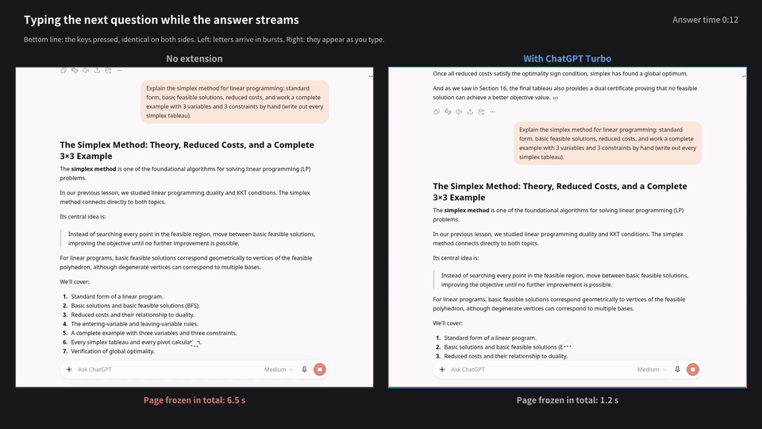
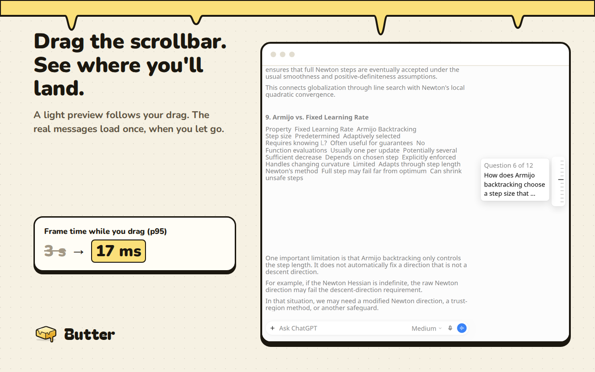
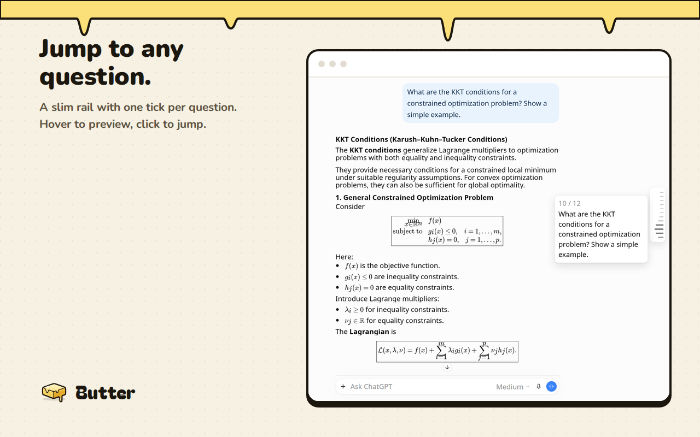
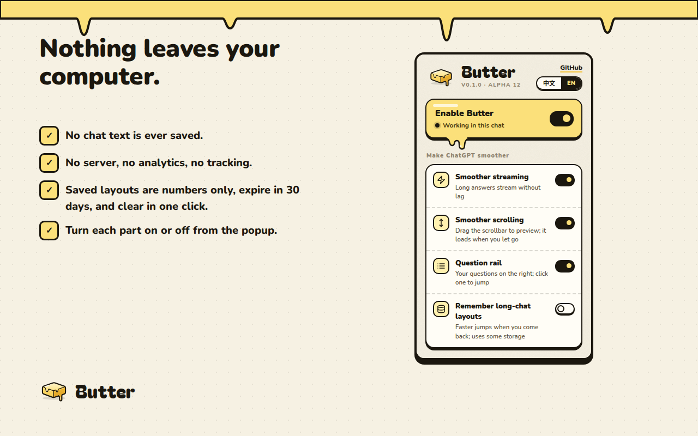

#  Butter for ChatGPT

English | [中文](README.zh-CN.md)

Long ChatGPT chats, smooth as butter.

## Install

**[Add to Chrome](https://chromewebstore.google.com/detail/butter-for-chatgpt/fedpfgnghhahjkkcdeepohabigdjfhif)** — install from the Chrome Web Store, then reload ChatGPT. Store updates go through Google's review, so the store can be a few days behind the latest [GitHub release](https://github.com/SimianW/butter/releases).

### Or install manually

1. Download the zip from [GitHub Releases](https://github.com/SimianW/butter/releases) and unzip it somewhere permanent.
2. Open `chrome://extensions` and turn on **Developer mode**.
3. Click **Load unpacked**, select the `butter` folder, then reload chatgpt.com.

Supports Chrome, Edge, Brave and Arc (Chromium 111+). Safari and Firefox are not supported.
[Install and settings →](docs/install.md)

Current version: **0.1.0-alpha.19** ([changelog](CHANGELOG.md)).

## Demo

Left: ChatGPT as is. Right: with Butter. Same chat, same answer, same input.
[Full video](docs/media/demo-en.mp4). This demo is from an earlier build; the measurements below are newer.

## The difference

Medians from 5–6 runs per arm in a long math chat on Linux Chromium without GPU acceleration:

| | ChatGPT as is | With Butter |
|---|---|---|
| Page frozen while an answer streams (total blocking) | 76.4 s | 11.5 s |
| Slowest 5% of frames while it streams (p95) | 317 ms | 50 ms |
| Dragging the scrollbar into unread history (p95 frame) | 3.0 s | 17 ms |
| New question visible after sending from far up | 13.1 s | 3.4 s |
| Wheel-scrolling the whole chat (p95 frame) | 2.6 s | 0.28 s |

The trade-off: after releasing a drag at an unread spot, real text took about 4.3 s to appear with Butter versus 0.2 s without it, where the drag itself stuttered for seconds.

These are lab results, not a promise for every computer. Drag figures use classic scrollbars; the builds use different release-readiness checks. “Frozen” sums blocking time, rather than one continuous freeze. Typing showed no meaningful improvement. Butter was measured at alpha.11; later builds change only the popup, locale metadata and toolbar icon.
[Full results, method and caveats →](docs/benchmarks.md)

## Features

### Smoother streaming

Butter reduces the work ChatGPT repeats as an answer arrives, so long answers stream with less page lag. It works out of the box, with no extra account.

### Drag the scrollbar to preview

Drag ChatGPT's scrollbar to skim a lightweight preview. Butter holds loading while you drag, then loads the destination when you let go. Seen answers use their measured layout; unread ones preview from the question's start.

### Question rail

A slim rail on the right has one tick per question. Hover to preview a question, click to jump, or use the keyboard.
[More about the rail →](docs/history-rail.md)

### Remember long-chat layouts

Optional, and Butter asks first. Saved layouts help when you return to a long chat: layout numbers and formatting with one-way hashes, never chat text. They expire after 30 days, take at most 50 MB, and can be cleared in the popup. Turning this off deletes saved layouts and stops saving new ones.

### The popup and its settings

Click Butter's toolbar icon to pause Butter, switch streaming, scrolling, the question rail or saved layouts on and off, clear saved layouts, or choose English or Chinese. Changes apply to open ChatGPT tabs immediately.

### Faster send from far up

Sending while reading earlier messages takes a shortcut toward the end, so ChatGPT can bring your new question into view sooner.

## Privacy

Butter runs only on chatgpt.com, makes no network requests of its own, and has no server, analytics, tracking or ads. The only chat text it saves is the first three lines of each bookmark you make, kept in your browser until you delete it. Settings stay in your browser; optional saved layouts contain only layout data and one-way hashes, expire after 30 days, and are capped at 50 MB. Butter never reads passwords, sign-in tokens or cookies.
[Full privacy policy →](PRIVACY.md)

## FAQ

**Does it send my data anywhere?** No. All processing and storage stay in your browser.

**What if ChatGPT changes?** Butter checks for the parts of ChatGPT's page it relies on and stops helping when they are missing. If an update still causes problems, pause Butter from the popup's main switch and [open an issue](https://github.com/SimianW/butter/issues).

**How do I turn parts off?** Open the popup from Butter's toolbar icon. Use the individual switches, or pause Butter with the main switch.

**Why does text take a few seconds to appear after I release a far scrollbar drag?** Butter holds ChatGPT's loading while you drag to keep the drag smooth. After release, ChatGPT renders the destination; typing can also wait for that work to finish. [Known trade-offs →](docs/how-it-works.md#known-trade-offs)

## More

- [Install and settings](docs/install.md)
- [How it works](docs/how-it-works.md): implementation and known trade-offs
- [Benchmarks](docs/benchmarks.md): full results and method
- [Development](docs/development.md): repo layout, tests and packaging
- [Privacy policy](PRIVACY.md): what Butter reads, stores and sends

MIT license.
