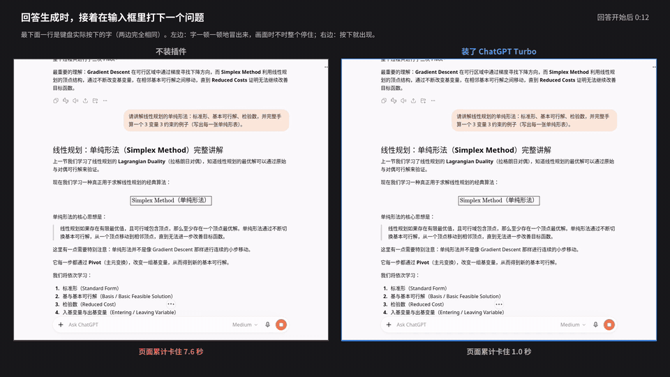
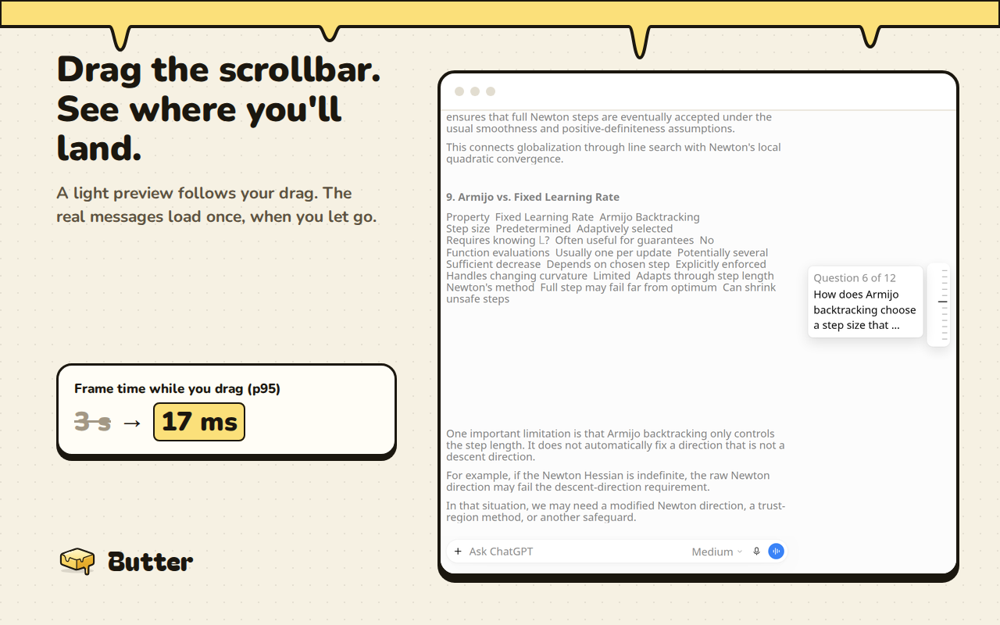
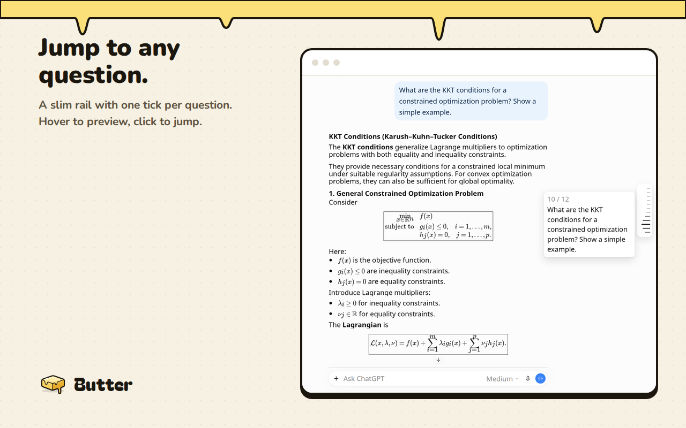
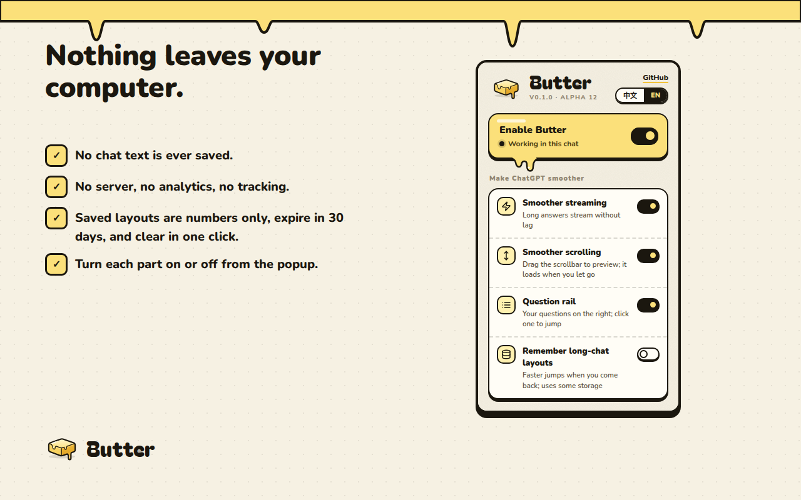

#  Butter for ChatGPT

[English](README.md) | 中文

让 ChatGPT 长对话丝滑如黄油。

## 安装

**[添加至 Chrome](https://chromewebstore.google.com/detail/butter-for-chatgpt/fedpfgnghhahjkkcdeepohabigdjfhif)** — 从 Chrome 应用商店安装，然后刷新 ChatGPT。商店更新要经过 Google 审核，可能比 [GitHub 最新版本](https://github.com/SimianW/butter/releases)晚几天。

### 或者手动安装

1. 从 [GitHub Releases](https://github.com/SimianW/butter/releases) 下载 zip，解压到一个不会删掉的位置。
2. 打开 `chrome://extensions`，开启 **开发者模式**。
3. 点击 **加载已解压的扩展程序**，选择 `butter` 文件夹，然后刷新 chatgpt.com。

支持 Chrome、Edge、Brave 和 Arc（Chromium 111 及以上），暂不支持 Safari 和 Firefox。
[安装与设置（英文）→](docs/install.md)

当前版本：**0.1.0-alpha.12**（[更新日志](CHANGELOG.md)）。

## 演示

左边：原版 ChatGPT。右边：装了 Butter。同一个对话、同一段回答、同样的操作。
[完整视频](docs/media/demo-zh.mp4)。演示录制于较早版本，下方的数据来自最新测试。

## 效果对比

在 Linux Chromium、无 GPU 加速的环境下，用一个很长的数学对话测试，每组运行 5–6 次，取中位数：

| | 原版 ChatGPT | 装了 Butter |
|---|---|---|
| 回答输出时页面卡住的总时长 | 76.4 秒 | 11.5 秒 |
| 回答输出时最慢的 5% 帧耗时（p95） | 317 毫秒 | 50 毫秒 |
| 拖动滚动条到未读历史（p95 帧耗时） | 3.0 秒 | 17 毫秒 |
| 从靠前位置发送后，新问题出现在视野内 | 13.1 秒 | 3.4 秒 |
| 用滚轮滚过整个对话（p95 帧耗时） | 2.6 秒 | 0.28 秒 |

取舍是：拖到未读位置并松手后，Butter 约需 4.3 秒才显示实际文字，原版约需 0.2 秒；不过原版在拖动过程中就会卡顿数秒。

这些是实验室数据，不保证每台电脑都有相同效果。拖动数据使用传统滚动条，各版本对松手后“可读”的判断方式不同。“卡住的总时长”是多次阻塞的总和，并非一次连续卡死。打字延迟没有明显改善。测试版本为 alpha.11；alpha.12 只改了弹窗和语言元数据。
[完整结果、测试方法与局限（英文）→](docs/benchmarks.md)

## 功能

### 回答输出更流畅

Butter 减少 ChatGPT 在输出回答时反复进行的工作，让长回答输出时页面更少卡顿。装上即用，无需额外账号。

### 拖动滚动条即可预览

拖动 ChatGPT 的滚动条，快速浏览轻量预览。Butter 在拖动时暂缓加载，松手后再加载目标位置。看过的回答按测量过的布局预览，未读内容则从问题开头预览。

### 问题导航条

右侧一条细细的导航条，每个问题对应一个刻度。悬停预览问题，点击跳转，也可以用键盘操作。
[导航条详情（英文）→](docs/history-rail.md)

### 记住长对话的布局

这是可选功能，Butter 会先征求同意。保存布局能帮助你下次打开长对话：只保存布局数值、格式信息和单向哈希，从不保存聊天文字。布局 30 天后过期，最多占用 50 MB，可在弹窗中清除。关闭此功能会删除已保存的布局，并停止保存新布局。

### 弹窗与设置

点击 Butter 的工具栏图标，即可暂停 Butter，分别开关回答输出优化、滚动优化、问题导航条和布局保存，清除已保存的布局，或切换中英文。设置会立即应用到已打开的 ChatGPT 标签页。

### 在靠前位置发送也更快

阅读较早的消息时发送新问题，Butter 会先向对话末尾跳近一些，让 ChatGPT 更快把新问题带到视野内。

## 隐私

Butter 只在 chatgpt.com 上运行，不自行发起网络请求，没有服务器、分析统计、追踪或广告，也从不保存聊天文字。设置保存在浏览器本地；可选的布局保存只包含布局数据和单向哈希，30 天后过期，最多 50 MB。Butter 从不读取密码、登录令牌或 Cookie。
[完整隐私政策 →](PRIVACY.zh-CN.md)

## 常见问题

**会把我的数据发送到别处吗？** 不会。所有处理和存储都在你的浏览器内完成。

**ChatGPT 改版了怎么办？** Butter 会检查它依赖的页面结构，找不到时就停止优化。如果更新后仍然出现问题，可以用弹窗里的总开关暂停 Butter，并[提交 issue](https://github.com/SimianW/butter/issues)。

**怎样关闭部分功能？** 点击工具栏里的 Butter 图标，在弹窗中分别关闭各项功能，或用总开关暂停 Butter。

**为什么拖动滚动条跳到远处，松手后要等几秒才出现文字？** 为了让拖动保持流畅，Butter 会在拖动时暂缓 ChatGPT 的加载。松手后，ChatGPT 才渲染目标内容；此时打字也可能要等这部分工作完成。[已知取舍（英文）→](docs/how-it-works.md#known-trade-offs)

## 更多

- [安装与设置](docs/install.md)（英文）
- [工作原理](docs/how-it-works.md)（英文）：实现方式与已知取舍
- [性能测试](docs/benchmarks.md)（英文）：完整结果与测试方法
- [开发](docs/development.md)（英文）：仓库结构、测试与打包
- [隐私政策](PRIVACY.zh-CN.md)：Butter 读取、存储和发送了什么

MIT 许可证。
