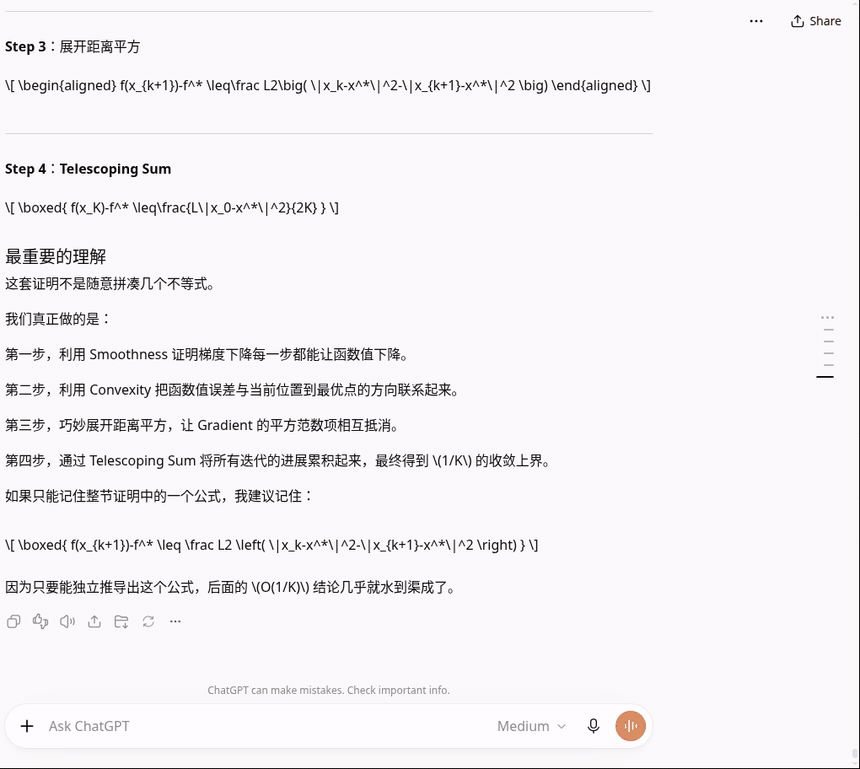

# Butter for ChatGPT

[English](README.md) | 中文

ChatGPT 网页版实在是太卡了…… 这是一个真正让它好用起来的插件。

左边：原版 ChatGPT。右边：装了 Butter。同一个对话、同一段回答、同样的操作。
[完整视频](docs/media/demo-zh.mp4)

## 效果对比

在一个很长的数学对话里，回答正在输出时：

| | 原版 ChatGPT | 装了 Butter |
|---|---|---|
| 页面卡住 | **75.6 秒** | **6.3 秒** |
| 滚动（p95 帧耗时） | 300 ms | 33 ms |
| 最慢的一次按键 | 3.5 秒 | 0.8 秒 |

装上即用。不用登录，插件自己不发任何请求。如果 ChatGPT 改了页面结构，插件可能会失效，但不会弄坏页面。[测试方法和完整报告 →](docs/REPORT.md)

## 在问题之间跳转

右侧一条细细的导航条，每个问题一个刻度。悬停预览，点击跳转。
[详细说明（英文）→](docs/history-rail.md)

## 安装

1. 从 [Releases](https://github.com/SimianW/butter/releases) 下载 zip，解压到一个不会删掉的位置。
2. 打开 `chrome://extensions`，打开右上角的 **开发者模式**。
3. 点 **加载已解压的扩展程序**，选 `butter` 文件夹，然后刷新 chatgpt.com。

支持 Chrome、Edge、Brave、Arc（Chromium 95 及以上）。[设置与更多细节（英文）→](docs/install.md)

当前版本：**0.1.0-alpha.10**（[更新日志](CHANGELOG.md)）。

## 本地存储与隐私

Butter 在扩展本地保存设置、布局数值和排版样式、消息与对话 ID 的哈希值，以及内容和布局摘要，
并按账号的 SHA-256 哈希值分区。不保存聊天文本、认证令牌或 Cookie；账号未知时不能访问持久化布局。
布局 30 天后过期，所有账号合计最多 50 MB。关闭 `butter.opts.layout` 会清除所有已保存布局，
并停止持久化读写。[清除方法（英文）→](docs/development.md#layout-storage-api)

## 更多

- [测试报告](docs/REPORT.md)：方法、全部结果、与其他插件的对比
- [工作原理](docs/how-it-works.md)（英文）：改了什么、隐私、已知取舍
- [开发](docs/development.md)（英文）：仓库结构、测试、打包
- [隐私政策](PRIVACY.md)（英文）：读取、存储和发送了什么

MIT 许可证。
