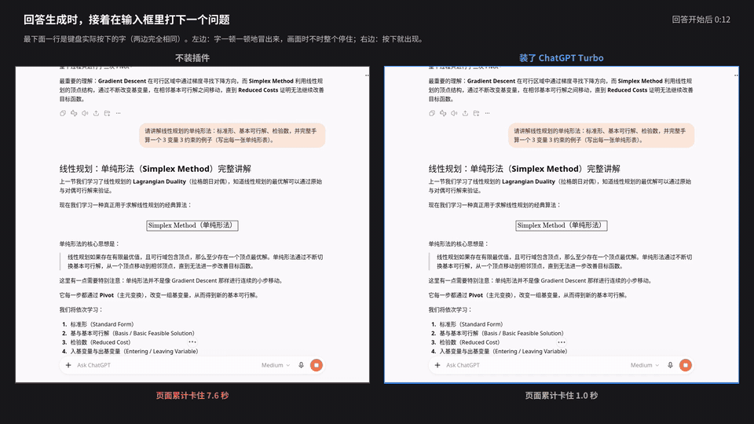
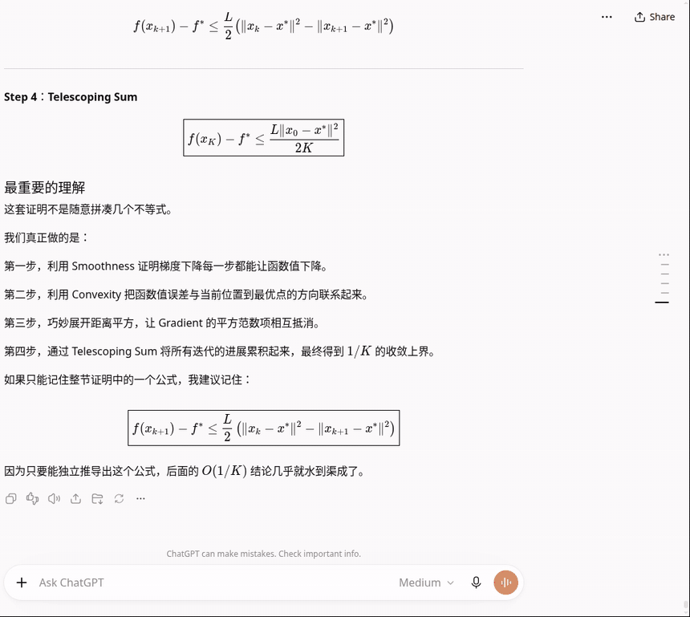

# ChatGPT Turbo 测试报告

2026-10-29 至 10-30。测的是 0.0.1-alpha 版（开发时的内部版本名是 v5，结果表里的 `turbo-v5`）。本文写清楚测了什么、怎么测的、每个数字从哪来。原始数据的汇总表在 [`results/`](../results)，测试脚本在 [`lab/`](../lab)。

## 结论

在一个 9 轮的数学长对话里（页面上约 9 万个 DOM 节点），让 ChatGPT 生成一段 122 秒的长回答，回答期间一边滚动一边打字：

| 指标 | ChatGPT 原样 | 装了 Turbo | 倍数 |
|---|---|---|---|
| 主线程被卡住的总时间 | 75.6 秒 | 6.3 秒 | 12× |
| 帧间隔 p95 | 300 ms | 33 ms | 9× |
| 帧率 | 15 fps | 52 fps | 3.5× |
| 最长一次卡死 | 2.1 秒 | 0.6 秒 | 3.5× |
| 最慢一次按键响应 | 3.5 秒 | 0.8 秒 | 4.5× |
| 按键响应 p95 | 277 ms | 182 ms | 1.5× |
| 滚动整段对话时最长的一帧（不在生成时） | 3.6 秒 | 0.7 秒 | 5× |
| 刷新页面时主线程卡住的时间 | 7.2 秒 | 3.7 秒 | 2× |

两种情况下最终渲染出的回答文本逐字节一致。

同样的测试下，Chrome 应用商店上约 4 万用户的同类扩展 Speed Booster Toolkit 默认设置卡住 121.5 秒，设成"只加载 1 条消息"也有 98.3 秒，都比不装还卡（见 [4.7](#47-和其他扩展对比)）。

0.0.2-alpha 加了右侧的历史记录条，在 ChatGPT 改版后的前端上重测，不会让页面变卡，见[第 7 节](#7-002-alpha历史记录条)。

**这些数字是在一台没有 GPU 的 Linux 机器上测的。** 在 Windows 和 Mac 上绝对值会小很多，倍数应该接近，但还没在这两个平台上实测，见[在 Windows 和 Mac 上](#在-windows-和-mac-上)。

## 演示视频



完整视频（75 秒，带中文说明）：[media/demo-zh.mp4](media/demo-zh.mp4)。英文版：[media/demo-en.mp4](media/demo-en.mp4)。

视频怎么录的（`lab/harness/demo.mjs`、`lab/make-demo.py`）：

- 在同一个 9 轮数学长对话里，再问一次第 9 轮的问题。两边播放的是同一段录好的真实 ChatGPT 回答（方法同 [3.2](#32-回放基准labharnessbenchmjs所有优化效果都用这个测)），所以内容和出字速度完全一样。
- 两边各录一次屏幕：先不装插件，再装 ChatGPT Turbo。回答期间按固定时间表操作：第 14 秒开始打下一个问题，第 38 秒往上翻看再翻回来，第 78 秒继续打字，第 96 秒再翻看一次。按键和滚轮按时间表直接发出，不等页面响应，所以页面卡住时，字和滚动会像真人操作一样延后出现。
- 画面只截了对话这一栏，不含地址栏和侧边栏。剪辑时把两段录像按"按下回车"的时刻对齐并排，截取 5 个片段。
- 画面下方的"页面累计卡住"来自页面自己记录的 Long Animation Frames；红色"页面卡住"标记表示正在经历一次 300ms 以上的长帧。

这次录制的数字（原始数据在 [`results/demo/`](../results/demo)）：

| | 不装插件 | 装了 ChatGPT Turbo |
|---|---|---|
| 页面累计卡住（中文版） | 75.1 秒 | 6.5 秒 |
| 最长一次卡住（中文版） | 2.6 秒 | 0.6 秒 |
| 页面累计卡住（英文版） | 75.8 秒 | 8.0 秒 |
| 最长一次卡住（英文版） | 3.2 秒 | 0.7 秒 |
| 打字时最慢的一个字（英文版） | 1.6 秒 | 0.2 秒 |

英文版用的是另一个全英文的 9 轮数学对话（同样的题目，英文提问），在 Test 项目里真实对话生成，数据在 [`results/live-baseline.csv`](../results/live-baseline.csv) 的 `baseline-en-2026-10-30` 行。

## 1. 目标

写一个 Chrome 扩展，用在很长、公式很多的 ChatGPT 对话里。

做到的效果：装上扩展后，回答生成期间主线程被卡住的时间从 76 秒变成 7 秒，滚动保持在每秒 50 帧以上，打字最慢的一次从 3.5 秒变成 0.8 秒，回答内容和不装时完全一致。

## 2. 测试环境

| 项目 | 配置 |
|---|---|
| 机器 | Intel i5-10400（6 核 12 线程），16 GB 内存，**没有 GPU** |
| 系统 | Ubuntu，Linux 7.0 |
| 浏览器 | Chromium 156.0.8078.47（snap 版，沙箱开启），独立的测试 profile，在里面登录了 ChatGPT |
| 显示 | Xvfb 虚拟显示器 1600×1000，通过 noVNC 远程查看 |
| 控制 | Playwright 1.64 通过 CDP（`127.0.0.1:9222`）连接这个浏览器 |
| ChatGPT | 2026-10-29/30 的线上版本；测试期间前端发布过两次新版本，每次换版后都重测了基线 |

搭建脚本是 [`lab/lab`](../lab/lab)，说明见 [`lab/README.md`](../lab/README.md)。

## 3. 测试方法

### 3.1 真实对话基线（`lab/harness/baseline.mjs`）

在 ChatGPT 的 "Test" 项目里新开一个对话，用 [`prompts-baseline.mjs`](../lab/harness/prompts-baseline.mjs) 里的数学题（线性代数、凸优化、拉格朗日对偶等推导题）一轮一轮真实发送。每轮从按下回车到回答结束都在测：

- **帧间隔**：页面里跑一个 `requestAnimationFrame` 循环，记录相邻两帧的间隔。帧率 = 帧数 / 时长；p95 是第 95 百分位；jank% = 超过 50ms 的帧所占比例。
- **主线程被卡住的总时间**：[Long Animation Frames API](https://developer.chrome.com/docs/web-platform/long-animation-frames) 报告的所有长帧的 `blockingDuration` 之和，也就是"这段时间里浏览器有多少秒没法及时响应你"。
- **最长卡死**：最长的一个 long animation frame 的时长。
- **按键响应**：`keydown` 事件到下一帧画完之后的时间。
- **样式重算、布局、脚本时间**：CDP `Performance.getMetrics` 前后差值。
- DOM 节点数、KaTeX 公式数、JS 堆大小；第 5 轮和第 8 轮之后还测一次刷新页面。

用户在第 8 轮时要求停下（页面肉眼已经很卡），第 6 轮因为超时没有记录完整，所以有 7 轮的数据。

### 3.2 回放基准（`lab/harness/bench.mjs`），所有优化效果都用这个测

真实对话每次回答都不一样，而且会消耗额度，没法做严格对比。所以：

1. **录制**（`record.mjs`）：在测试对话里真实发送第 9 轮问题，把 `POST /backend-api/f/conversation` 返回的 SSE 流连同每个数据块的到达时间录下来。共 189 个数据块，回答约 2.1 万字、420 个公式。
2. **回放**：每次测试时，在页面里替换 `window.fetch`。页面发出 `POST /backend-api/f/conversation` 时，不发给 OpenAI，而是把录好的 SSE 流按原来的时间间隔吐给页面（超过 1.5 秒的"思考"停顿压到 1.5 秒，总长 122 秒），消息 ID 换成新的随机 UUID。ChatGPT 的前端代码完全照常运行：解析流、平滑器、React 渲染、KaTeX。我用 `convcheck.mjs` 查过服务器端的对话，回放的消息一条也没有到达服务器。
3. **每个配置都重启浏览器**，用 `--load-extension` 只加载要测的扩展，打开同一个 9 轮对话，滚到底，等 8 秒稳定后发送。
4. **回答期间模拟使用**：每 1.5 秒滚轮滚 3 下（每下 250px，上下交替）；在 1/3 和 2/3 处各点一次输入框，以 120ms 间隔打 10 个字母再删掉。
5. **测量**：指标和 3.1 一样，另外把每个长帧拆成三部分：
   - 渲染阶段的样式和布局（`styleAndLayoutStart` 到帧结束）；
   - 被脚本强制触发的样式和布局（每段脚本的 `forcedStyleAndLayoutDuration`），并按脚本来源归类；
   - 纯脚本时间。
6. **正确性**：回答结束后，取最后一个回答的 `textContent` 算 SHA-256。所有配置都必须得到同一个值 `043dc8afaf8d…`。

原样 ChatGPT 在不同时间、两个前端版本上一共测了 11 次，卡住时间在 73.3–78.8 秒之间，所以单次测量的噪声约 ±2 秒。

### 3.3 不在生成时的场景（`lab/harness/scenarios.mjs`）

- **刷新**：从导航开始，到最后一个回答的公式都显示出来、主线程安静为止。
- **滚动整段对话**：用滚轮从底部滚到顶部再滚回来，记录帧率、最长一帧、卡住时间。
- **空闲打字**：没有回答在生成时，在输入框里打字。

### 3.4 正确性和显示检查（`lab/harness/qa.mjs`）

- 最后一个回答里每个标题滚到顶部时截图，和原样逐像素比较；
- 宽表格和可视化块的宽度；
- 浏览器自带查找（`window.find`）能否找到回答开头的文字；
- 全选最后一个回答，复制出的文字长度是否覆盖 DOM 文本；
- **滚动跳动**：刷新后从底部往上滚 40 步，每步检查视口中心的元素是否正好移动了滚轮的距离。占位高度被替换成真实高度时，内容会"跳"，这里能量出来。

### 3.5 Trace 诊断（`bench.mjs` 的 `TRACE=` 选项 + `analyze-trace.py`）

在回答进行到 45 秒时录 12 秒的 Chrome trace，打开 `invalidationTracking`、`SelectorStats`（`disabled-by-default-blink.debug`）和调用栈，统计主线程时间按类别、强制布局的调用栈、最耗时的 JS 函数。

### 3.6 单元测试

`node test/raf.test.mjs`：用假时钟检查节流包装器（取消、重入、和其他 rAF 用户共存、配置非法值）。

## 4. 结果

### 4.1 真实对话：越往后越卡（[`results/live-baseline.csv`](../results/live-baseline.csv)）

| 轮次 | DOM 节点 | 帧率 | 帧间隔 p95 | 卡住时间 | 最长卡死 | 最慢按键 | 样式重算 |
|---|---|---|---|---|---|---|---|
| 1 | 2.1 万 | 48 | 33 ms | 8.2 秒 | 0.8 秒 | 0.4 秒 | 32 秒 |
| 2 | 4.6 万 | 24 | 167 ms | 41.9 秒 | 1.0 秒 | 0.9 秒 | 62 秒 |
| 3 | 6.7 万 | 20 | 217 ms | 35.2 秒 | 1.2 秒 | 1.4 秒 | 42 秒 |
| 4 | 8.8 万 | 29 | 233 ms | 43.7 秒 | 1.4 秒 | 1.7 秒 | 49 秒 |
| 5 | 11.3 万 | 9 | 450 ms | 75.4 秒 | 1.7 秒 | 2.1 秒 | 71 秒 |
| 7 | 8.0 万 | 37 | 33 ms | 33.5 秒 | 2.4 秒 | 0.6 秒 | 38 秒 |
| 8 | 9.9 万 | 16 | 367 ms | 71.2 秒 | 2.9 秒 | 3.3 秒 | 73 秒 |

（第 7 轮节点数下降，是因为 ChatGPT 自己的虚拟化器卸载了最早的回合。）

一轮数学回答约 2 万个节点，九成以上是 KaTeX 公式的 span。主线程时间里，**样式重算占绝大部分**，脚本和布局都不多。

### 4.2 根因

Trace 和 LoAF 归因得到三个原因：

1. **流式平滑器每帧发布一次。** 服务器每秒只推 1–2 个数据块，但 ChatGPT 的平滑器把文字拆碎，每个动画帧（60 次/秒）调用一次 `publish()`，每次都让 React 重新渲染整段回答。
2. **整个对话被包在一个 CSS 尺寸容器里。** 对话的内层包装 `div.[container-type:inline-size].min-h-full`（`container-name: thread-content`）下面挂着约 9 万个节点。每次更新后只要有代码读几何信息，就会触发一次整页布局。Chrome 对尺寸容器的处理方式是在布局过程中重算容器内的样式，所以 CDP 把这部分时间几乎都记成了"样式重算"。
3. **ChatGPT 自己的代码在强制同步布局。** 回合虚拟化器的 ResizeObserver、贴底滚动和一个可见性/延迟遥测采样器，每次更新都会读取几何信息。原样时，强制布局总共 29.8 秒。

**选择器匹配不是瓶颈**：SelectorStats 显示 12 秒 trace 里所有选择器匹配加起来约 1 秒，所以"CSS 选择器写得太复杂"不是原因。

**现有扩展针对的问题不对。** 它们隐藏、删掉或少加载旧消息，但 ChatGPT 已经会自己卸载旧回合，真正重的是正在生成的那一轮，以及每次更新都要重算整个容器。

### 4.3 每项改动的贡献（消融，[`results/bench.csv`](../results/bench.csv)）

每个变体都是一个单独的扩展目录，在 [`lab/variants/`](../lab/variants)：

| 变体 | 内容 | 卡住时间（秒） | 帧间隔 p95 | 最慢按键 |
|---|---|---|---|---|
| 原样 | — | 75.6（11 次 73.3–78.8） | 300 ms | 3.5 秒 |
| `smooth-only` | 只节流平滑器 | 72.4 | 283 ms | 2.5 秒 |
| `cv` | 只做回合级 `content-visibility` | 57.1（58.0 / 56.1） | 183 ms | 1.8 秒 |
| `nocq` | 只去掉尺寸容器 | 31.6（32.4 / 30.8） | 117 ms | 1.9–3.1 秒 |
| `cv-nocq` | 去掉容器 + 回合级跳过 | 16.8（17.2 / 16.5） | 67 ms | 1.5 秒 |
| `turbo-60` / `120` / `250` / `400` | 再加节流，间隔分别为 60/120/250/400ms | 16.2 / 13.2 / 8.5–11.6 / 8.1–9.5 | 67 / 50 / 33 / 17 ms | ~1.5 秒 |
| `turbo-250-blocks` | 再加回答内段落级跳过，**不加门控** | 2.2 | 17–33 ms | 0.4 秒 |
| `safe-nocq-outer` | 只去掉外层 app 容器 | 18.3 | 67 ms | 1.0 秒 |
| `safe-nocq-inner` | 只去掉内层对话容器 | 7.3 | 33 ms | 0.8 秒 |
| **最终版 v5（0.0.1-alpha）** | 门控后的回合级和段落级跳过 + 内层容器 + 250ms 节流 | **6.3（6.4 / 6.2）** | **33 ms** | **0.7–0.8 秒** |

累积起来看：

```
原样                         75.6 s
① 去掉对话的尺寸容器          31.6 s   (−44.0)
② + 屏幕外回合跳过渲染        16.8 s   (−14.8)
③ + 平滑器节流 250ms           9.5 s   (−7.3，两次 10.6 / 8.5 的均值)
④ + 回答内段落跳过渲染         2.2 s   (−7.3)   ← 激进版，有显示问题，不采用
最终版（加门控、保留外层容器） 6.3 s
```

几点观察：

- **只节流平滑器几乎没有用**（72.4 秒）。页面本身太卡时，帧率早就被压得很低，一帧本来就要几百毫秒，节流掉的发布不多。只有当每次更新变便宜以后，节流才有明显效果，所以这几项改动是相互配合的。
- **节流间隔**：250ms 和 400ms 差不多，60ms 明显差。选 250ms，因为文字每秒更新 4 次看起来仍然是流式的。
- **两层容器里只有内层是问题。** 外层 `app-shell-main-content` 容器负责侧边面板布局，去掉它没有收益，所以保留。

LoAF 时间拆分（秒）：

| 配置 | 渲染阶段样式+布局 | 脚本强制的样式+布局 | 纯脚本 |
|---|---|---|---|
| 原样 | 74.0 | 29.8 | 6.5 |
| ①+② | 33.5 | 3.3 | 9.7 |
| ①+②+③ | 15.4 | 3.5 | 1.7 |
| 最终版 | 15.2 | 1.7 | 1.8 |

### 4.4 为什么不用更快的激进版

激进版（`turbo-250-blocks`）卡住时间只有 2.2 秒，但 QA 发现两个问题（[`results/qa.csv`](../results/qa.csv)）：

- **刷新后往上滚会跳**：40 步里有 31 步跳动超过 20px，最大 282px。原因是从没渲染过的块只能用 120px 的占位高度，滚到它时才换成真实高度。
- **宽表格变宽**：最宽的块从 963px 变成 1144px（激进版连外层容器也去掉了）。

最终版的做法：先给块设 `contain-intrinsic-size: auto`，让浏览器在它正常渲染时记住真实高度，渲染完后再打 `data-turbo-seen` 标记，打了标记的块才允许跳过渲染。这样跳过的块用的是记住的真实高度，滚动不再跳（40 步里最大 1px）。正在生成的那一轮例外：它的块出现时就在屏幕上，可以直接跳过。中间试过的版本：

| 版本 | 做法 | 卡住时间 | 最大跳动 |
|---|---|---|---|
| v2 | 只做段落级，标记后才跳过 | 10.9–11.4 秒 | 4 px |
| v3 | 按整个回答打标记 | 3.8–4.9 秒 | 191 px（回答重新挂载时段落是逐步插入的，后插入的段落没渲染过就被跳过了） |
| v4 | 按段落打标记，每秒批量提交一次 | 8.7–9.1 秒 | 1 px |
| v4 每 5 秒提交 | 同上 | 14.5 秒（更慢：没标记的段落都在渲染） | — |
| **v5** | v4 + 正在生成的那一轮直接跳过 | **6.2–6.4 秒** | **1 px** |

### 4.5 不在生成时的场景（[`results/scenarios.csv`](../results/scenarios.csv)，各 2 次）

| 场景 | 原样 | 最终版 |
|---|---|---|
| 刷新：主线程卡住 | 7.2 秒 | 3.0–4.4 秒 |
| 刷新：最长一帧 | 2.7–3.0 秒 | 0.9–1.4 秒 |
| 滚动整段对话：最长一帧 | 2.6–4.6 秒 | 0.7 秒 |
| 滚动整段对话：卡住时间 | 7.1 秒 | 2.4–2.9 秒 |
| 滚动整段对话：帧间隔 p95 | 33 ms | 17 ms |
| 空闲打字：按键 p95 | 31 ms | 23 ms |
| 空闲打字：最慢按键 | 276–282 ms | 256–257 ms |

没有回答在生成时，打字本来就不卡，扩展也没有让它变慢。

### 4.6 正确性检查

| 检查 | 原样 | 最终版 |
|---|---|---|
| 回答文本 SHA-256 | `043dc8afaf8d` | `043dc8afaf8d`（一致） |
| 浏览器查找 | 能找到 | 能找到 |
| 全选复制的字符数 | 22,586 | 22,586 |
| 刷新后往上滚的跳动 | 0 次，最大 0 px | 0 次，最大 1 px |
| 最宽的块 | 963 px | 973 px（+10 px，见风险 1） |
| 截图比较 | — | 除侧边栏外只有 1px 的偏移 |

### 4.7 和其他扩展对比

所有扩展都用同一个回放基准测（[`results/bench.csv`](../results/bench.csv) 里 `oss-*` 和 `cmp-*` 开头的行）。

#### Speed Booster Toolkit for ChatGPT 4.6.1

Chrome 应用商店上约 4 万用户、评分 4.5，闭源（All Rights Reserved）。从 Chrome 应用商店下载 CRX 后解包加载，只在本地测试，没有放进本仓库。

**它的"提速"做法**：读源码后发现，提速功能只有一项，就是改写 ChatGPT 加载对话的请求 `GET /backend-api/conversations/<id>?num_turns=N`，把 `N` 换成设置里的"消息数"（默认 10，可设 1–100），让页面初始只加载最近几条。它不碰流式渲染、平滑器和 CSS。其余功能是提示词导航、全对话搜索、书签、文件夹和导出。这些功能各自在 `document` 上挂一个 `subtree` 级别的 MutationObserver，再加防抖的 `setTimeout` 去扫描页面。

**测试注意事项**：
- Speed Booster 每次浏览器重启都会把设置恢复成默认值。第一轮"只加载 1 条"的测试因此实际跑的是默认设置。我通过检查请求里的 `num_turns` 和页面上的回合数发现了这一点。那两组数据重新标为 `cmp-sb-default` / `cmp-sb-default-turbo`；之后改成重启后再写设置、不再重启，重测了"只加载 1 条"（`run-sb2.sh`）。
- 它首次打开对话时会弹出一个全屏欢迎框，挡住了输入框，导致有一组测试失败。之后的测试会先关掉欢迎框。
- 测试期间 ChatGPT 前端又发布了一次新版本，所以原样和 Turbo 在新版本上也各重测了两次。下表的原样和 Turbo 是新旧两个版本共 4 次测试的平均值，两个版本之间的差异在噪声范围内。

**回答生成期间**（同一个回放，每个配置 2–4 次）：

| 配置 | 开始前页面上的回合 / 节点 | 卡住时间 | 帧间隔 p95 | 帧率 | 最长卡死 | 最慢按键 |
|---|---|---|---|---|---|---|
| ChatGPT 原样 | 5 / 10.4 万 | 76.4 秒（73.3–78.8） | 300 ms | 15 | 2.2 秒 | 3.3 秒 |
| Speed Booster 默认（10 条） | 5 / 10.4 万 | **121.5 秒**（120.5–123.3） | 1358 ms | 5 | 9.3 秒 | 9.4 秒 |
| Speed Booster 只加载 1 条 | 1 / 2.8 万 | **98.3 秒**（97.6–99.1） | 600 ms | 12 | 3.5 秒 | 4.5 秒 |
| **ChatGPT Turbo** | 5 / 10.4 万 | **6.7 秒**（6.2–7.1） | 33 ms | 52 | 0.6 秒 | 0.7 秒 |
| Speed Booster 默认 + Turbo | 5 / 10.4 万 | 65.7 秒 | 233 ms | 22 | 1.0 秒 | 1.0 秒 |
| Speed Booster 1 条 + Turbo | 1 / 2.8 万 | 31.2 秒 | 100 ms | 40 | 0.8 秒 | 0.6 秒 |

**不在生成时**（各 2 次）：

| 场景 | 原样 | Speed Booster 默认 | Speed Booster 1 条 | Turbo |
|---|---|---|---|---|
| 刷新：主线程卡住 | 7.3–8.3 秒 | 7.1–7.5 秒 | **3.1–3.7 秒** | 4.5–4.6 秒 |
| 刷新：最长一帧 | 2.8–3.2 秒 | 2.7 秒 | **0.8–0.9 秒** | 1.5 秒 |
| 滚动整段对话：最长一帧 | 2.5–2.6 秒 | 1.6–2.5 秒 | 1.5–1.7 秒（只有 1 轮可滚） | **0.7–0.75 秒** |
| 空闲打字：最慢按键 | 0.28 秒 | **2.0–4.6 秒** | 0.9–2.1 秒 | 0.17–0.26 秒 |

**结论**：
- **回答生成期间，Speed Booster 让页面更卡。** 默认设置下卡住时间是原样的 1.6 倍；即使只加载 1 条、页面节点少了 3/4，也还是比原样多 29%。LoAF 归因显示，多出来的主要是匿名 `setTimeout` 回调强制触发的样式和布局：原样约 4 秒，默认设置下约 18 秒。这和它的书签、导航、搜索模块在每批 DOM 变化后用 `setTimeout` 防抖扫描页面相吻合。不过回调的来源在 LoAF 里是匿名的，这一点是推断。
- **少加载旧消息对刷新有用。** "只加载 1 条"时，打开对话最快：卡住 3.4 秒，最长一帧 0.8 秒，比 Turbo 还好。但代价是看不到之前的对话，要点"加载更多"才能看。
- **它不解决正在生成的那一轮。** 只加载 1 条时，渲染阶段的样式和布局仍然是 79 秒，和原样的 75 秒差不多。正如 4.2 说的，重的是正在生成的那一轮和尺寸容器，而不是旧消息。
- **和 Turbo 一起装会抵消 Turbo 的大部分效果**（6.7 秒变成 31–66 秒）。不建议同时启用。
- 它空闲时也让打字变慢：最慢按键从 0.28 秒变成 2–4.6 秒。

开源扩展（调研见 [`docs/oss-survey.md`](oss-survey.md)）：

| 扩展 | 做法 | 卡住时间 | 结果 |
|---|---|---|---|
| LightSession Pro | 在 fetch 层裁掉旧消息 | 75.3 秒 | 没效果：ChatGPT 本来就只挂载最近几轮 |
| In-Memory Conversation Trimmer | 同上 | 76.0 秒 | 没效果 |
| CJ-tpub Long Chat Optimizer | 把旧消息折叠/隐藏 | 105.1 秒 | **更卡**，出现过一次 27 秒的卡死 |
| GPT Delagger | 隐藏旧消息 + 观察器 | 106.7 秒 | **更卡**，帧间隔 p95 2 秒 |

另外几个（Lag Fixer 旧版、Lazy Chat++、Thread Optimizer）用的选择器在当前 ChatGPT 上已经匹配不到任何元素，等于没装，所以没有测。

## 5. 风险

完整的风险审查在 [`notes/review.md`](../notes/review.md)。概括：

**扩展不自己发网络请求，不改消息，不存数据，不碰账号。**（0.0.2-alpha 的历史记录条会读取 ChatGPT 自己下载的对话数据来列出问题，见[第 7 节](#7-002-alpha历史记录条)。0.0.2-alpha.3 起，ChatGPT 加载更早消息的请求从每次 10 轮改为每次 2 轮，以缩短打字被卡住的时间；`config.js` 里的 `olderPageTurns` 设为 0 即恢复原样。） 最坏的情况是显示上的小问题，或者 ChatGPT 改版后扩展悄悄失效。关掉扩展、刷新页面就完全恢复原样。

1. **宽内容尺寸变化**：宽表格和可视化块原来用 `cqi` 按对话栏宽度计算，现在按外层容器计算。在 1600px 宽的窗口下宽了 10px；代码面板的 `max-height: 56.25cqw` 也会跟着变。
2. **裁切**：`content-visibility` 自带 paint containment。如果回答里有直接画到段落外面、而不是用 portal 的弹层，可能会被裁掉。宽块已经排除了，但没有逐个检查所有组件。
3. **跳转到旧消息或改变窗口宽度后**，被跳过的块用的是之前记住的高度，第一次跳转时位置可能会差一点。
4. **KaTeX 自动编号**：每个块是独立的样式作用域，不带星号的 `equation` 环境编号可能会在每个块里从头开始。ChatGPT 很少用到这种写法。
5. **文字以 250ms 为一步出现**，而不是每帧一点。把 `config.js` 里的 `smoothMs` 设成 0 就关掉节流。
6. **依赖 ChatGPT 当前的 DOM**：`data-turn-key`、`data-markdown-text-style`、`data-talvt-turn-state`、一个 Tailwind 类名，以及平滑器回调的源码形状。改版后最可能的结果是扩展不再起作用，而不是页面坏掉：平滑器用精确正则匹配，匹配不上就原样放行。

**没测过的部分**：Canvas、语音模式、图片生成、Deep Research、代码解释器输出、窄窗口和手机布局、chat.openai.com 旧域名（扩展只匹配 chatgpt.com）。

## 在 Windows 和 Mac 上

上面所有数字都来自 Linux + 没有 GPU 的 Chromium。对 Windows 和 Mac 的预期：

- **扩展本身跨平台。** 它只用了标准的 CSS（`content-visibility`、`contain-intrinsic-size: auto`、`container-type`，Chrome 95 以后都支持）和 `requestAnimationFrame`，没有任何平台相关的代码。Edge、Brave、Arc 等 Chromium 浏览器也一样。Safari 和 Firefox 不能用。
- **省下的主要是 CPU 时间。** 样式重算和布局都在主线程上，跟有没有 GPU 关系不大。GPU 影响的是光栅化和合成，这部分本来就不是瓶颈。Mac 的 M 系列芯片单核比 i5-10400 快不少，原样的卡顿会轻一些，加速比应该接近，但需要实测。
- **还没在 Windows 和 Mac 上实测过。** 可以用 [`lab/measure-console.js`](../lab/measure-console.js) 在自己的电脑上测：粘到 DevTools 控制台，问一个长问题，回答结束后运行 `turboMeasure.stop()`。扩展开、关各测一次，对比"main thread blocked"。

## 6. 复现

1. Linux 上按 [`lab/README.md`](../lab/README.md) 搭好虚拟显示器和浏览器，在测试 profile 里登录 ChatGPT。（Windows/Mac 可以用任何带 `--remote-debugging-port=9222` 启动的 Chrome，但 `EXT=` 自动加载扩展只在 lab 脚本里实现了。）
2. `cd lab/harness && npm install`
3. 准备一个长对话，录一段回答：`node record.mjs <chat-url> t09 "<问题>" recordings/t09.json`
4. 跑基准：`CHAT=<chat-url> EXT=<扩展目录，逗号分隔，空字符串表示原样> node bench.mjs <名字> 2`
5. 其他：`scenarios.mjs`、`qa.mjs` 用法相同；`run-matrix.sh` 批量跑。
6. `python3 lab/summarize.py` 把原始结果汇总成 `results/*.csv`。

原始结果（截图、trace、每次运行的 JSON）里有账号界面和对话 ID，没有放进仓库。录制的回答同理。

## 7. 0.0.2-alpha：历史记录条



在对话右侧加了一列横线，每条对应你问过的一个问题，深色加长的那条是当前正在看的问题。录屏：[media/rail.mp4](media/rail.mp4)。

- **悬停**：光标附近的横线像波浪一样变长变亮，左边弹出卡片，显示完整的提问；在横线之间移动时卡片跟着滑动。
- **点击**：滚到那个问题，并给提问气泡短暂加一圈高亮。即使那一段已经被 ChatGPT 从页面上卸载，也能跳过去。
- **顶部三个点**：表示更早的问题 ChatGPT 还没加载。点一下滚到顶部，ChatGPT 加载下一批，记录条随之变长。
- **键盘**：Tab 进入记录条，↑/↓ 选择，回车跳转。
- 界面语言跟随浏览器语言（中文或英文），颜色跟随 ChatGPT 的浅色和深色主题。

### 7.1 实现

测试期间 ChatGPT 前端改版：长对话改成分页加载（先加载最新的约 10 轮消息，往上滚到顶才加载更早的），页面上同时只保留约 5 轮对话，其余轮次卸载，用占位高度撑住滚动条。所以只看页面 DOM 拿不到完整的问题列表。

- **问题列表**：`turbo-nav-main.js` 在页面里包一层 `fetch`，ChatGPT 自己请求 `conversations/<id>`（最新一页）和 `conversations/<id>/messages?before=…`（更早的一页）时，读一份响应的副本，取出用户提问发给记录条。用户发新问题时从请求体里取出这条问题。扩展本身不发任何请求。
- **跳转到已卸载的轮次**：每轮对话挂载时记下它在滚动区里的位置。点击时，如果目标不在页面上，就先滚到它记录的位置（没记录过的按前后已知轮次插值），等 ChatGPT 把它挂载出来，再精确对齐。
- **跳转的动画**：1.5 屏以内的目标直接用浏览器原生的平滑滚动过去。更远的目标，渲染它要花 ChatGPT 1 秒以上，这期间页面画不出新帧；刚打开对话时还要等 ChatGPT 加载公式模块；如果目标是已加载的最早一个问题，到顶部还会触发加载更早的消息，又要 2.7 秒（不装扩展时 4.9 秒）。如果真的一路滚过去，中间每一轮都要现场渲染，会更卡。所以远距离跳转做成一段连续的"快速滚动"：
  1. **出发**：内容朝目标方向真实地滚一小段，同时渐隐，浅灰色的"文字行"占位层淡入，并以每秒 2.5 屏的速度流动；
  2. **途中**：占位层持续流动，后台直接跳到目标，等 ChatGPT 挂载、排版、渲染完公式，并确认目标位置连续 8 帧不再变化；
  3. **到达**：内容停在离目标还差 0.4 屏的地方，淡入，同时平滑滚到问题上停下。
  
  这几段动画只用了 `opacity`、浏览器原生平滑滚动和占位层上的 `transform`，都由合成线程执行，ChatGPT 再忙也不会停顿。实测在主线程被占住 0.6 秒的情况下，原生平滑滚动照样走完。中间试过两种做法都放弃了：一是让整块内容淡出、等待、再淡入（用户只看到屏幕变暗、干等）；二是用 `transform` 移动整块对话内容，这会让 Chrome 重绘整块内容，自己造成 0.1–1 秒的卡顿。
- **ChatGPT 保留的隐藏副本**：ChatGPT 会把本标签页里打开过的对话以隐藏副本（`display: none`）保留下来，每个副本有自己的滚动区。切回这样的对话时不会重新挂载任何轮次。记录条用 ResizeObserver 监视所有见过的滚动区，始终跟随当前可见的那个。
- **不影响性能**：记录条放在 shadow root 里，悬停动画只改 `transform` 和 `opacity`，不会触发 ChatGPT 页面的样式重算。指针位置对应哪条横线用记录条自己的几何参数算，不读布局。当前问题用 IntersectionObserver 判断，不监听滚动事件。只有点击跳转时才读一次布局。

### 7.2 测试

| 测试 | 方法 | 结果 |
|---|---|---|
| 性能 | `bench.mjs`，同一段回放回答，在改版后的 ChatGPT 上原样 / 0.0.1-alpha / 0.0.2-alpha 各 2 次 | 主线程卡住 66.3–66.8 / 3.6–3.8 / 3.6–3.9 秒，回答文本三者一致（`043dc8afaf8d`）。记录条没有可测出的开销 |
| 跳转 | `nav-jumps.mjs`：依次点 5 条横线，包括已卸载的轮次 | 5 次都停在距滚动区顶部 64px 处（误差 0），用时 0.9–1.5 秒，主要是 ChatGPT 渲染目标轮次（每轮约 2 万节点）的时间 |
| 刚打开对话就跳转 | `nav-video.mjs`：记录条出现后 1.5 秒或 6 秒点击，录屏逐帧看 | 最初的版本：内容可见时出现 0.9–1.0 秒的卡帧，画面先跳一下、停住，再跳到终点。现在：从点击到停下，录屏里每一帧画面都在动，没有停顿，到达时公式已渲染好。用时：加载 6 秒后点已卸载的问题约 2.1 秒；加载 1.5 秒后点约 3.6 秒（多出的时间在等 ChatGPT 加载公式模块）；加载 1.5 秒后点已加载的最早一个问题约 6.3 秒（ChatGPT 同时在初始化、加载公式模块和加载更早的消息） |
| 切换对话 | `nav-switch.mjs`：从侧边栏在 4 个对话之间来回切换（包括切回之前打开过的），每次检查记录条 | 修复前：切回打开过的对话时有时不显示记录条，或混进上一个对话的问题。修复后：最后连续 96 次切换全部正确；修复后共 128 次切换中有 1 次失败，之后没再复现 |
| 加载更早的问题 | 同上，跳到最早一条时 ChatGPT 触发分页 | 记录条从 5 条变成 10 条，当前问题的高亮仍对应正确的问题 |
| 回答生成中 | `nav-stream.mjs`：回放一段回答，发出问题 12 秒后点击往上跳 | 新问题立刻出现在记录条末尾；跳转 1.5 秒内到位，之后 20 秒内一直停在原处，没被 ChatGPT 拉回底部 |
| 深色主题 | 同上，切换系统深色/浅色 | 记录条和卡片颜色跟着切换 |

原样的 66.5 秒比第 4 节的 75.6 秒低，Turbo 的 3.7 秒也比 6.3 秒低，是因为 ChatGPT 改版后页面上只保留约 5 轮对话。这组数字只和同一组内互相比较，详见 [`results/bench.csv`](../results/bench.csv) 中的 `nav-*` 行。

**限制**：跳转依赖 `data-turn-key` 等于提问的消息 ID、`.thread-scroll-container` 和 `data-user-message-bubble`，问题列表依赖 ChatGPT 对话接口的响应格式。改版后最可能的结果是记录条不显示或跳不准，不影响页面本身。还没在 Windows、Mac 和窄窗口上测过。
