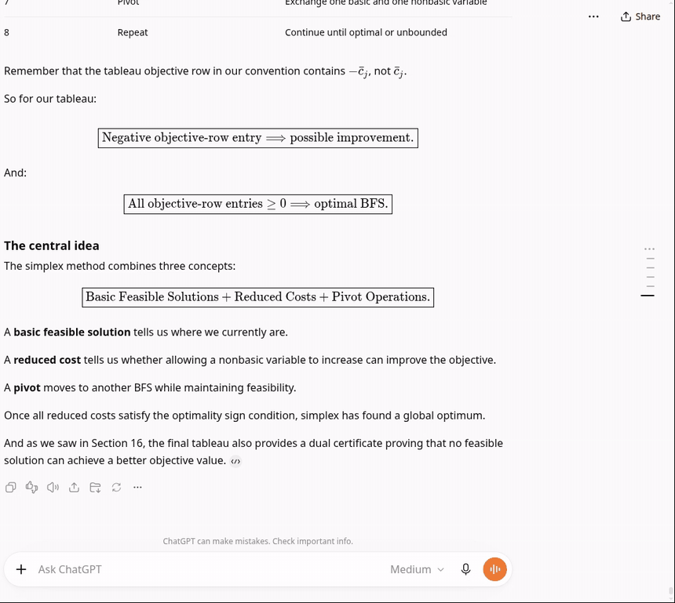

# History rail

A column of ticks at the right edge of the chat, one per question you asked. The dark tick is the
question you are reading.

| Action | What happens |
|---|---|
| **Hover** | The ticks around the pointer swell like a wave and a card shows the question. |
| **Click** | The chat jumps to that question and briefly rings it. |
| **Three dots** at the top | ChatGPT hasn't loaded your earlier questions yet. Click to scroll to the top; ChatGPT loads the next older batch and the rail grows. |
| **Keyboard** | Tab to the rail, then ↑/↓ and Enter. |

Jumps also work when ChatGPT has unloaded that part of the chat (it keeps only about five turns on
the page). A far jump plays as one continuous fast scroll: the chat scrolls off, placeholder lines
stream past while ChatGPT renders the target, and the chat scrolls in and stops on it.

A far jump takes about 1–2 s on the slow test machine, and up to about 6 s to the oldest loaded
question right after a chat opens, because ChatGPT has to render that turn (and, at the top, load
earlier messages) first. The placeholder lines keep moving and the clicked tick pulses meanwhile.

The questions come from the conversation data ChatGPT downloads anyway; the rail sends no requests.
