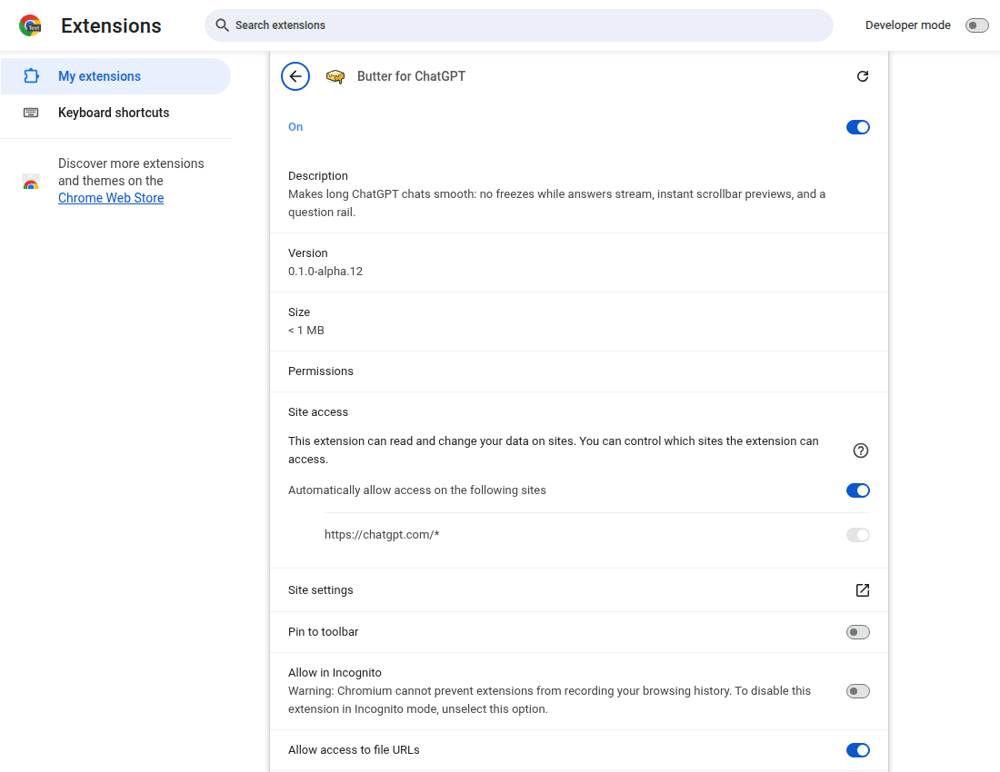
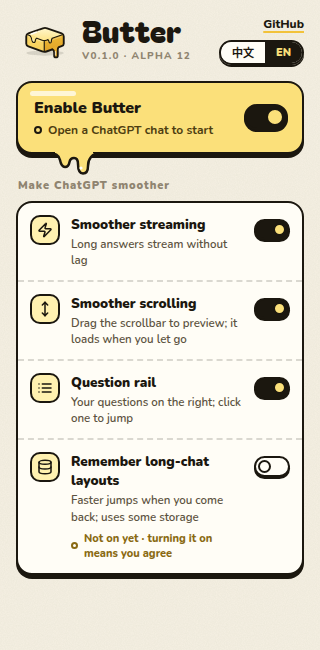
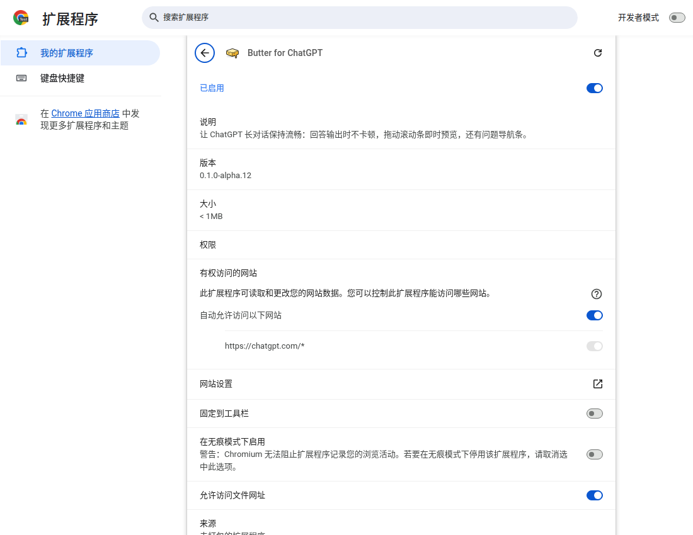
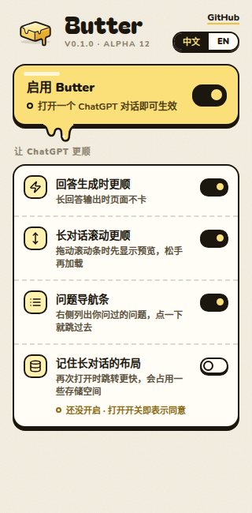

# Chrome metadata localization — alpha.12

The built alpha.12 package declares `en` (default) and `zh_CN`. Chromium resolves the
manifest placeholders to the requested strings in both languages. The brand stays
“Butter for ChatGPT”. No version bump, tag, release, or merge is part of this change.

## Findings

- The supplied English summary is **114** Unicode characters including its final period,
  rather than 113; it fits the 132-character limit. Chinese: 45. Both names: 18 (limit 75).
- The manifest has no `action.default_title` or other user-facing text beyond name and
  description. Chrome uses the localized name for the action's fallback title.
- `rg -n 'getManifest|manifest\.json|Keeps long ChatGPT conversations'` across the repo
  found that the product popup reads only `version_name`. Packaging and version checking
  likewise read version fields, not the localized name/description. No consumer needs
  a resolver added. README and current architecture/development docs do not quote the
  old summary; historical lab variants and reports remain historical.
- `package.py` already includes underscore-prefixed directories. A regression test packages
  the real extension in both release and test modes and checks both locale files byte for
  byte. No packaging implementation change is needed.
- All new Node locale tests fail against the pre-change source. The packaging test fails
  in both modes against it (`KeyError: 'default_locale'`), then passes with the change.
- `t3/drag-release` was left at its existing commit; the implementation branch was created
  from `origin/main` at `3774ccaa89ebff87e6a801ce34b02145c9a8f681`.

## Commands and actual output

Commands were run from the worktree root. Inspection commands also included `cat` of
`AGENTS.md`, `CODING_STANDARDS.md`, `docs/development.md`, `lab/README.md`,
`notes/runs/README.md`, the manifest, packaging/version scripts and popup tests; `rg`
for manifest consumers; and `git diff --check`. Before switching branches,
`CODING_STANDARDS.md` was absent on `t3/drag-release`; it was read after switching to main.

```text
$ git fetch origin && git switch -c t3/store-i18n origin/main
Switched to a new branch 't3/store-i18n'
branch 't3/store-i18n' set up to track 'origin/main'.

$ node --test test/manifest-locales.test.mjs   # before implementation
ℹ tests 3
ℹ pass 0
ℹ fail 3
# default_locale: undefined !== 'en'; no manifest message references; _locales ENOENT

$ python3 -m unittest discover -s scripts -p 'test_*.py'   # before implementation
Ran 8 tests in 0.753s
FAILED (errors=2)
# Both new packaging subtests: KeyError: 'default_locale'

$ npx prettier --write extension/manifest.json extension/_locales/en/messages.json extension/_locales/zh_CN/messages.json test/manifest-locales.test.mjs
extension/manifest.json 37ms
extension/_locales/en/messages.json 2ms (unchanged)
extension/_locales/zh_CN/messages.json 3ms (unchanged)
test/manifest-locales.test.mjs 30ms

$ node --test test/manifest-locales.test.mjs
✔ Chrome metadata declares English as default and supports Simplified Chinese
✔ every manifest message resolves in every declared locale
✔ localized names and summaries fit Chrome Web Store character limits
ℹ tests 3
ℹ pass 3
ℹ fail 0

$ node --test
ℹ tests 212
ℹ suites 0
ℹ pass 212
ℹ fail 0
ℹ cancelled 0
ℹ skipped 0
ℹ todo 0
ℹ duration_ms 828.780912

$ npm run format:check
> format:check
> prettier --check "extension/**/*.{js,css,html,json}" "test/**"
Checking formatting...
All matched files use Prettier code style!

$ python3 scripts/check-version.py
OK: 0.1.0-alpha.12 / 0.1.0.12; manifest, READMEs, and changelog agree.

$ python3 -m unittest discover -s scripts -p 'test_*.py'
........
Ran 8 tests in 0.934s
OK

$ python3 scripts/package.py
/home/simon/.t3/worktrees/butter/t3-6cf413cf/dist/butter-0.1.0-alpha.12.zip

$ unzip -l dist/butter-0.1.0-alpha.12.zip
# Full listing: data/zip-contents.txt. Relevant entries:
     1612  2026-11-04 19:15   butter/manifest.json
      448  2026-11-04 19:15   butter/_locales/en/messages.json
      451  2026-11-04 19:15   butter/_locales/zh_CN/messages.json
   327143                     34 files

$ sha256sum dist/butter-0.1.0-alpha.12.zip
ccc8874d0be96699b915550dbf2256fcfcff111ae3eb2225ce4f7eb9195c08ee  dist/butter-0.1.0-alpha.12.zip

$ stat -c '%s bytes' dist/butter-0.1.0-alpha.12.zip
146305 bytes

$ node notes/runs/2026-11-04-store-i18n/data/chromium-check.mjs
# Exit 0. Full actual JSON stdout: data/chromium-output.txt
# Structured results: data/chromium-results.json

$ git diff --check
# Exit 0; no output.
```

[Full Node output](data/node-test.txt) · [Full zip listing](data/zip-contents.txt) ·
[Chromium stdout](data/chromium-output.txt) · [Structured Chromium results](data/chromium-results.json)

## Chromium proof

The shared preview tool rejected `chrome://extensions` with
`Invalid preview URL (unsupported-protocol: chrome:; input length 19)`.
The self-contained [verification script](data/chromium-check.mjs) instead uses installed
Playwright Chromium **156.0.8078.4**, headless, launches once per locale with
`--lang=en-US` / `--lang=zh-CN` and matching Linux locale environment, and loads the
**unzipped release package**. Both profiles and the unpack directory are disposable
`/tmp` directories, removed after the checks. No ChatGPT lab profile or ChatGPT page is used.

The script reads the real extension record via `chrome.developerPrivate.getExtensionsInfo`
inside `chrome://extensions/?id=…`; it also reads resolved `chrome.runtime.getManifest()`
from the real popup page. Both APIs report the exact intended strings, with no raw
`__MSG_…__` text:

| Browser language | Name | Description |
|---|---|---|
| en-US | Butter for ChatGPT | Makes long ChatGPT chats smooth: no freezes while answers stream, instant scrollbar previews, and a question rail. |
| zh-CN | Butter for ChatGPT | 让 ChatGPT 长对话保持流畅：回答输出时不卡顿，拖动滚动条即时预览，还有问题导航条。 |

The popup page opens without JavaScript errors and displays `v0.1.0 · alpha 12` and
four feature switches (streaming, scrolling, question rail, layouts), plus the master
switch. In each fresh browser profile, the popup starts in EN, including under zh-CN.
Clicking 中文 translates the switch labels and persists after reload; clicking EN
restores all English labels. The extension's independent language choice is preserved.
Layouts are off pending consent; the other feature switches and master start on.

An initial harness assertion incorrectly expected raw SemVer text in the visible version
label; it was corrected to the popup's existing formatted label, and the switch count
explicitly separates the master from the four features. No product fix was needed.

### English browser




### Chinese browser





The same Chinese popup check was captured under the English browser:
[Chinese popup in English browser](data/popup-en-US-chinese.png).

This verifies local Chromium metadata and package contents. The actual Chrome Web Store
page is left for the lead's later upload and release process.
