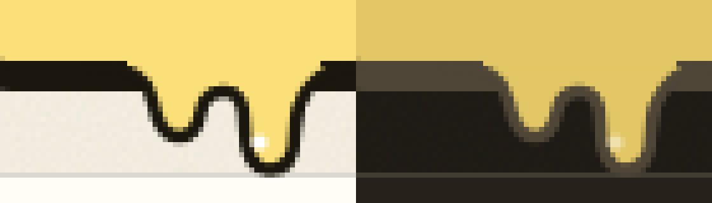

# Popup drip: smooth join with the master card's bottom edge

Build: `t3/drip-align` (0.1.0-alpha.15 plus the fix). Before: the #35 run's built screenshots
(`bbfcc74`). The harness starts its own headless Chromium and sends no ChatGPT requests.

`BUTTER_CASES=13 node lab/harness/popup-qa.mjs` → PASS (light and dark).

The master card's bottom edge is a 2.5 px border plus a 4 px hard shadow. The butter rect that hid
the border under the drip ran only from x = 7 to 45 and down to y = 2.7, so the edge ended in a
notch on the left, a vertical step on the right, and a butter sliver on the shadow. The rect now
runs the drip's full width (x = 0 to 52) and stops at y = 2, inside the border.

Crops at 8× (left light, right dark), 1× device pixel ratio:

| Before | After |
|---|---|
|  |  |

Full states: [light](13-en-branch-on-light.png), [dark](13-en-branch-on-dark.png).
