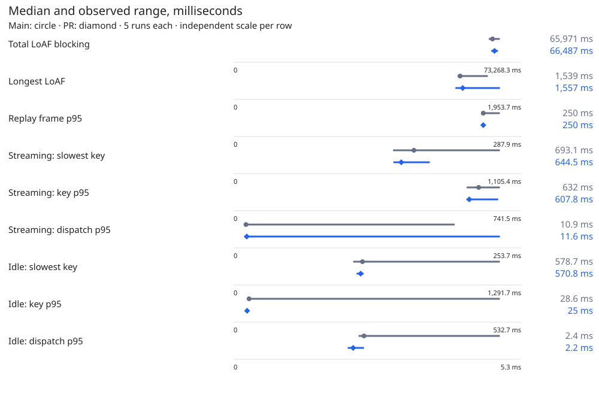

# Butter PR #92: main versus rail model — live acceptance

**Result: all prescribed functional checks pass on requested PR head b4a0ac8; 9/9 timing metrics satisfy the requested no-worse rule with 5 valid runs per build.**

Acceptance compares the two requested immutable heads. **The branch advanced to `697307c` during testing, including extension and harness changes; those later changes were not tested here.** This report is published on top of that freshly fetched head. Extension source was not changed. Full commands and sanitized actual outputs are in [commands.md](commands.md); all exported JSON leaves are numeric (booleans become 0/1). Raw captures remain local.

## Builds and method

- main: `a100fd6dec8841411e183e3d178065bfcbe9f10d`; archive/build: `/home/simon/snap/chromium/common/rail-model-live-main`; extension: that archive’s `extension/`.
- pr: `b4a0ac87ab5d4f5227de3521ffe325e66ce94cdb`; archive/build: `/home/simon/snap/chromium/common/rail-model-live-pr`; extension: that archive’s `extension/`.

- Worktree: `/tmp/rail-model-live`, created from `origin/t3/rail-model`. The shared checkout’s branch, tracked files and pre-existing untracked files were preserved. Each arm used its own archived harness. `node_modules` linked to the installed Playwright; `.git` metadata was linked read-only for the takeover harness’s historical `git show`. No extension code edits.
- Lock owner: `rail-model-live`; every acquire used `--lab auto --wait 1800 --perf` (with the named fixture constraint). A Node module loader overrides only the bookmark harness’s lock options, which otherwise use a different owner, a 60-second wait and no perf lock in wash. The harness’s restore and release remain in its normal cleanup. The nav fixtures’ hardcoded CDP port requires lab 1; they run sequentially under one acquired lock, with a send-guard preload on every context.
- Matrix: `LAB_FIXTURE=math12`, REPS=3 per empty/bookmarked arm. Wash: `MODE=wash LAB_FIXTURE=demo-en12`. Each install is byte-for-byte checked by the harness; extension-local test data and shortcut bindings are removed/restored.
- Chromium 156.0.8078.47; Playwright 1.65.0. Extension file checks: main 59/59 and PR 62/62 byte-identical to their requested SHA.
- Benchmark: each archive’s `lab/harness/bench.mjs` is identical (SHA-256 `2e1498fd9e979f90b79ce391d6fca06a0c2d92e0f3bb59abf692937d40bd8def`). An identical external preparation script writes `bench-live.mjs` beside it: same replay/input schedule, plus frozen-history routing, dual fetch guards, local prepare responses, the lab send guard, WebSocket closure, service-worker bypass, full answer SHA-256, visible-scroller selection and an active-rail/CV preflight, stream-only frame/LoAF/key windows, dispatch-delay capture and a separate idle-typing sample. Original harnesses remain intact.
- Provenance limitation: the host README names live fixtures through `labs.json` but does not name the frozen replay artifacts or a replay driver. The frozen history and recording were therefore reused from the documented November 4 benchmark’s local archive, `/tmp/butter-bench-final/raw/`. History `math-nine.json` SHA-256: `359b4fe33317cb357e4f6646f3dc443dd6338241e53897039349c23fa239d345`; recording SHA-256: `36b773bf0733ff3f4df3856157834243bfdcf886af1fbc2f0600631d251ca05c`. The safety adapter takes its local prepare/dual-guard code from that benchmark. No new answers are generated.
- Benchmark settings: headed software-rendered lab, viewport 1440 × 1000, light media setting, same browser flags per arm, fresh browser restart and cleared extension storage with layout consent granted before each repetition. Frozen nine-question history with the live app/session, 189 recorded SSE chunks, original chunk timing with thinking gaps capped at 1500 ms. Wheel input is three 250 px steps per 1500 ms, alternating direction; two ten-letter bursts at 120 ms spacing plus Backspaces. Idle input is 54 fixed letters at 80 ms spacing, then cleared without sending.
- LoAF blocking sums per-frame `blockingDuration`; longest LoAF uses `duration`; replay frame p95 uses the harness’s sorted index convention. Frames and LoAFs are limited to replay start/end. Stream keystrokes include letters/Backspace only while replay is active, excluding Enter. Paint response is keydown to rAF plus setTimeout; dispatch delay is event timestamp to the capture listener. Idle samples use the same observers before replay. Tables round to three decimal places; verdicts use unrounded captured values.
- All ChatGPT mutations remain denied. Simulated stream/prepare POSTs are answered locally inside the fetch hook; no real message is submitted. Live bookmark harnesses never fill a composer. Native fixture harnesses request only their local `butter.test` fixture. Account and chat identifiers, text, screenshots and private endpoints are excluded.

## Lock windows (UTC)

| Activity | Lab | Acquired | Restored / released |
|---|---:|---|---|
| bookmarks harness | 1 | 2026-11-11T18:53:37.056Z | 2026-11-11T18:58:39.325Z (restore completed first) |
| bookmarks harness | 2 | 2026-11-11T18:58:39.551Z | 2026-11-11T19:00:53.556Z (restore completed first) |
| bookmarks harness | 1 | 2026-11-11T19:00:53.784Z | 2026-11-11T19:05:57.835Z (restore completed first) |
| bookmarks harness | 2 | 2026-11-11T19:05:58.073Z | 2026-11-11T19:08:12.521Z (restore completed first) |
| pilot | 1 | 2026-11-11T19:13:34.977520+00:00 | 2026-11-11T19:19:38.714773+00:00 |
| nav | 1 | 2026-11-11T19:08:12.658670+00:00 | 2026-11-11T19:13:34.253232+00:00 |
| bench | 1 | 2026-11-11T19:20:29.098769+00:00 | 2026-11-11T19:49:18.712562+00:00 |

Every lock was restored before release, including expected main fixture failures. Restore and release outputs are in commands.md. Lab 1 serves math; lab 2 serves the wash fixture.

## Excluded replay pilots

The first main sample completed with the old harness’s first-scroller selector, which selected ChatGPT’s hidden scroll container. The wheel/observer setup therefore did not exercise the documented visible-chat method; zero observed block additions/seen marks exposed the problem. It is excluded from acceptance. The PR pilot process was deliberately terminated after discovery; it had already saved raw replay measurements before its final logging/postflight steps. The lab was restored and released, then the complete required sequence restarted with visible-scroller selection in both identical adapters. This was a harness correction, not a flaky product check. The earlier queued lock request was deliberately cancelled before acquiring and never reached the 30-minute timeout.

| Excluded sample | loafBlockMs | loafMaxMs | p95 | keyMax | keyP95 | inputDelayP95 | idle.keyMax | idle.keyP95 | idle.inputDelayP95 |
|---|---:|---:|---:|---:|---:|---:|---:|---:|---:|
| Main pilot | 84467 | 2735 | 350 | 4678.2 | 3106.1 | 1192.7 | 537.6 | 26.9 | 2.1 |
| PR pilot (process interrupted) | 86712 | 2811 | 300 | 4107.1 | 2902.5 | 1225.6 | 557.8 | 29.5 | 2 |

Both excluded pilots saved all 189 replay chunks and the expected answer hash, with zero completed network mutations. The PR pilot process was terminated after its JSON/screenshot writes and before final logging/postflight completion; its available raw numbers are retained above. Actual outputs, extracted numeric records and cancellation are retained in commands.md.

## Replay and typing

Actual order: A1 B1 B2 A2 A3 B3 B4 A4 A5 B5. A denotes main; B denotes PR.

All final answer SHA-256 values: `043dc8afaf8d1e05e984597494a403589e3f38448954c6343e33689c4ff82e68`. Unique hashes: 1.

### Measured set

| Metric | Main median [min–max], n | PR median [min–max], n | No worse |
|---|---:|---:|---|
| Replay: total LoAF blocking (ms) | 65971 [65003–67841], $n=5$ | 66487 [65656–67363], $n=5$ | PASS |
| Replay: longest LoAF (ms) | 1539 [1522–1727], $n=5$ | 1557 [1507–1809], $n=5$ | PASS |
| Replay: frame p95 (ms) | 250 [249.9–266.6], $n=5$ | 250 [250–250.1], $n=5$ | PASS |
| Streaming typing: slowest keydown → paint (ms) | 693.1 [612.9–1023.5], $n=5$ | 644.5 [614.2–754], $n=5$ | PASS |
| Streaming typing: keydown → paint p95 (ms) | 632 [601.2–686.6], $n=5$ | 607.8 [600.5–682.5], $n=5$ | PASS |
| Streaming typing: dispatch delay p95 (ms) | 10.9 [10.5–195], $n=5$ | 11.6 [9.5–234.9], $n=5$ | PASS |
| Idle typing: slowest keydown → paint (ms) | 578.7 [537.4–1196], $n=5$ | 570.8 [552.3–584.1], $n=5$ | PASS |
| Idle typing: keydown → paint p95 (ms) | 28.6 [25.1–493.2], $n=5$ | 25 [23.1–26.6], $n=5$ | PASS |
| Idle typing: dispatch delay p95 (ms) | 2.4 [2.3–4.9], $n=5$ | 2.2 [2.1–2.4], $n=5$ | PASS |

No first-set PR median exceeded main’s maximum; the additional set was not triggered.

### Every measured repetition

| Order | Set | Build / run | loafBlockMs | loafMaxMs | p95 | keyMax | keyP95 | inputDelayP95 | idle.keyMax | idle.keyP95 | idle.inputDelayP95 |
|---:|---:|---|---:|---:|---:|---:|---:|---:|---:|---:|---:|
| 1 | 1 | main 1 | 65971 | 1727 | 249.9 | 612.9 | 601.2 | 10.5 | 608.2 | 493.2 | 4.9 |
| 2 | 1 | pr 1 | 65791 | 1557 | 250 | 614.2 | 600.5 | 9.5 | 584.1 | 23.1 | 2.1 |
| 3 | 1 | pr 2 | 65656 | 1541 | 250 | 754 | 605.1 | 234.9 | 552.3 | 25.7 | 2.1 |
| 4 | 1 | main 2 | 65393 | 1564 | 250 | 655 | 632 | 10.7 | 541.2 | 25.9 | 2.3 |
| 5 | 1 | main 3 | 67841 | 1539 | 266.6 | 693.1 | 686.6 | 11.1 | 578.7 | 25.1 | 2.3 |
| 6 | 1 | pr 3 | 67048 | 1598 | 250 | 701.1 | 682.5 | 12.2 | 577.6 | 25 | 2.2 |
| 7 | 1 | pr 4 | 66487 | 1809 | 250 | 644.5 | 638.6 | 11.6 | 570.8 | 24.2 | 2.2 |
| 8 | 1 | main 4 | 66665 | 1532 | 250 | 1023.5 | 602.3 | 195 | 1196 | 33.2 | 2.8 |
| 9 | 1 | main 5 | 65003 | 1522 | 249.9 | 706 | 679.3 | 10.9 | 537.4 | 28.6 | 2.4 |
| 10 | 1 | pr 5 | 67363 | 1507 | 250.1 | 627.4 | 607.8 | 10.4 | 553.2 | 26.6 | 2.4 |

Each repetition’s answer length, chunk count, key sample counts, mutation denial count and fixture-read count are in `data/bench-runs.json`. Zero completed network mutations are required for every measured run. These are host-specific lab measurements, not a universal performance claim.

## bookmarks-live

| Run | Lab | Checks passed / total | Exit | Seconds | Cleanup |
|---|---:|---:|---:|---:|---|
| matrix-main-1 | 1 | 35/35 | 0 | 302.487 | `{"remainingBeforeFallback":0,"remainingAfterFallback":0,"shortcutsRestored":true,"restored":true,"composerEmpty":true,"oneHomeTab":true,"defaultExtensions":true,"labLockReleased":true,"perfLockReleased":true}` |
| wash-main-1 | 2 | 42/42 | 0 | 134.235 | `{"remainingBeforeFallback":3,"remainingAfterFallback":0,"restored":true,"composerEmpty":true,"oneHomeTab":true,"defaultExtensions":true,"labLockReleased":true,"perfLockReleased":true}` |
| matrix-pr-1 | 1 | 35/35 | 0 | 304.288 | `{"remainingBeforeFallback":0,"remainingAfterFallback":0,"shortcutsRestored":true,"restored":true,"composerEmpty":true,"oneHomeTab":true,"defaultExtensions":true,"labLockReleased":true,"perfLockReleased":true}` |
| wash-pr-1 | 2 | 42/42 | 0 | 134.69 | `{"remainingBeforeFallback":3,"remainingAfterFallback":0,"restored":true,"composerEmpty":true,"oneHomeTab":true,"defaultExtensions":true,"labLockReleased":true,"perfLockReleased":true}` |

### matrix: ordered checks

| # | Check | Main attempt(s) | PR attempt(s) |
|---:|---|---|---|
| 1 | real long fixture loaded | 1: PASS | 1: PASS |
| 2 | held drag empty 1 | 1: PASS | 1: PASS |
| 3 | held drag empty 2 | 1: PASS | 1: PASS |
| 4 | held drag empty 3 | 1: PASS | 1: PASS |
| 5 | live selection message ids match conversation API by SHA-256 | 1: PASS | 1: PASS |
| 6 | the Bookmark cell is named Bookmark selection | 1: PASS | 1: PASS |
| 7 | paragraph button saves one bookmark | 1: PASS | 1: PASS |
| 8 | selection saved through real Alt+Shift+M | 1: PASS | 1: PASS |
| 9 | held drag bookmarked 1 | 1: PASS | 1: PASS |
| 10 | held drag bookmarked 2 | 1: PASS | 1: PASS |
| 11 | held drag bookmarked 3 | 1: PASS | 1: PASS |
| 12 | matched drag comparison with bookmarks versus empty | 1: PASS | 1: PASS |
| 13 | selection card jump after drag lands on text | 1: PASS | 1: PASS |
| 14 | paragraph jump requested during native drag lands on text | 1: PASS | 1: PASS |
| 15 | reload before row click leaves earlier answer unloaded | 1: PASS | 1: PASS |
| 16 | earlier bookmarks sit under dots and not a loaded tick (row) | 1: PASS | 1: PASS |
| 17 | hover earlier segment shows 2-bookmark card (row) | 1: PASS | 1: PASS |
| 18 | row click loads earlier pages and lands on requested text | 1: PASS | 1: PASS |
| 19 | segment moves from dots to loaded question after row click | 1: PASS | 1: PASS |
| 20 | reload before keyboard click leaves earlier answer unloaded | 1: PASS | 1: PASS |
| 21 | earlier bookmarks sit under dots and not a loaded tick (keyboard) | 1: PASS | 1: PASS |
| 22 | hover earlier segment shows 2-bookmark card (keyboard) | 1: PASS | 1: PASS |
| 23 | keyboard click loads earlier pages and lands on requested text | 1: PASS | 1: PASS |
| 24 | segment moves from dots to loaded question after keyboard click | 1: PASS | 1: PASS |
| 25 | reload resolves both bookmarks live without answer changed | 1: PASS | 1: PASS |
| 26 | card delete removes selection bookmark | 1: PASS | 1: PASS |
| 27 | earlier bookmarks sit under dots and not a loaded tick (single) | 1: PASS | 1: PASS |
| 28 | hover earlier segment shows 1-bookmark card (single) | 1: PASS | 1: PASS |
| 29 | card delete removes both test bookmarks | 1: PASS | 1: PASS |
| 30 | real fixture has a later top-level list item for distinct landing | 1: PASS | 1: PASS |
| 31 | list item: the Bookmark cell is named Bookmark selection | 1: PASS | 1: PASS |
| 32 | list item button saves its individual paragraph with ask and line | 1: PASS | 1: PASS |
| 33 | list item jump lands on the item instead of the list start | 1: PASS | 1: PASS |
| 34 | list item resolves live and lands on the same item after reload | 1: PASS | 1: PASS |
| 35 | card delete removes list item test bookmark | 1: PASS | 1: PASS |

First-attempt ordered names and results identical: **True**. First-attempt cleanup identical: **True**.

### wash: ordered checks

| # | Check | Main attempt(s) | PR attempt(s) |
|---:|---|---|---|
| 1 | wash light: ChatGPT shows its light theme | 1: PASS | 1: PASS |
| 2 | wash light: the whole chat loads through the earlier-history dots | 1: PASS | 1: PASS |
| 3 | wash: a mounted answer holds two long paragraphs and a table | 1: PASS | 1: PASS |
| 4 | wash: the Bookmark cell bookmarks the paragraph | 1: PASS | 1: PASS |
| 5 | wash: the Bookmark cell bookmarks the selection | 1: PASS | 1: PASS |
| 6 | wash: the Bookmark cell bookmarks the table | 1: PASS | 1: PASS |
| 7 | wash light: a paragraph is washed on its own lines | 1: PASS | 1: PASS |
| 8 | wash light: a paragraph: Butter's layer, multiplied, in the wash colour, no pointer events, no bubble flash | 1: PASS | 1: PASS |
| 9 | wash light: a paragraph: the text keeps its colour under the wash | 1: PASS | 1: PASS |
| 10 | wash light: a paragraph: scrolled 74 px during the hold, the boxes follow the text | 1: PASS | 1: PASS |
| 11 | wash light: a paragraph: with the washed text under ChatGPT's header, the wash reaches the header and no butter shows on it | 1: PASS | 1: PASS |
| 12 | wash light: a paragraph: gone after the hold and fade | 1: PASS | 1: PASS |
| 13 | wash light: a selection is washed on its own lines | 1: PASS | 1: PASS |
| 14 | wash light: a selection: Butter's layer, multiplied, in the wash colour, no pointer events, no bubble flash | 1: PASS | 1: PASS |
| 15 | wash light: a selection: the text keeps its colour under the wash | 1: PASS | 1: PASS |
| 16 | wash light: a selection: scrolled -680 px during the hold, the boxes follow the text | 1: PASS | 1: PASS |
| 17 | wash light: a selection: with the washed text under ChatGPT's composer, the wash reaches the composer and no butter shows on it | 1: PASS | 1: PASS |
| 18 | wash light: a selection: gone after the hold and fade | 1: PASS | 1: PASS |
| 19 | wash light: a table is washed on its own lines (one box 3 px around the table) | 1: PASS | 1: PASS |
| 20 | wash light: a table: Butter's layer, multiplied, in the wash colour, no pointer events, no bubble flash | 1: PASS | 1: PASS |
| 21 | wash light: a table: the text keeps its colour under the wash | 1: PASS | 1: PASS |
| 22 | wash light: a table: scrolled 80 px during the hold, the boxes follow the text | 1: PASS | 1: PASS |
| 23 | wash light: a table: gone after the hold and fade | 1: PASS | 1: PASS |
| 24 | wash dark: ChatGPT shows its dark theme | 1: PASS | 1: PASS |
| 25 | wash dark: the whole chat loads through the earlier-history dots | 1: PASS | 1: PASS |
| 26 | wash dark: a paragraph is washed on its own lines | 1: PASS | 1: PASS |
| 27 | wash dark: a paragraph: Butter's layer, lightened, in the wash colour, no pointer events, no bubble flash | 1: PASS | 1: PASS |
| 28 | wash dark: a paragraph: the text keeps its colour under the wash | 1: PASS | 1: PASS |
| 29 | wash dark: a paragraph: scrolled 74 px during the hold, the boxes follow the text | 1: PASS | 1: PASS |
| 30 | wash dark: a paragraph: with the washed text under ChatGPT's header, the wash reaches the header and no butter shows on it | 1: PASS | 1: PASS |
| 31 | wash dark: a paragraph: gone after the hold and fade | 1: PASS | 1: PASS |
| 32 | wash dark: a selection is washed on its own lines | 1: PASS | 1: PASS |
| 33 | wash dark: a selection: Butter's layer, lightened, in the wash colour, no pointer events, no bubble flash | 1: PASS | 1: PASS |
| 34 | wash dark: a selection: the text keeps its colour under the wash | 1: PASS | 1: PASS |
| 35 | wash dark: a selection: scrolled -680 px during the hold, the boxes follow the text | 1: PASS | 1: PASS |
| 36 | wash dark: a selection: with the washed text under ChatGPT's composer, the wash reaches the composer and no butter shows on it | 1: PASS | 1: PASS |
| 37 | wash dark: a selection: gone after the hold and fade | 1: PASS | 1: PASS |
| 38 | wash dark: a table is washed on its own lines (one box 3 px around the table) | 1: PASS | 1: PASS |
| 39 | wash dark: a table: Butter's layer, lightened, in the wash colour, no pointer events, no bubble flash | 1: PASS | 1: PASS |
| 40 | wash dark: a table: the text keeps its colour under the wash | 1: PASS | 1: PASS |
| 41 | wash dark: a table: scrolled 80 px during the hold, the boxes follow the text | 1: PASS | 1: PASS |
| 42 | wash dark: a table: gone after the hold and fade | 1: PASS | 1: PASS |

First-attempt ordered names and results identical: **True**. First-attempt cleanup identical: **True**.

### Jump probe counts by label

Each cell is main / PR; absent probe entries are zero. These single-run call counts are observations, not timing measurements. The table preserves all seven requested probes.

| Attempt / label | rail.jump | rail.jumpTo | rail.earlierJump | rail.landOff | rail.targetTop | rail.glide | bookmark.locate |
|---|---:|---:|---:|---:|---:|---:|---:|
| 1 / after-drag | 6 / 6 | 1 / 1 | 0 / 0 | 25 / 25 | 7 / 7 | 0 / 0 | 25 / 25 |
| 1 / during-drag | 6 / 6 | 0 / 0 | 0 / 0 | 45 / 45 | 9 / 9 | 0 / 0 | 0 / 0 |
| 1 / unloaded-row | 1 / 1 | 1 / 1 | 1 / 1 | 18 / 24 | 5 / 5 | 0 / 0 | 18 / 24 |
| 1 / unloaded-keyboard | 1 / 1 | 1 / 1 | 1 / 1 | 21 / 24 | 5 / 5 | 0 / 0 | 21 / 24 |

### Held-drag facts

| Run / arm / repetition | Held | Mounts | Storage reads | Storage messages | Coverage scripts | Updates | Frame p95 / max ms |
|---|---|---:|---:|---:|---:|---:|---:|
| matrix-pr-1 / empty / 1 | True | 0 | 0 | 0 | 2 | 31 | 16.7 / 16.8 |
| matrix-pr-1 / empty / 2 | True | 0 | 0 | 0 | 2 | 31 | 16.7 / 16.8 |
| matrix-pr-1 / empty / 3 | True | 0 | 0 | 0 | 2 | 31 | 16.8 / 16.8 |
| matrix-pr-1 / bookmarked / 1 | True | 0 | 0 | 0 | 2 | 32 | 16.7 / 16.8 |
| matrix-pr-1 / bookmarked / 2 | True | 0 | 0 | 0 | 2 | 32 | 16.7 / 16.8 |
| matrix-pr-1 / bookmarked / 3 | True | 0 | 0 | 0 | 2 | 32 | 16.7 / 16.8 |
| matrix-main-1 / empty / 1 | True | 0 | 0 | 0 | 2 | 31 | 16.7 / 16.8 |
| matrix-main-1 / empty / 2 | True | 0 | 0 | 0 | 2 | 32 | 16.7 / 16.8 |
| matrix-main-1 / empty / 3 | True | 0 | 0 | 0 | 2 | 32 | 16.7 / 16.8 |
| matrix-main-1 / bookmarked / 1 | True | 0 | 0 | 0 | 2 | 33 | 16.7 / 16.8 |
| matrix-main-1 / bookmarked / 2 | True | 0 | 0 | 0 | 2 | 31 | 16.8 / 16.8 |
| matrix-main-1 / bookmarked / 3 | True | 0 | 0 | 0 | 2 | 31 | 16.7 / 16.8 |

## Earlier navigation and takeovers (#89)

| Harness / arm / attempt | Earlier passed | Alpha6 cases completed | Current cases completed | Exit | Actual result |
|---|---:|---:|---:|---:|---|
| nav-earlier-main-1 | 0 | 0 | 0 | 1 | Timed out waiting for `chatgpt-butter-nav[data-on]` |
| nav-earlier-main-2 | 0 | 0 | 0 | 1 | Timed out waiting for `chatgpt-butter-nav[data-on]` |
| nav-takeovers-main-1 | 0 | 3 | 0 | 1 | Timed out waiting for `chatgpt-butter-nav[data-on]` |
| nav-takeovers-main-2 | 0 | 3 | 0 | 1 | Timed out waiting for `chatgpt-butter-nav[data-on]` |
| nav-earlier-pr-1 | 14 | 0 | 0 | 0 | See actual case results in commands.md |
| nav-takeovers-pr-1 | 0 | 3 | 12 | 0 | See actual case results in commands.md |

The main failures are expected dependency-injection regressions covered by issue #89. Each failed harness is retried once and both attempts are retained. For takeovers, counts describe cases completed before an assertion or setup failure; a nonzero exit never counts as a full pass.

## Findings, cleanup and privacy

- Matrix: both 35/35; wash: both 42/42. Ordered names/results and cleanup are identical. All live checks passed on the first attempt; no functional flake occurred.
- Every held drag on both arms kept the thumb held, mounted zero turns, read no storage and sent no storage messages, and counted two bookmark coverage scripts. All recorded bookmark-work counters are zero.
- Jump probes match exactly after/during drag. Unloaded row: main/PR landOff and locate are 18/24; unloaded keyboard: 21/24. Other requested per-label probes match. All jump checks passed. These call-count differences are recorded observations; their cause and timing impact were not isolated.
- Issue #89: main times out before any nav-earlier case and after the three historical alpha6 takeover cases, in both attempts. PR passes nav-earlier 14/14 and takeovers 3/3 alpha6 plus 12/12 current, with no page errors.
- Timing: 9/9 combined metrics pass the requested empirical-range rule. No PR median exceeded the first set’s main maximum, so no extra pairs were required. Variability, including idle-typing outliers, is retained. The fixed 8-second initial harness wait is not the full-settled readiness test of other benchmark scenarios. Both current arms show substantially more replay blocking than the older published alpha.11 results; this task does not isolate why. The acceptance comparison is between these matched current heads, not against the historical builds.
- The adapters were identical for every valid sample; final SHA-256: `0249f58a22ce0c92703a198af7551849f31254ac938680ebe1061dc4b1235630`. The original first-scroller main pilot and interrupted PR pilot are excluded explicitly, with raw numbers/output retained. No extension source was changed.
- All acquired locks were restored and released. Restore checks confirm one home tab, an empty composer, default extensions and flags. The shared checkout remains on main with its original status and no tracked changes. Test outputs, raw snapshots and screenshots remain local; only the curated report, numeric summaries and comparison chart are committed.
- Final verification and privacy results are in `data/verification.json` and `data/privacy-scan.json`. The privacy scan rejects chat/conversation/message identifiers, account emails, chat URLs and known private tokens across every added file. JSON leaves are numeric; booleans are 0/1. This report qualifies only the two requested immutable SHAs, even if the branch later receives code changes.
