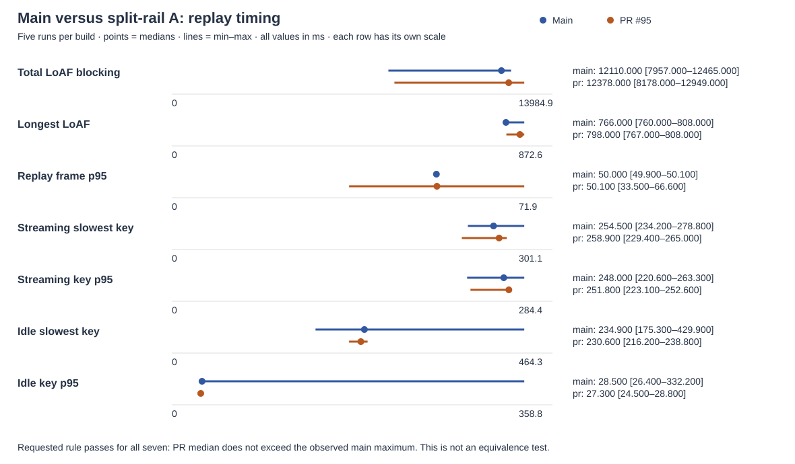

# Butter PR #95: main versus split-rail A — live comparison

**Replay result: 7/7 metrics meet the requested no-worse rule.**

Tested baseline `4e6c25928ee3eb1b31a91533ce6490ce7ea0358e` and PR extension `a2ed2ce139ec26f76186b6fb9d2ed220d6658fb8`. Results qualify those immutable builds. Publication head and any later branch changes are recorded below. Only this report folder is committed. Commands and actual, redacted outputs are in [commands.md](commands.md).

## All six requested items

| Item | Result |
|---|---|
| 1. Five interleaved perf replays per build | All seven metrics meet the requested rule; all ten answer hashes match; zero completed writes. |
| 2. Bookmark matrix | Main 35/35; PR 35/35. Ordered names/results and cleanup identical. |
| 3. Main bookmark wash | 42/42, collected from the completed saved run. |
| 4. PR bookmark wash | 42/42, finished before the interruption. Ordered names/results and cleanup identical to main. |
| 5. Live jump/navigation harnesses | Shared failures: typing composer cleanup; latency instrumentation anchor; earlier-history target lookup; settle timeout. No PR-only failure observed; these checks do not establish live jump/typing correctness or timing equivalence. |
| 6. Branch ready and pill | Both widths ready on both builds, sends guarded, original tabs unchanged, pill measurements identical. |

## Method

Fetched origin first, then created two detached, Snap-readable Git worktrees at the requested commits. Each loads its own `extension/` as the sole unpacked extension. No extension or tracked harness file was edited. Dependencies link to the host Playwright installation. Extension files are checked against Git bytes before publication.

Reused the November 11 rail-model live method and its final visible-scroller adapter byte for byte (adapter SHA-256 `0249f58a22ce0c92703a198af7551849f31254ac938680ebe1061dc4b1235630`). Both original `bench.mjs` files have SHA-256 `2e1498fd9e979f90b79ce391d6fca06a0c2d92e0f3bb59abf692937d40bd8def`. The adapter file itself is unchanged; only its safety helper’s private artifact directory differs. Frozen history SHA-256 `359b4fe33317cb357e4f6646f3dc443dd6338241e53897039349c23fa239d345`; recording SHA-256 `36b773bf0733ff3f4df3856157834243bfdcf886af1fbc2f0600631d251ca05c`. These are the earlier documented benchmark’s local fixtures, not fresh generated answers.

All timing uses the lab and machine-wide perf lock, owner `rail-split-a-live`, with `--wait 1800`. Named lab fixtures only: lab 1 math12 and lab 2 demo-en12. The host README and labs.json are authoritative; their private URLs are omitted. Login expiration or lock timeout stops work. Each lock window restores the lab before release, including harness failures.

Five replays per build, strict main → PR alternation. Browser restarts per run, 1440 × 1000 CSS viewport, forced light theme, fresh extension storage and granted layout consent. Nine-question frozen history with live ChatGPT app/session; 189 SSE chunks with original timing and thinking gaps capped at 1500 ms. Three 250 px wheel steps every 1500 ms alternate direction. Two ten-letter bursts at 120 ms spacing, then Backspaces. Idle typing is 54 letters at 80 ms spacing, cleared without sending.

LoAF blocking is summed `blockingDuration`; longest LoAF is `duration`. Frame/LoAF samples are bounded by replay start/end. Streaming keys are letters/Backspace during the replay, excluding Enter; response is keydown to rAF plus setTimeout. p95 uses the existing sorted-index convention. The requested rule passes when the PR median is no higher than main’s median or lies in main’s observed range; equivalently for these lower-is-better metrics, it must not exceed main’s maximum. Verdicts use unrounded values. This empirical rule is not a statistical equivalence test.

Local SSE/prepare responses, dual fetch write guards, the lab network send guard, blocked WebSockets and service-worker bypass prevent real replay sends. Denied mutations are expected; completed ChatGPT writes must be zero. Live jump typing attempts to clear its draft without submitting; both resumed commands failed that cleanup check (see the live results below). Branch-live allows only native `new_branch`; its message send remains guarded. No new real prompt was authorized or sent.

Main already includes #94’s streaming fix. The latest comparable main evidence was about 13.6 s blocking, not the obsolete 66 s. That report uses M2 with additional probes; this pass deliberately reuses the requested rail-model adapter. Absolute timing differences between methods are not attributed to the refactor.

## Replay and typing

| Metric (ms) | Main median [min–max] | PR median [min–max] | No worse |
|---|---|---|---|
| Replay total LoAF blocking | 12110.000 [7957.000–12465.000] | 12378.000 [8178.000–12949.000] | PASS |
| Longest LoAF | 766.000 [760.000–808.000] | 798.000 [767.000–808.000] | PASS |
| Replay frame p95 | 50.000 [49.900–50.100] | 50.100 [33.500–66.600] | PASS |
| Streaming slowest key | 254.500 [234.200–278.800] | 258.900 [229.400–265.000] | PASS |
| Streaming key p95 | 248.000 [220.600–263.300] | 251.800 [223.100–252.600] | PASS |
| Idle slowest key | 234.900 [175.300–429.900] | 230.600 [216.200–238.800] | PASS |
| Idle key p95 | 28.500 [26.400–332.200] | 27.300 [24.500–28.800] | PASS |

Each build has five samples. All answer SHA-256 values must match `043dc8afaf8d1e05e984597494a403589e3f38448954c6343e33689c4ff82e68`; all completed samples match. Every replay delivered 189 chunks and has zero completed network writes. No sample was silently discarded or replaced.

| Order | Build / repetition | loafBlockMs | loafMaxMs | p95 | keyMax | keyP95 | idle.keyMax | idle.keyP95 |
|---|---|---|---|---|---|---|---|---|
| 1 | main 1 | 7957.000 | 760.000 | 49.900 | 234.200 | 220.600 | 175.300 | 26.400 |
| 2 | pr 1 | 8178.000 | 808.000 | 33.500 | 229.400 | 223.100 | 216.200 | 24.500 |
| 3 | main 2 | 12237.000 | 808.000 | 50.100 | 254.500 | 248.000 | 234.900 | 28.700 |
| 4 | pr 2 | 12378.000 | 767.000 | 50.100 | 258.900 | 252.600 | 238.800 | 27.000 |
| 5 | main 3 | 12110.000 | 764.000 | 50.100 | 265.200 | 258.900 | 429.900 | 332.200 |
| 6 | pr 3 | 12949.000 | 806.000 | 50.100 | 265.000 | 251.900 | 237.800 | 28.800 |
| 7 | main 4 | 11314.000 | 766.000 | 50.000 | 235.000 | 228.500 | 229.300 | 28.500 |
| 8 | pr 4 | 12266.000 | 798.000 | 50.100 | 258.300 | 251.800 | 230.300 | 28.400 |
| 9 | main 5 | 12465.000 | 782.000 | 50.000 | 278.800 | 263.300 | 242.500 | 27.600 |
| 10 | pr 5 | 12681.000 | 775.000 | 66.600 | 262.700 | 247.400 | 230.600 | 27.300 |

## bookmarks-live: matrix

| Build | Passed / total | Cleanup |
|---|---|---|
| main | 35/35 | {"remainingBeforeFallback":0,"remainingAfterFallback":0,"shortcutsRestored":true,"restored":true,"composerEmpty":true,"oneHomeTab":true,"defaultExtensions":true,"labLockReleased":true,"perfLockReleased":true} |
| pr | 35/35 | {"remainingBeforeFallback":0,"remainingAfterFallback":0,"shortcutsRestored":true,"restored":true,"composerEmpty":true,"oneHomeTab":true,"defaultExtensions":true,"labLockReleased":true,"perfLockReleased":true} |

Ordered names/results identical: **True**. Cleanup identical: **True**.

| # | Main check | Main | PR check | PR |
|---|---|---|---|---|
| 1 | real long fixture loaded | PASS | real long fixture loaded | PASS |
| 2 | held drag empty 1 | PASS | held drag empty 1 | PASS |
| 3 | held drag empty 2 | PASS | held drag empty 2 | PASS |
| 4 | held drag empty 3 | PASS | held drag empty 3 | PASS |
| 5 | live selection message ids match conversation API by SHA-256 | PASS | live selection message ids match conversation API by SHA-256 | PASS |
| 6 | the Bookmark cell is named Bookmark selection | PASS | the Bookmark cell is named Bookmark selection | PASS |
| 7 | paragraph button saves one bookmark | PASS | paragraph button saves one bookmark | PASS |
| 8 | selection saved through real Alt+Shift+M | PASS | selection saved through real Alt+Shift+M | PASS |
| 9 | held drag bookmarked 1 | PASS | held drag bookmarked 1 | PASS |
| 10 | held drag bookmarked 2 | PASS | held drag bookmarked 2 | PASS |
| 11 | held drag bookmarked 3 | PASS | held drag bookmarked 3 | PASS |
| 12 | matched drag comparison with bookmarks versus empty | PASS | matched drag comparison with bookmarks versus empty | PASS |
| 13 | selection card jump after drag lands on text | PASS | selection card jump after drag lands on text | PASS |
| 14 | paragraph jump requested during native drag lands on text | PASS | paragraph jump requested during native drag lands on text | PASS |
| 15 | reload before row click leaves earlier answer unloaded | PASS | reload before row click leaves earlier answer unloaded | PASS |
| 16 | earlier bookmarks sit under dots and not a loaded tick (row) | PASS | earlier bookmarks sit under dots and not a loaded tick (row) | PASS |
| 17 | hover earlier segment shows 2-bookmark card (row) | PASS | hover earlier segment shows 2-bookmark card (row) | PASS |
| 18 | row click loads earlier pages and lands on requested text | PASS | row click loads earlier pages and lands on requested text | PASS |
| 19 | segment moves from dots to loaded question after row click | PASS | segment moves from dots to loaded question after row click | PASS |
| 20 | reload before keyboard click leaves earlier answer unloaded | PASS | reload before keyboard click leaves earlier answer unloaded | PASS |
| 21 | earlier bookmarks sit under dots and not a loaded tick (keyboard) | PASS | earlier bookmarks sit under dots and not a loaded tick (keyboard) | PASS |
| 22 | hover earlier segment shows 2-bookmark card (keyboard) | PASS | hover earlier segment shows 2-bookmark card (keyboard) | PASS |
| 23 | keyboard click loads earlier pages and lands on requested text | PASS | keyboard click loads earlier pages and lands on requested text | PASS |
| 24 | segment moves from dots to loaded question after keyboard click | PASS | segment moves from dots to loaded question after keyboard click | PASS |
| 25 | reload resolves both bookmarks live without answer changed | PASS | reload resolves both bookmarks live without answer changed | PASS |
| 26 | card delete removes selection bookmark | PASS | card delete removes selection bookmark | PASS |
| 27 | earlier bookmarks sit under dots and not a loaded tick (single) | PASS | earlier bookmarks sit under dots and not a loaded tick (single) | PASS |
| 28 | hover earlier segment shows 1-bookmark card (single) | PASS | hover earlier segment shows 1-bookmark card (single) | PASS |
| 29 | card delete removes both test bookmarks | PASS | card delete removes both test bookmarks | PASS |
| 30 | real fixture has a later top-level list item for distinct landing | PASS | real fixture has a later top-level list item for distinct landing | PASS |
| 31 | list item: the Bookmark cell is named Bookmark selection | PASS | list item: the Bookmark cell is named Bookmark selection | PASS |
| 32 | list item button saves its individual paragraph with ask and line | PASS | list item button saves its individual paragraph with ask and line | PASS |
| 33 | list item jump lands on the item instead of the list start | PASS | list item jump lands on the item instead of the list start | PASS |
| 34 | list item resolves live and lands on the same item after reload | PASS | list item resolves live and lands on the same item after reload | PASS |
| 35 | card delete removes list item test bookmark | PASS | card delete removes list item test bookmark | PASS |

## bookmarks-live: wash

| Build | Passed / total | Cleanup |
|---|---|---|
| main | 42/42 | {"remainingBeforeFallback":3,"remainingAfterFallback":0,"restored":true,"composerEmpty":true,"oneHomeTab":true,"defaultExtensions":true,"labLockReleased":true,"perfLockReleased":true} |
| pr | 42/42 | {"remainingBeforeFallback":3,"remainingAfterFallback":0,"restored":true,"composerEmpty":true,"oneHomeTab":true,"defaultExtensions":true,"labLockReleased":true,"perfLockReleased":true} |

Ordered names/results identical: **True**. Cleanup identical: **True**.

| # | Main check | Main | PR check | PR |
|---|---|---|---|---|
| 1 | wash light: ChatGPT shows its light theme | PASS | wash light: ChatGPT shows its light theme | PASS |
| 2 | wash light: the whole chat loads through the earlier-history dots | PASS | wash light: the whole chat loads through the earlier-history dots | PASS |
| 3 | wash: a mounted answer holds two long paragraphs and a table | PASS | wash: a mounted answer holds two long paragraphs and a table | PASS |
| 4 | wash: the Bookmark cell bookmarks the paragraph | PASS | wash: the Bookmark cell bookmarks the paragraph | PASS |
| 5 | wash: the Bookmark cell bookmarks the selection | PASS | wash: the Bookmark cell bookmarks the selection | PASS |
| 6 | wash: the Bookmark cell bookmarks the table | PASS | wash: the Bookmark cell bookmarks the table | PASS |
| 7 | wash light: a paragraph is washed on its own lines | PASS | wash light: a paragraph is washed on its own lines | PASS |
| 8 | wash light: a paragraph: Butter's layer, multiplied, in the wash colour, no pointer events, no bubble flash | PASS | wash light: a paragraph: Butter's layer, multiplied, in the wash colour, no pointer events, no bubble flash | PASS |
| 9 | wash light: a paragraph: the text keeps its colour under the wash | PASS | wash light: a paragraph: the text keeps its colour under the wash | PASS |
| 10 | wash light: a paragraph: scrolled 74 px during the hold, the boxes follow the text | PASS | wash light: a paragraph: scrolled 74 px during the hold, the boxes follow the text | PASS |
| 11 | wash light: a paragraph: with the washed text under ChatGPT's header, the wash reaches the header and no butter shows on it | PASS | wash light: a paragraph: with the washed text under ChatGPT's header, the wash reaches the header and no butter shows on it | PASS |
| 12 | wash light: a paragraph: gone after the hold and fade | PASS | wash light: a paragraph: gone after the hold and fade | PASS |
| 13 | wash light: a selection is washed on its own lines | PASS | wash light: a selection is washed on its own lines | PASS |
| 14 | wash light: a selection: Butter's layer, multiplied, in the wash colour, no pointer events, no bubble flash | PASS | wash light: a selection: Butter's layer, multiplied, in the wash colour, no pointer events, no bubble flash | PASS |
| 15 | wash light: a selection: the text keeps its colour under the wash | PASS | wash light: a selection: the text keeps its colour under the wash | PASS |
| 16 | wash light: a selection: scrolled -680 px during the hold, the boxes follow the text | PASS | wash light: a selection: scrolled -680 px during the hold, the boxes follow the text | PASS |
| 17 | wash light: a selection: with the washed text under ChatGPT's composer, the wash reaches the composer and no butter shows on it | PASS | wash light: a selection: with the washed text under ChatGPT's composer, the wash reaches the composer and no butter shows on it | PASS |
| 18 | wash light: a selection: gone after the hold and fade | PASS | wash light: a selection: gone after the hold and fade | PASS |
| 19 | wash light: a table is washed on its own lines (one box 3 px around the table) | PASS | wash light: a table is washed on its own lines (one box 3 px around the table) | PASS |
| 20 | wash light: a table: Butter's layer, multiplied, in the wash colour, no pointer events, no bubble flash | PASS | wash light: a table: Butter's layer, multiplied, in the wash colour, no pointer events, no bubble flash | PASS |
| 21 | wash light: a table: the text keeps its colour under the wash | PASS | wash light: a table: the text keeps its colour under the wash | PASS |
| 22 | wash light: a table: scrolled 80 px during the hold, the boxes follow the text | PASS | wash light: a table: scrolled 80 px during the hold, the boxes follow the text | PASS |
| 23 | wash light: a table: gone after the hold and fade | PASS | wash light: a table: gone after the hold and fade | PASS |
| 24 | wash dark: ChatGPT shows its dark theme | PASS | wash dark: ChatGPT shows its dark theme | PASS |
| 25 | wash dark: the whole chat loads through the earlier-history dots | PASS | wash dark: the whole chat loads through the earlier-history dots | PASS |
| 26 | wash dark: a paragraph is washed on its own lines | PASS | wash dark: a paragraph is washed on its own lines | PASS |
| 27 | wash dark: a paragraph: Butter's layer, lightened, in the wash colour, no pointer events, no bubble flash | PASS | wash dark: a paragraph: Butter's layer, lightened, in the wash colour, no pointer events, no bubble flash | PASS |
| 28 | wash dark: a paragraph: the text keeps its colour under the wash | PASS | wash dark: a paragraph: the text keeps its colour under the wash | PASS |
| 29 | wash dark: a paragraph: scrolled 74 px during the hold, the boxes follow the text | PASS | wash dark: a paragraph: scrolled 74 px during the hold, the boxes follow the text | PASS |
| 30 | wash dark: a paragraph: with the washed text under ChatGPT's header, the wash reaches the header and no butter shows on it | PASS | wash dark: a paragraph: with the washed text under ChatGPT's header, the wash reaches the header and no butter shows on it | PASS |
| 31 | wash dark: a paragraph: gone after the hold and fade | PASS | wash dark: a paragraph: gone after the hold and fade | PASS |
| 32 | wash dark: a selection is washed on its own lines | PASS | wash dark: a selection is washed on its own lines | PASS |
| 33 | wash dark: a selection: Butter's layer, lightened, in the wash colour, no pointer events, no bubble flash | PASS | wash dark: a selection: Butter's layer, lightened, in the wash colour, no pointer events, no bubble flash | PASS |
| 34 | wash dark: a selection: the text keeps its colour under the wash | PASS | wash dark: a selection: the text keeps its colour under the wash | PASS |
| 35 | wash dark: a selection: scrolled -680 px during the hold, the boxes follow the text | PASS | wash dark: a selection: scrolled -680 px during the hold, the boxes follow the text | PASS |
| 36 | wash dark: a selection: with the washed text under ChatGPT's composer, the wash reaches the composer and no butter shows on it | PASS | wash dark: a selection: with the washed text under ChatGPT's composer, the wash reaches the composer and no butter shows on it | PASS |
| 37 | wash dark: a selection: gone after the hold and fade | PASS | wash dark: a selection: gone after the hold and fade | PASS |
| 38 | wash dark: a table is washed on its own lines (one box 3 px around the table) | PASS | wash dark: a table is washed on its own lines (one box 3 px around the table) | PASS |
| 39 | wash dark: a table: Butter's layer, lightened, in the wash colour, no pointer events, no bubble flash | PASS | wash dark: a table: Butter's layer, lightened, in the wash colour, no pointer events, no bubble flash | PASS |
| 40 | wash dark: a table: the text keeps its colour under the wash | PASS | wash dark: a table: the text keeps its colour under the wash | PASS |
| 41 | wash dark: a table: scrolled 80 px during the hold, the boxes follow the text | PASS | wash dark: a table: scrolled 80 px during the hold, the boxes follow the text | PASS |
| 42 | wash dark: a table: gone after the hold and fade | PASS | wash dark: a table: gone after the hold and fade | PASS |

## Recovery after the restart

The previous run was interrupted at about 06:09 UTC. At 06:14 UTC no harness or runner survived, and the PID recorded in its owner file was absent. Lab 1 and the machine-wide perf lock were still held by `rail-split-a-live`. Restored lab 1 with that owner and released both orphaned locks before acquiring again. No foreign lock was removed. PR wash had already completed successfully at 06:08:41 UTC; its saved data was collected, not rerun. The ten replays, both bookmark matrices and both washes were not rerun.

The interrupted jump-typing run had one invalid partial sample (zero composer characters, no landing) and no command completion record. Its log and JSON were preserved privately and excluded from resumed timing comparisons. The resumed main jump-typing command failed before writing a result JSON.

## Live jump and navigation checks

The live named math12 fixture has 16 user turns in the server check. All commands use the pinned build’s original harness with a send-guard preload. The fixture is long enough for earlier-history pagination and contains the labelled turns nav-settle expects. No harness repairs were made. Results below distinguish failed checks and incomplete runs from successful coverage.

| Build | Harness | Exit | Seconds |
|---|---|---|---|
| main | jump-typing | 1 | 33.758 |
| main | jump-latency | 1 | 0.365 |
| main | nav-earlier-live | 1 | 47.762 |
| main | nav-settle | 124 | 220.006 |
| pr | jump-typing | 1 | 33.516 |
| pr | jump-latency | 1 | 0.365 |
| pr | nav-earlier-live | 1 | 46.424 |
| pr | nav-settle | 124 | 220.006 |

### main

Jump typing: failed composer cleanup = True; completed samples = 0. Jump latency: missing ZH instrumentation anchor = True.

Navigation result fields and any partial settle samples: [live-checks-main.json](data/live-checks-main.json).

### pr

Jump typing: failed composer cleanup = True; completed samples = 0. Jump latency: missing ZH instrumentation anchor = True.

Navigation result fields and any partial settle samples: [live-checks-pr.json](data/live-checks-pr.json).

## Ask in branch: ready and pill measurements

Reused the pre-existing `branch-live-task.mjs` copy, whose only harness change redirects screenshots and JSON to the private task directory. Only native new_branch is allowed past the lab guard; message-send requests remain blocked. Original chat identity/content/draft/scroll, verified destination, send click and pill measurements are taken by the existing harness.

### main

| Width (px) | End | Pill gap (px) | Vertical delta (px) | Native style matches | Original unchanged | Send clicks in branch | All post-click mutations blocked |
|---|---|---|---|---|---|---|---|
| 1280 | ready | 4 | 0 | True | True | True | True |
| 800 | ready | 4 | 0 | True | True | True | True |

Complete measured fields: [branch-live-main.json](data/branch-live-main.json). Page errors: `{"butter": 0, "other": 0}`.

### pr

| Width (px) | End | Pill gap (px) | Vertical delta (px) | Native style matches | Original unchanged | Send clicks in branch | All post-click mutations blocked |
|---|---|---|---|---|---|---|---|
| 1280 | ready | 4 | 0 | True | True | True | True |
| 800 | ready | 4 | 0 | True | True | True | True |

Complete measured fields: [branch-live-pr.json](data/branch-live-pr.json). Page errors: `{"butter": 0, "other": 0}`.

Pill measurements identical by viewport: **True**. The measurement includes native/Butter computed height, radius, background and shadow, horizontal gap, and vertical delta.

## Command exits

| Command / stage | Exit | Seconds |
|---|---|---|
| bench-acquire | 0 | 0.064 |
| bench-restart-main-1 | 0 | 2.073 |
| bench-main-1 | 0 | 149.249 |
| bench-restart-pr-1 | 0 | 2.072 |
| bench-pr-1 | 0 | 148.838 |
| bench-restart-main-2 | 0 | 2.071 |
| bench-main-2 | 0 | 157.908 |
| bench-restart-pr-2 | 0 | 2.072 |
| bench-pr-2 | 0 | 158.177 |
| bench-restart-main-3 | 0 | 2.072 |
| bench-main-3 | 0 | 155.182 |
| bench-restart-pr-3 | 0 | 2.073 |
| bench-pr-3 | 0 | 158.091 |
| bench-restart-main-4 | 0 | 2.073 |
| bench-main-4 | 0 | 158.096 |
| bench-restart-pr-4 | 0 | 2.073 |
| bench-pr-4 | 0 | 157.593 |
| bench-restart-main-5 | 0 | 2.072 |
| bench-main-5 | 0 | 158.05 |
| bench-restart-pr-5 | 0 | 2.071 |
| bench-pr-5 | 0 | 157.597 |
| bench-restore | 0 | 9.737 |
| bench-release | 0 | 0.064 |
| matrix-main | 0 | 304.188 |
| wash-main | 0 | 125.783 |
| matrix-pr | 0 | 286.724 |
| wash-pr | 0 | 130.703 |
| live-acquire | 0 | 0.064 |
| convcheck-after | 0 | 1.417 |
| live-restart-main | 0 | 2.071 |
| auth-main | 0 | 1.567 |
| live-acquire | 0 | 0.064 |
| convcheck-resume-before | 0 | 1.218 |
| live-restart-main | 0 | 2.073 |
| auth-main | 0 | 1.116 |
| jump-typing-main | 1 | 33.758 |
| jump-latency-main | 1 | 0.365 |
| nav-earlier-live-main | 1 | 47.762 |
| nav-settle-main | 124 | 220.006 |
| branch-live-main | 0 | 45.465 |
| live-restart-pr | 0 | 2.072 |
| auth-pr | 0 | 1.417 |
| jump-typing-pr | 1 | 33.516 |
| jump-latency-pr | 1 | 0.365 |
| nav-earlier-live-pr | 1 | 46.424 |
| nav-settle-pr | 124 | 220.006 |
| branch-live-pr | 0 | 41.408 |
| live-restore | 0 | 10.141 |
| live-release | 0 | 0.065 |
| postcheck-acquire | 0 | 0.064 |
| convcheck-resume-after | 0 | 1.318 |
| postcheck-restore | 0 | 4.222 |
| postcheck-release | 0 | 0.064 |

Public exports omit private screenshots, DOM, chat text, identifiers, private branch content fingerprints and source captures. Small numeric data and safe, selected result fields are retained. Failed harness logs are redacted in commands.md. Raw captures remain local; they are deliberately absent from this archive.

## Findings and coverage limits

No PR-only failure was observed in this comparison. This is evidence for preserving the measured replay, bookmark, wash and branch behavior; the shared live failures leave jump correctness and live jump/typing latency unqualified.

- Both jump-typing commands exited 1 at the same `Failed to clear composer` check before writing a completed sample. The interrupted pre-restart sample was invalid and is excluded. Do not infer a typing or landing pass from these commands.
- Both jump-latency commands exited 1 in instrument(), at `Instrumentation anchor missing:   const ZH =`. The failure occurs before loading the staged extension. No latency numbers are available; the known shared instrumentation failure was left unchanged.
- Both nav-earlier-live commands loaded all 16 ticks from five initial ticks, with 11 successful two-turn history requests, zero page errors and zero uncovered insertions. Both then failed the target-position assertion because top was null. Main reported 37,195 ms, PR 35,269 ms for the harness's overall operation, but neither is a valid successful landing latency. The harness also observed no insertions, so zero uncovered insertions alone does not establish visual coverage.
- Both nav-settle commands hit the same 220-second runner limit (exit 124). Each emitted four partial runs with null arrivedMs/top, zero busy state and a hidden warp. Neither wrote a complete five-run artifact. The underlying cause of the shared typing/navigation failures was not diagnosed in this task.
- The wash fixture contains paragraph, selection and nested-table targets; it does not supply a code-block wash case. The observed wash cleanup had three bookmarks before fallback and zero after fallback on each build. This matched cleanup is reported explicitly rather than counted as direct UI deletion success.

The exact redacted failure logs are in commands.md; selected numeric/boolean fields and partial settle samples are in data/live-checks-main.json and data/live-checks-pr.json. Replay no-worse verdicts follow the requested median/range rule, not a statistical claim of equivalence.

## Verification and final lab state

All four server checks (before/after replay, resumed before/after live checks) returned HTTP 200 with 16 user turns and the same user-turn SHA-256 fingerprint. The resumed-before JSON was recovered from that command's saved stdout; the runner had written its file under the generic after label. No new real user message was sent.

Final restore succeeded at 06:27:44 UTC: default extension and flags, one home tab, empty composer. Lab 1, lab 2 and the perf lock were all free after release. No live harness remained running. The separate post-check acquired its own lab lock, checked the server and restored/released again, without taking a perf lock because it measured no timing.

The report verifier recomputes replay verdicts from all ten saved samples, checks chunk counts/hash equality/zero completed writes, checks all bookmark outcomes/order/cleanup, compares all branch pill fields and guards, and confirms the four server checks match. JSON exports parse. Privacy scanning found zero private tokens or text fragments (1,436 scanned), and zero account-chat URL, email, UUID or private-endpoint pattern matches. Raw private artifacts and screenshots are excluded. Historical replay/bookmark numeric JSON encodes booleans as zero or one; selected live JSON retains JSON booleans and nulls.

The report commit changes only this folder. Review tier for that report-only delta is 0; this testing task does not replace the implementation PR's gate review or approve the failed live jump/navigation checks.

## Publication scope

The measured PR extension remains pinned at a2ed2ce139ec26f76186b6fb9d2ed220d6658fb8. The publication worktree started at the fetched branch head 038b65dcf20ae64b6f308d752e757667573b36d4. The intervening commit changes tests, development documentation, and two extension comments; executable extension code is unchanged. Only notes/runs/2026-11-12-rail-split-a-live/ is included in the report commit, on t3/split-rail-a. The shared checkout and both measured extension trees are left untouched.
