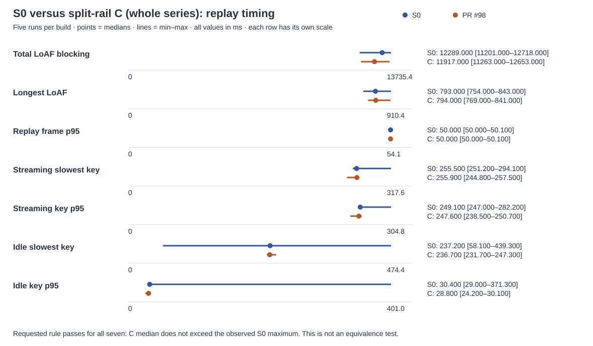

# Butter rail-split C: final live-lab comparison

**Replay: 7/7 metrics meet the requested no-worse rule.** Matrix: 35/35 per build. Branch ready: both widths per build. Initial C wash setup failed; matched repeat: 42/42 per build. The initial failure is retained below.

Pinned builds: S0 `4e6c25928ee3eb1b31a91533ce6490ce7ea0358e` (before the series), M `1bde0d28af4994b011bb96b3095d773f3d1db4f4` (A/B merged), C `5c6a6272a22175033092afa32cba000005c196cb` (PR #98). Replay compares S0 with C for the cumulative effect; functional suites compare M with C. These results qualify those immutable builds. Commands and actual redacted outputs are in [commands.md](commands.md).

## Method

Read lab/README.md, the host lab README (source of truth), docs/benchmarks.md and notes/runs/README.md. Fetched origin and created three fresh detached Snap-readable worktrees. Reused split-A’s replay adapter byte for byte and its frozen history/recording; reused split-B’s bookmark and branch setup. Dependencies link to the existing host Playwright installation. Private harness copies only change artifact destinations; no tracked extension or harness file was edited.

All acquisitions use --wait 1800 and the named fixture constraint. Replay, bookmark matrix and wash use the machine-wide perf lock; branch checks use the lab lock. Every lock window restores defaults before release, including harness failure paths. Only configured math12 and demo-en12 fixtures were used. Login expiration or a lock timeout stops work. No new real prompt was authorized or sent.

Replay uses 1440 × 1000 CSS pixels, light theme, fresh extension storage and granted layout consent. Five runs per build, strict S0 → C alternation, browser restart per run. Frozen nine-question history and 189 SSE chunks, original timing with thinking gaps capped at 1500 ms. Three 250 px wheel steps every 1500 ms alternate direction. Two ten-letter bursts at 120 ms spacing then Backspaces; idle typing is 54 letters at 80 ms spacing and cleared without sending. Local SSE/prepare responses, dual fetch write guards, lab send guard, blocked WebSockets and service-worker bypass protect against writes.

LoAF blocking sums blockingDuration; longest LoAF uses duration. Frame/LoAF samples are bounded by replay start/end. Streaming keys are letters/Backspace during replay; Enter is excluded. Key response is keydown to rAF plus setTimeout. Percentiles retain the original harness convention. For each lower-is-better metric, “no worse” means the C median is no higher than the S0 median or within S0’s observed range. This is an empirical acceptance rule, not a statistical equivalence test.

Bookmarks run the original matrix and wash suites, three empty and three bookmarked native-scrollbar drags. Branch-live attempts ready at 1280 and 800 px with only native new_branch permitted; message sends remain blocked. Every suite has HTTP conversation GET checks before/after, comparing all server user turns by count and SHA-256. Private message text and IDs are not exported.

Skipped jump-typing, jump-latency, nav-earlier-live and nav-settle as requested (baseline failures in #96). No product code or UI was changed.

## Replay: S0 versus C (whole series)

| Metric (ms) | S0 median [min–max] | C median [min–max] | No worse |
|---|---|---|---|
| Replay total LoAF blocking | 12289.000 [11201.000–12718.000] | 11917.000 [11263.000–12653.000] | PASS |
| Longest LoAF | 793.000 [754.000–843.000] | 794.000 [769.000–841.000] | PASS |
| Replay frame p95 | 50.000 [50.000–50.100] | 50.000 [50.000–50.100] | PASS |
| Streaming slowest key | 255.500 [251.200–294.100] | 255.900 [244.800–257.500] | PASS |
| Streaming key p95 | 249.100 [247.000–282.200] | 247.600 [238.500–250.700] | PASS |
| Idle slowest key | 237.200 [58.100–439.300] | 236.700 [231.700–247.300] | PASS |
| Idle key p95 | 30.400 [29.000–371.300] | 28.800 [24.200–30.100] | PASS |

| Order | Build | Rep | loafBlockMs | loafMaxMs | p95 | keyMax | keyP95 | idle.keyMax | idle.keyP95 |
|---|---|---|---|---|---|---|---|---|---|
| 1 | S0 | 1 | 12718.000 | 843.000 | 50.100 | 255.500 | 249.100 | 58.100 | 31.400 |
| 2 | C | 1 | 12381.000 | 817.000 | 50.100 | 257.100 | 250.700 | 247.300 | 24.200 |
| 3 | S0 | 2 | 12469.000 | 793.000 | 50.000 | 294.100 | 282.200 | 237.200 | 29.000 |
| 4 | C | 2 | 11917.000 | 781.000 | 50.000 | 255.900 | 249.700 | 236.700 | 29.500 |
| 5 | S0 | 3 | 12089.000 | 802.000 | 50.000 | 254.900 | 248.200 | 239.900 | 30.400 |
| 6 | C | 3 | 11532.000 | 841.000 | 50.000 | 253.800 | 247.600 | 232.800 | 28.800 |
| 7 | S0 | 4 | 12289.000 | 789.000 | 50.000 | 251.200 | 247.000 | 235.200 | 29.100 |
| 8 | C | 4 | 12653.000 | 769.000 | 50.100 | 244.800 | 238.500 | 237.300 | 26.000 |
| 9 | S0 | 5 | 11201.000 | 754.000 | 50.000 | 288.900 | 270.100 | 439.300 | 371.300 |
| 10 | C | 5 | 11263.000 | 794.000 | 50.000 | 257.500 | 242.000 | 231.700 | 30.100 |

All 10 final answer SHA-256 values: `043dc8afaf8d1e05e984597494a403589e3f38448954c6343e33689c4ff82e68`. Every sample completed all 189 chunks with zero completed ChatGPT writes. Nine completed samples survived a tool interruption. The unfinished final C attempt had no saved result; after server audit, restoration and release, only that slot was repeated under a new perf lock. No completed sample was discarded or replaced. Numeric results and per-run write counts are in [replay.json](data/replay.json).

Replay adapter SHA-256: `0249f58a22ce0c92703a198af7551849f31254ac938680ebe1061dc4b1235630`. Recording SHA-256: `36b773bf0733ff3f4df3856157834243bfdcf886af1fbc2f0600631d251ca05c`. Frozen history SHA-256: `359b4fe33317cb357e4f6646f3dc443dd6338241e53897039349c23fa239d345`. These match split-A. The safety helper changes only the private fixture directory.

## bookmarks-live matrix

| Build | Passed / total | Failure | Skipped |
|---|---|---|---|
| main | 35/35 | null | [] |
| pr | 35/35 | null | [] |

Ordered check names/results identical: **yes**. Cleanup identical: **yes**.

| Cleanup field | Main | PR |
|---|---|---|
| composerEmpty | True | True |
| defaultExtensions | True | True |
| labLockReleased | True | True |
| oneHomeTab | True | True |
| perfLockReleased | True | True |
| remainingAfterFallback | 0 | 0 |
| remainingBeforeFallback | 0 | 0 |
| restored | True | True |
| shortcutsRestored | True | True |

| # | Main check | Main | PR check | PR |
|---|---|---|---|---|
| 1 | real long fixture loaded | PASS | real long fixture loaded | PASS |
| 2 | held drag empty 1 | PASS | held drag empty 1 | PASS |
| 3 | held drag empty 2 | PASS | held drag empty 2 | PASS |
| 4 | held drag empty 3 | PASS | held drag empty 3 | PASS |
| 5 | live selection message ids match conversation API by SHA-256 | PASS | live selection message ids match conversation API by SHA-256 | PASS |
| 6 | the Bookmark cell is named Bookmark selection | PASS | the Bookmark cell is named Bookmark selection | PASS |
| 7 | paragraph button saves one bookmark | PASS | paragraph button saves one bookmark | PASS |
| 8 | selection saved through real Alt+Shift+M | PASS | selection saved through real Alt+Shift+M | PASS |
| 9 | held drag bookmarked 1 | PASS | held drag bookmarked 1 | PASS |
| 10 | held drag bookmarked 2 | PASS | held drag bookmarked 2 | PASS |
| 11 | held drag bookmarked 3 | PASS | held drag bookmarked 3 | PASS |
| 12 | matched drag comparison with bookmarks versus empty | PASS | matched drag comparison with bookmarks versus empty | PASS |
| 13 | selection card jump after drag lands on text | PASS | selection card jump after drag lands on text | PASS |
| 14 | paragraph jump requested during native drag lands on text | PASS | paragraph jump requested during native drag lands on text | PASS |
| 15 | reload before row click leaves earlier answer unloaded | PASS | reload before row click leaves earlier answer unloaded | PASS |
| 16 | earlier bookmarks sit under dots and not a loaded tick (row) | PASS | earlier bookmarks sit under dots and not a loaded tick (row) | PASS |
| 17 | hover earlier segment shows 2-bookmark card (row) | PASS | hover earlier segment shows 2-bookmark card (row) | PASS |
| 18 | row click loads earlier pages and lands on requested text | PASS | row click loads earlier pages and lands on requested text | PASS |
| 19 | segment moves from dots to loaded question after row click | PASS | segment moves from dots to loaded question after row click | PASS |
| 20 | reload before keyboard click leaves earlier answer unloaded | PASS | reload before keyboard click leaves earlier answer unloaded | PASS |
| 21 | earlier bookmarks sit under dots and not a loaded tick (keyboard) | PASS | earlier bookmarks sit under dots and not a loaded tick (keyboard) | PASS |
| 22 | hover earlier segment shows 2-bookmark card (keyboard) | PASS | hover earlier segment shows 2-bookmark card (keyboard) | PASS |
| 23 | keyboard click loads earlier pages and lands on requested text | PASS | keyboard click loads earlier pages and lands on requested text | PASS |
| 24 | segment moves from dots to loaded question after keyboard click | PASS | segment moves from dots to loaded question after keyboard click | PASS |
| 25 | reload resolves both bookmarks live without answer changed | PASS | reload resolves both bookmarks live without answer changed | PASS |
| 26 | card delete removes selection bookmark | PASS | card delete removes selection bookmark | PASS |
| 27 | earlier bookmarks sit under dots and not a loaded tick (single) | PASS | earlier bookmarks sit under dots and not a loaded tick (single) | PASS |
| 28 | hover earlier segment shows 1-bookmark card (single) | PASS | hover earlier segment shows 1-bookmark card (single) | PASS |
| 29 | card delete removes both test bookmarks | PASS | card delete removes both test bookmarks | PASS |
| 30 | real fixture has a later top-level list item for distinct landing | PASS | real fixture has a later top-level list item for distinct landing | PASS |
| 31 | list item: the Bookmark cell is named Bookmark selection | PASS | list item: the Bookmark cell is named Bookmark selection | PASS |
| 32 | list item button saves its individual paragraph with ask and line | PASS | list item button saves its individual paragraph with ask and line | PASS |
| 33 | list item jump lands on the item instead of the list start | PASS | list item jump lands on the item instead of the list start | PASS |
| 34 | list item resolves live and lands on the same item after reload | PASS | list item resolves live and lands on the same item after reload | PASS |
| 35 | card delete removes list item test bookmark | PASS | card delete removes list item test bookmark | PASS |

### Held-drag probe

| Build | Arm | Rep | Held | Mounts | Added nodes | Updates | Reads | Messages | Bookmark scripts | Bookmark function calls | Critical bookmark work |
|---|---|---|---|---|---|---|---|---|---|---|---|
| main | empty | 1 | True | 0 | 0 | 31 | 0 | 0 | 2 | 124 | 0 |
| main | empty | 2 | True | 0 | 0 | 32 | 0 | 0 | 2 | 128 | 0 |
| main | empty | 3 | True | 0 | 0 | 32 | 0 | 0 | 2 | 128 | 0 |
| main | bookmarked | 1 | True | 0 | 0 | 32 | 0 | 0 | 2 | 128 | 0 |
| main | bookmarked | 2 | True | 0 | 0 | 31 | 0 | 0 | 2 | 124 | 0 |
| main | bookmarked | 3 | True | 0 | 0 | 32 | 0 | 0 | 2 | 128 | 0 |
| pr | empty | 1 | True | 0 | 0 | 32 | 0 | 0 | 2 | 128 | 0 |
| pr | empty | 2 | True | 0 | 0 | 32 | 0 | 0 | 2 | 128 | 0 |
| pr | empty | 3 | True | 0 | 0 | 33 | 0 | 0 | 2 | 132 | 0 |
| pr | bookmarked | 1 | True | 0 | 0 | 32 | 0 | 0 | 2 | 128 | 0 |
| pr | bookmarked | 2 | True | 0 | 0 | 32 | 0 | 0 | 2 | 128 | 0 |
| pr | bookmarked | 3 | True | 0 | 0 | 33 | 0 | 0 | 2 | 132 | 0 |

Critical bookmark work comprises refresh, paragraphs, measure, selection, topBlock, locate, create, remove, show and place. The per-function counts and frame observations are retained in the numeric JSON. Frame numbers are observations under the matrix perf lock, not a timing-equivalence claim.

### Jump probe calls

The probe records coverage after selected jumps, separately from the held-drag interval above. Both builds use the same unchanged probe and aggregate rail/rail.js and rail/jump.js functions under the rail label. It records locate, jump, jumpTo, earlierJump, landOff, targetTop and glide; absent entries are not zero-filled.

| Jump label | Function | Main calls | PR calls |
|---|---|---|---|
| after-drag | bookmark.locate | 26 | 25 |
| after-drag | rail.jump | 6 | 6 |
| after-drag | rail.jumpTo | 1 | 1 |
| after-drag | rail.landOff | 26 | 25 |
| after-drag | rail.targetTop | 7 | 7 |
| during-drag | rail.jump | 6 | 6 |
| during-drag | rail.landOff | 45 | 45 |
| during-drag | rail.targetTop | 9 | 9 |
| unloaded-keyboard | bookmark.locate | 19 | 17 |
| unloaded-keyboard | rail.earlierJump | 1 | 1 |
| unloaded-keyboard | rail.jump | 1 | 1 |
| unloaded-keyboard | rail.jumpTo | 1 | 1 |
| unloaded-keyboard | rail.landOff | 19 | 17 |
| unloaded-keyboard | rail.targetTop | 5 | 5 |
| unloaded-row | bookmark.locate | 19 | 20 |
| unloaded-row | rail.earlierJump | 1 | 1 |
| unloaded-row | rail.jump | 1 | 1 |
| unloaded-row | rail.jumpTo | 1 | 1 |
| unloaded-row | rail.landOff | 19 | 20 |
| unloaded-row | rail.targetTop | 5 | 5 |

## bookmarks-live wash

| Build | Passed / total | Failure | Skipped |
|---|---|---|---|
| main | 42/42 | null | [] |
| pr | 5/6 | {"phase":"wash-bookmark","kind":"Error"} | ["wash-light-paragraph: needs 3 stored test bookmarks, has 0","wash-light-selection: needs 3 stored test bookmarks, has 0","wash-light-table: needs 3 stored test bookmarks, has 0","wash-dark-paragraph: needs 3 stored test bookmarks, has 0","wash-dark-selection: needs 3 stored test bookmarks, has 0","wash-dark-table: needs 3 stored test bookmarks, has 0"] |

Ordered check names/results identical: **no**. Cleanup identical: **no**.

| Cleanup field | Main | PR |
|---|---|---|
| composerEmpty | True | True |
| defaultExtensions | True | True |
| labLockReleased | True | True |
| oneHomeTab | True | True |
| perfLockReleased | True | True |
| remainingAfterFallback | 0 | 0 |
| remainingBeforeFallback | 3 | 0 |
| restored | True | True |

| # | Main check | Main | PR check | PR |
|---|---|---|---|---|
| 1 | wash light: ChatGPT shows its light theme | PASS | wash light: ChatGPT shows its light theme | PASS |
| 2 | wash light: the whole chat loads through the earlier-history dots | PASS | wash light: the whole chat loads through the earlier-history dots | PASS |
| 3 | wash: a mounted answer holds two long paragraphs and a table | PASS | wash: a mounted answer holds two long paragraphs and a table | PASS |
| 4 | wash: the Bookmark cell bookmarks the paragraph | PASS | wash dark: ChatGPT shows its dark theme | PASS |
| 5 | wash: the Bookmark cell bookmarks the selection | PASS | wash dark: the whole chat loads through the earlier-history dots | PASS |
| 6 | wash: the Bookmark cell bookmarks the table | PASS | — (not reached) | not reached |
| 7 | wash light: a paragraph is washed on its own lines | PASS | — (not reached) | not reached |
| 8 | wash light: a paragraph: Butter's layer, multiplied, in the wash colour, no pointer events, no bubble flash | PASS | — (not reached) | not reached |
| 9 | wash light: a paragraph: the text keeps its colour under the wash | PASS | — (not reached) | not reached |
| 10 | wash light: a paragraph: scrolled 74 px during the hold, the boxes follow the text | PASS | — (not reached) | not reached |
| 11 | wash light: a paragraph: with the washed text under ChatGPT's header, the wash reaches the header and no butter shows on it | PASS | — (not reached) | not reached |
| 12 | wash light: a paragraph: gone after the hold and fade | PASS | — (not reached) | not reached |
| 13 | wash light: a selection is washed on its own lines | PASS | — (not reached) | not reached |
| 14 | wash light: a selection: Butter's layer, multiplied, in the wash colour, no pointer events, no bubble flash | PASS | — (not reached) | not reached |
| 15 | wash light: a selection: the text keeps its colour under the wash | PASS | — (not reached) | not reached |
| 16 | wash light: a selection: scrolled -680 px during the hold, the boxes follow the text | PASS | — (not reached) | not reached |
| 17 | wash light: a selection: with the washed text under ChatGPT's composer, the wash reaches the composer and no butter shows on it | PASS | — (not reached) | not reached |
| 18 | wash light: a selection: gone after the hold and fade | PASS | — (not reached) | not reached |
| 19 | wash light: a table is washed on its own lines (one box 3 px around the table) | PASS | — (not reached) | not reached |
| 20 | wash light: a table: Butter's layer, multiplied, in the wash colour, no pointer events, no bubble flash | PASS | — (not reached) | not reached |
| 21 | wash light: a table: the text keeps its colour under the wash | PASS | — (not reached) | not reached |
| 22 | wash light: a table: scrolled 80 px during the hold, the boxes follow the text | PASS | — (not reached) | not reached |
| 23 | wash light: a table: gone after the hold and fade | PASS | — (not reached) | not reached |
| 24 | wash dark: ChatGPT shows its dark theme | PASS | — (not reached) | not reached |
| 25 | wash dark: the whole chat loads through the earlier-history dots | PASS | — (not reached) | not reached |
| 26 | wash dark: a paragraph is washed on its own lines | PASS | — (not reached) | not reached |
| 27 | wash dark: a paragraph: Butter's layer, lightened, in the wash colour, no pointer events, no bubble flash | PASS | — (not reached) | not reached |
| 28 | wash dark: a paragraph: the text keeps its colour under the wash | PASS | — (not reached) | not reached |
| 29 | wash dark: a paragraph: scrolled 74 px during the hold, the boxes follow the text | PASS | — (not reached) | not reached |
| 30 | wash dark: a paragraph: with the washed text under ChatGPT's header, the wash reaches the header and no butter shows on it | PASS | — (not reached) | not reached |
| 31 | wash dark: a paragraph: gone after the hold and fade | PASS | — (not reached) | not reached |
| 32 | wash dark: a selection is washed on its own lines | PASS | — (not reached) | not reached |
| 33 | wash dark: a selection: Butter's layer, lightened, in the wash colour, no pointer events, no bubble flash | PASS | — (not reached) | not reached |
| 34 | wash dark: a selection: the text keeps its colour under the wash | PASS | — (not reached) | not reached |
| 35 | wash dark: a selection: scrolled -680 px during the hold, the boxes follow the text | PASS | — (not reached) | not reached |
| 36 | wash dark: a selection: with the washed text under ChatGPT's composer, the wash reaches the composer and no butter shows on it | PASS | — (not reached) | not reached |
| 37 | wash dark: a selection: gone after the hold and fade | PASS | — (not reached) | not reached |
| 38 | wash dark: a table is washed on its own lines (one box 3 px around the table) | PASS | — (not reached) | not reached |
| 39 | wash dark: a table: Butter's layer, lightened, in the wash colour, no pointer events, no bubble flash | PASS | — (not reached) | not reached |
| 40 | wash dark: a table: the text keeps its colour under the wash | PASS | — (not reached) | not reached |
| 41 | wash dark: a table: scrolled 80 px during the hold, the boxes follow the text | PASS | — (not reached) | not reached |
| 42 | wash dark: a table: gone after the hold and fade | PASS | — (not reached) | not reached |

## bookmarks-live wash-repeat

| Build | Passed / total | Failure | Skipped |
|---|---|---|---|
| main | 42/42 | null | [] |
| pr | 42/42 | null | [] |

Ordered check names/results identical: **yes**. Cleanup identical: **yes**.

| Cleanup field | Main | PR |
|---|---|---|
| composerEmpty | True | True |
| defaultExtensions | True | True |
| labLockReleased | True | True |
| oneHomeTab | True | True |
| perfLockReleased | True | True |
| remainingAfterFallback | 0 | 0 |
| remainingBeforeFallback | 3 | 3 |
| restored | True | True |

| # | Main check | Main | PR check | PR |
|---|---|---|---|---|
| 1 | wash light: ChatGPT shows its light theme | PASS | wash light: ChatGPT shows its light theme | PASS |
| 2 | wash light: the whole chat loads through the earlier-history dots | PASS | wash light: the whole chat loads through the earlier-history dots | PASS |
| 3 | wash: a mounted answer holds two long paragraphs and a table | PASS | wash: a mounted answer holds two long paragraphs and a table | PASS |
| 4 | wash: the Bookmark cell bookmarks the paragraph | PASS | wash: the Bookmark cell bookmarks the paragraph | PASS |
| 5 | wash: the Bookmark cell bookmarks the selection | PASS | wash: the Bookmark cell bookmarks the selection | PASS |
| 6 | wash: the Bookmark cell bookmarks the table | PASS | wash: the Bookmark cell bookmarks the table | PASS |
| 7 | wash light: a paragraph is washed on its own lines | PASS | wash light: a paragraph is washed on its own lines | PASS |
| 8 | wash light: a paragraph: Butter's layer, multiplied, in the wash colour, no pointer events, no bubble flash | PASS | wash light: a paragraph: Butter's layer, multiplied, in the wash colour, no pointer events, no bubble flash | PASS |
| 9 | wash light: a paragraph: the text keeps its colour under the wash | PASS | wash light: a paragraph: the text keeps its colour under the wash | PASS |
| 10 | wash light: a paragraph: scrolled 74 px during the hold, the boxes follow the text | PASS | wash light: a paragraph: scrolled 74 px during the hold, the boxes follow the text | PASS |
| 11 | wash light: a paragraph: with the washed text under ChatGPT's header, the wash reaches the header and no butter shows on it | PASS | wash light: a paragraph: with the washed text under ChatGPT's header, the wash reaches the header and no butter shows on it | PASS |
| 12 | wash light: a paragraph: gone after the hold and fade | PASS | wash light: a paragraph: gone after the hold and fade | PASS |
| 13 | wash light: a selection is washed on its own lines | PASS | wash light: a selection is washed on its own lines | PASS |
| 14 | wash light: a selection: Butter's layer, multiplied, in the wash colour, no pointer events, no bubble flash | PASS | wash light: a selection: Butter's layer, multiplied, in the wash colour, no pointer events, no bubble flash | PASS |
| 15 | wash light: a selection: the text keeps its colour under the wash | PASS | wash light: a selection: the text keeps its colour under the wash | PASS |
| 16 | wash light: a selection: scrolled -680 px during the hold, the boxes follow the text | PASS | wash light: a selection: scrolled -680 px during the hold, the boxes follow the text | PASS |
| 17 | wash light: a selection: with the washed text under ChatGPT's composer, the wash reaches the composer and no butter shows on it | PASS | wash light: a selection: with the washed text under ChatGPT's composer, the wash reaches the composer and no butter shows on it | PASS |
| 18 | wash light: a selection: gone after the hold and fade | PASS | wash light: a selection: gone after the hold and fade | PASS |
| 19 | wash light: a table is washed on its own lines (one box 3 px around the table) | PASS | wash light: a table is washed on its own lines (one box 3 px around the table) | PASS |
| 20 | wash light: a table: Butter's layer, multiplied, in the wash colour, no pointer events, no bubble flash | PASS | wash light: a table: Butter's layer, multiplied, in the wash colour, no pointer events, no bubble flash | PASS |
| 21 | wash light: a table: the text keeps its colour under the wash | PASS | wash light: a table: the text keeps its colour under the wash | PASS |
| 22 | wash light: a table: scrolled 80 px during the hold, the boxes follow the text | PASS | wash light: a table: scrolled 80 px during the hold, the boxes follow the text | PASS |
| 23 | wash light: a table: gone after the hold and fade | PASS | wash light: a table: gone after the hold and fade | PASS |
| 24 | wash dark: ChatGPT shows its dark theme | PASS | wash dark: ChatGPT shows its dark theme | PASS |
| 25 | wash dark: the whole chat loads through the earlier-history dots | PASS | wash dark: the whole chat loads through the earlier-history dots | PASS |
| 26 | wash dark: a paragraph is washed on its own lines | PASS | wash dark: a paragraph is washed on its own lines | PASS |
| 27 | wash dark: a paragraph: Butter's layer, lightened, in the wash colour, no pointer events, no bubble flash | PASS | wash dark: a paragraph: Butter's layer, lightened, in the wash colour, no pointer events, no bubble flash | PASS |
| 28 | wash dark: a paragraph: the text keeps its colour under the wash | PASS | wash dark: a paragraph: the text keeps its colour under the wash | PASS |
| 29 | wash dark: a paragraph: scrolled 74 px during the hold, the boxes follow the text | PASS | wash dark: a paragraph: scrolled 74 px during the hold, the boxes follow the text | PASS |
| 30 | wash dark: a paragraph: with the washed text under ChatGPT's header, the wash reaches the header and no butter shows on it | PASS | wash dark: a paragraph: with the washed text under ChatGPT's header, the wash reaches the header and no butter shows on it | PASS |
| 31 | wash dark: a paragraph: gone after the hold and fade | PASS | wash dark: a paragraph: gone after the hold and fade | PASS |
| 32 | wash dark: a selection is washed on its own lines | PASS | wash dark: a selection is washed on its own lines | PASS |
| 33 | wash dark: a selection: Butter's layer, lightened, in the wash colour, no pointer events, no bubble flash | PASS | wash dark: a selection: Butter's layer, lightened, in the wash colour, no pointer events, no bubble flash | PASS |
| 34 | wash dark: a selection: the text keeps its colour under the wash | PASS | wash dark: a selection: the text keeps its colour under the wash | PASS |
| 35 | wash dark: a selection: scrolled -680 px during the hold, the boxes follow the text | PASS | wash dark: a selection: scrolled -680 px during the hold, the boxes follow the text | PASS |
| 36 | wash dark: a selection: with the washed text under ChatGPT's composer, the wash reaches the composer and no butter shows on it | PASS | wash dark: a selection: with the washed text under ChatGPT's composer, the wash reaches the composer and no butter shows on it | PASS |
| 37 | wash dark: a selection: gone after the hold and fade | PASS | wash dark: a selection: gone after the hold and fade | PASS |
| 38 | wash dark: a table is washed on its own lines (one box 3 px around the table) | PASS | wash dark: a table is washed on its own lines (one box 3 px around the table) | PASS |
| 39 | wash dark: a table: Butter's layer, lightened, in the wash colour, no pointer events, no bubble flash | PASS | wash dark: a table: Butter's layer, lightened, in the wash colour, no pointer events, no bubble flash | PASS |
| 40 | wash dark: a table: the text keeps its colour under the wash | PASS | wash dark: a table: the text keeps its colour under the wash | PASS |
| 41 | wash dark: a table: scrolled 80 px during the hold, the boxes follow the text | PASS | wash dark: a table: scrolled 80 px during the hold, the boxes follow the text | PASS |
| 42 | wash dark: a table: gone after the hold and fade | PASS | wash dark: a table: gone after the hold and fade | PASS |

## Branch ready and pill

The original two-width harness was run on each build. Completed widths, command exits and timeout errors are retained below; failed widths are not zero-filled.

| Build | Width (px) | End | Gap (px) | Top delta (px) | Original unchanged | Distinct destination | Latest reply matched | Send blocked |
|---|---|---|---|---|---|---|---|---|
| main | 1280 | ready | 4 | 0 | True | True | True | True |
| main | 800 | ready | 4 | 0 | True | True | True | True |
| pr | 1280 | ready | 4 | 0 | True | True | True | True |
| pr | 800 | ready | 4 | 0 | True | True | True | True |

Pill fields identical at all completed widths: **yes**. Fields include gap, vertical delta and both native/Butter computed height, radius, background and shadow. See the recorded attempts for 800 px readiness and any shared baseline failure.

| Build | Width | Native style | Butter style |
|---|---|---|---|
| main | 1280 | 30px \| 8px \| rgb(48, 48, 48) \| rgba(0, 0, 0, 0) 0px 0px 0px 0px, rgba(0, 0, 0, 0) 0px 0px 0px 0px, rgba(0, 0, 0, 0) 0px 0px 0px 0px, rgba(0, 0, 0, 0) 0px 0px 0px 0px, rgba(0, 0, 0, 0.1) 0px 4px 8px -2px | 30px \| 8px \| rgb(48, 48, 48) \| rgba(0, 0, 0, 0) 0px 0px 0px 0px, rgba(0, 0, 0, 0) 0px 0px 0px 0px, rgba(0, 0, 0, 0) 0px 0px 0px 0px, rgba(0, 0, 0, 0) 0px 0px 0px 0px, rgba(0, 0, 0, 0.1) 0px 4px 8px -2px |
| main | 800 | 30px \| 8px \| rgb(48, 48, 48) \| rgba(0, 0, 0, 0) 0px 0px 0px 0px, rgba(0, 0, 0, 0) 0px 0px 0px 0px, rgba(0, 0, 0, 0) 0px 0px 0px 0px, rgba(0, 0, 0, 0) 0px 0px 0px 0px, rgba(0, 0, 0, 0.1) 0px 4px 8px -2px | 30px \| 8px \| rgb(48, 48, 48) \| rgba(0, 0, 0, 0) 0px 0px 0px 0px, rgba(0, 0, 0, 0) 0px 0px 0px 0px, rgba(0, 0, 0, 0) 0px 0px 0px 0px, rgba(0, 0, 0, 0) 0px 0px 0px 0px, rgba(0, 0, 0, 0.1) 0px 4px 8px -2px |
| pr | 1280 | 30px \| 8px \| rgb(48, 48, 48) \| rgba(0, 0, 0, 0) 0px 0px 0px 0px, rgba(0, 0, 0, 0) 0px 0px 0px 0px, rgba(0, 0, 0, 0) 0px 0px 0px 0px, rgba(0, 0, 0, 0) 0px 0px 0px 0px, rgba(0, 0, 0, 0.1) 0px 4px 8px -2px | 30px \| 8px \| rgb(48, 48, 48) \| rgba(0, 0, 0, 0) 0px 0px 0px 0px, rgba(0, 0, 0, 0) 0px 0px 0px 0px, rgba(0, 0, 0, 0) 0px 0px 0px 0px, rgba(0, 0, 0, 0) 0px 0px 0px 0px, rgba(0, 0, 0, 0.1) 0px 4px 8px -2px |
| pr | 800 | 30px \| 8px \| rgb(48, 48, 48) \| rgba(0, 0, 0, 0) 0px 0px 0px 0px, rgba(0, 0, 0, 0) 0px 0px 0px 0px, rgba(0, 0, 0, 0) 0px 0px 0px 0px, rgba(0, 0, 0, 0) 0px 0px 0px 0px, rgba(0, 0, 0, 0.1) 0px 4px 8px -2px | 30px \| 8px \| rgb(48, 48, 48) \| rgba(0, 0, 0, 0) 0px 0px 0px 0px, rgba(0, 0, 0, 0) 0px 0px 0px 0px, rgba(0, 0, 0, 0) 0px 0px 0px 0px, rgba(0, 0, 0, 0) 0px 0px 0px 0px, rgba(0, 0, 0, 0.1) 0px 4px 8px -2px |

## Server checks and cleanup

| Suite | Before HTTP | After HTTP | Before users | After users | Fingerprint unchanged |
|---|---|---|---|---|---|
| bench-main-1 | 200 | 200 | 16 | 16 | True |
| bench-main-2 | 200 | 200 | 16 | 16 | True |
| bench-main-3 | 200 | 200 | 16 | 16 | True |
| bench-main-4 | 200 | 200 | 16 | 16 | True |
| bench-main-5 | 200 | 200 | 16 | 16 | True |
| bench-pr-1 | 200 | 200 | 16 | 16 | True |
| bench-pr-2 | 200 | 200 | 16 | 16 | True |
| bench-pr-3 | 200 | 200 | 16 | 16 | True |
| bench-pr-4 | 200 | 200 | 16 | 16 | True |
| bench-pr-5 | 200 | 200 | 16 | 16 | True |
| bench-pr-5-resume | 200 | 200 | 16 | 16 | True |
| branch-main | 200 | 200 | 16 | 16 | True |
| branch-pr | 200 | 200 | 16 | 16 | True |
| matrix-main | 200 | 200 | 16 | 16 | True |
| matrix-pr | 200 | 200 | 16 | 16 | True |
| wash-main | 200 | 200 | 12 | 12 | True |
| wash-pr | 200 | 200 | 12 | 12 | True |
| wash-repeat-main | 200 | 200 | 12 | 12 | True |
| wash-repeat-pr | 200 | 200 | 12 | 12 | True |

Full server user-turn fingerprints are in [server-checks.json](data/server-checks.json). These are fingerprints of the server’s user-message set, not captured prompt text. Raw branch screenshots, titles, content fingerprints and private endpoints remain outside this report.

## Command exits

| Stage | Exit | Seconds |
|---|---|---|
| bench-acquire | 0 | 0.064 |
| bench-restart-main-1 | 0 | 2.071 |
| bench-main-1-before | 0 | 1.968 |
| bench-main-1 | 0 | 157.401 |
| bench-main-1-after | 0 | 1.718 |
| bench-restart-pr-1 | 0 | 2.071 |
| bench-pr-1-before | 0 | 1.316 |
| bench-pr-1 | 0 | 157.517 |
| bench-pr-1-after | 0 | 1.768 |
| bench-restart-main-2 | 0 | 2.072 |
| bench-main-2-before | 0 | 1.417 |
| bench-main-2 | 0 | 157.649 |
| bench-main-2-after | 0 | 2.621 |
| bench-restart-pr-2 | 0 | 2.071 |
| bench-pr-2-before | 0 | 6.735 |
| bench-pr-2 | 0 | 157.714 |
| bench-pr-2-after | 0 | 2.119 |
| bench-restart-main-3 | 0 | 2.074 |
| bench-main-3-before | 0 | 1.467 |
| bench-main-3 | 0 | 157.408 |
| bench-main-3-after | 0 | 1.818 |
| bench-restart-pr-3 | 0 | 2.073 |
| bench-pr-3-before | 0 | 1.667 |
| bench-pr-3 | 0 | 157.565 |
| bench-pr-3-after | 0 | 2.873 |
| bench-restart-main-4 | 0 | 2.072 |
| bench-main-4-before | 0 | 1.517 |
| bench-main-4 | 0 | 157.003 |
| bench-main-4-after | 0 | 1.768 |
| bench-restart-pr-4 | 0 | 2.072 |
| bench-pr-4-before | 0 | 1.366 |
| bench-pr-4 | 0 | 156.855 |
| bench-pr-4-after | 0 | 4.982 |
| bench-restart-main-5 | 0 | 2.073 |
| bench-main-5-before | 0 | 1.567 |
| bench-main-5 | 0 | 154.907 |
| bench-main-5-after | 0 | 1.918 |
| bench-restart-pr-5 | 0 | 2.072 |
| bench-pr-5-before | 0 | 1.366 |
| bench-pr-5-after | 0 | 1.767 |
| interruption-restore | 0 | 10.283 |
| interruption-release | 0 | 0.064 |
| resume-acquire | 0 | 0.064 |
| resume-restart | 0 | 2.07 |
| bench-pr-5-resume-before | 0 | 1.366 |
| bench-pr-5-resume | 0 | 157.21 |
| bench-pr-5-resume-after | 0 | 1.718 |
| bench-restore | 0 | 10.288 |
| bench-release | 0 | 0.064 |
| matrix-main | 0 | 286.481 |
| wash-main | 0 | 127.038 |
| matrix-pr | 0 | 287.667 |
| wash-pr | 1 | 77.09 |
| live-acquire | 0 | 0.064 |
| live-restart-main | 0 | 2.069 |
| branch-main-before | 0 | 1.517 |
| branch-live-main | 0 | 41.151 |
| branch-main-after | 0 | 1.418 |
| live-restart-pr | 0 | 2.072 |
| branch-pr-before | 0 | 1.416 |
| branch-live-pr | 0 | 41.363 |
| branch-pr-after | 0 | 1.418 |
| live-restore | 0 | 9.737 |
| live-release | 0 | 0.114 |
| final-lock-status | 0 | 0.064 |
| wash-repeat-main | 0 | 130.389 |
| wash-repeat-pr | 0 | 127.493 |
| repeat-final-lock-status | 0 | 0.064 |

## Findings and limits

Replay meets the requested no-worse rule for all seven metrics. Longest-LoAF and streaming-slowest-key C medians are slightly higher than S0 medians, but within S0’s observed ranges. Timing variation and the five-sample empirical rule do not establish statistical equivalence. The high S0 idle sample is retained. The last C repetition resumed after an interruption; all nine earlier completed samples were retained.

The bookmark matrix passes 35/35 on each build with identical ordered check names/results and cleanup. Six held drags per build have held=true, zero turn mounts, added nodes, storage reads/messages and critical bookmark work, with both bookmark coverage scripts present. Callback counts and seek updates are observations, not a timing-equivalence gate.

M held-drag bookmark callbacks: [124, 128, 128, 128, 124, 128], seek updates: [31, 32, 32, 32, 31, 32].
C held-drag bookmark callbacks: [128, 128, 132, 128, 128, 132], seek updates: [32, 32, 33, 32, 32, 33].

The initial wash differs: M passed 42/42; C passed five setup/theme checks then threw “paragraph target unmounted” at wash-bookmark, before creating a bookmark (terminal total 5/6). Six dependent wash scenarios were skipped. Initial ordered results and cleanup are not identical: M had three bookmarks before fallback, C had zero; both ended with zero and restored/released successfully. A matched fresh repeat on both unchanged pinned builds passed 42/42 with identical ordered checks and cleanup (three before fallback, zero after). The failure did not recur. Its cause is not established; the passing repeat does not erase the initial C-only failure. Wash covers paragraph, selection and table targets in light/dark themes; this fixture has no code-block wash case.

Both branch commands exited 0. M and C reached ready at both 1280 and 800 px, with identical pill fields (4 px gap, 0 px vertical delta). Every completed width verified a distinct destination, latest-reply equality, unchanged original tab, one send click only in the branch and blocked send requests. The 800 px timeout seen in split-B did not recur. Destination identities are classified local by the harness; no real prompt was sent.

Jump-probe call counts vary on some repeated landing/pin lookups; the full values are retained above and in the matrix JSON. Both builds use the same probe. No held-drag safety count or landing pass/fail differs, and these single live samples do not establish the cause of callback-count variation.

All 19 before/after server comparisons match (38 HTTP 200 checks, including interrupted/resumed replay windows): math12 has 16 server user turns; demo-en12 has 12. No new real user message was sent. Every lock window ended with lab-restore then release; final status shows both labs and the perf lock free. All three measured extension trees still match their pinned Git bytes, with zero tracked changes. Raw captures and screenshots remain private.

## Publication scope

Initial fetch: the PR branch was still at the requested C build, `5c6a6272a22175033092afa32cba000005c196cb`. It advanced during the lab runs. A fresh fetch before creating the separate publication worktree found `ce7454c0b6ce9277ac8b214a1e268a147520398a`. Measurements remained pinned to the requested C commit. The later commit and the report publication commit were not measured. Only `notes/runs/2026-11-12-rail-split-c-live/` is committed from the separate worktree on `t3/split-rail-c`. This test report does not replace the implementation PR's gate review.

## Report validation

The verifier recomputed replay ordering and all seven verdicts, matrix/repeated-wash counts and ordered cleanup equality, held-drag safety, branch identity/send protection and pill equality at both widths, all 38 server checks, and the retained initial C wash failure. JSON parses. Privacy scanning found zero matches across 120 private tokens/titles/content fingerprints and four identifier/endpoint patterns. Only Markdown, numeric JSON and SVG are exported. All measured extension files match Git bytes. `git diff --cached --check` passed; this report-only addition is review tier 0.
