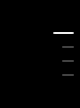
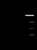
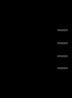
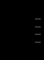
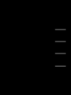
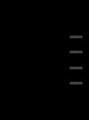
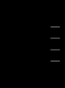

# Rail tick rendering — diagnosis and fix (#115)

**What shipped is in [Step 3](#step-3--green): each bar is nudged in layout onto a safe device-pixel phase, with a unit test.** The Findings and Steps 1–2 below are the diagnosis as it was written before the fix, on `91fc048`; they are kept as the record. Where they say no product code was changed, that no unit assertion or Green fix was made, or propose `will-change: transform` on `.bar` as the smallest fix, that was the state then: Step 3 measured that proposal and rejected it. The line numbers in their links to `extension/rail/` are `91fc048`'s.

Baseline: `91fc048` (`main`), manifest `0.1.0-alpha.21`. The reported Windows build was `0.1.0-alpha.21+dev.3`; that packaged build was not available for execution. Local branch: `fix/rail-tick-thin`. No product code, settings defaults, shared lab configuration/profile, issue, PR, release or version was changed. Nothing was pushed.

## Findings

1. **Yes, rest ticks can differ substantially at fractional scales.** Real Chrome zoom reproduced the approximately half-bright third tick at 90%: grayscale sums **1,242 / 634 / 1,242** for rest ticks 2–4, a **49.0%** deficit. At 110%, 125% and 175% real zoom the differences were 32.2%, 32.2% and 24.1%. At 100% and 150% real zoom they were equal. Device-scale emulation behaved differently: only 1.1 exceeded the 10% threshold; 0.9 had a small 3.4% spread. At scale 1 all rest ticks matched, with identical two-row, 12-pixel-long drawing and brightness 1,516. These are the tested scales and fixture geometry, not an exhaustive map of every scale/phase.
2. **The failure is position-dependent painting/rasterization, with equal state.** It remains with identity transforms, equal opacity, no animation, and even `transform:none`. At 90% zoom, moving only the ticks' layout down 2 CSS pixels changes all four equal-state sums from `1242,1242,634,1242` to `1242,1242,1242,1242`. The browser's logical rectangles retain equal dimensions. Their rasterized strokes do not. The inline hover-wave scale is not shrinking the third tick.
3. **Smallest supported fix proposal: add `will-change: transform` to `.bar` in `extension/rail/style.js`.** This fixture-only probe removes the large inequality at every tested scale, without changing the scale-1 bitmap at all. It gives each tick its own compositing/rasterization opportunity rather than relying only on the rail's layer. This is a proposal, not a product edit. Across the tested real-zoom values, all four equal-state sums become exactly equal; device-scale emulation retains at most 2.1% residual antialiasing/rounding variation. No finite matrix proves equality at every possible scale, geometry, browser or GPU. The proposal targets perceptually alike rest ticks, not byte-identical pixels at different subpixel phases. Layer count/memory and hover performance with a long rail require validation before shipping.

## Step 1 — Control

The external lab README was read. One `lab status` call returned `xvfb: stopped`, `chromium: stopped`, `x11vnc: stopped`, `novnc: stopped`. `ls -l /snap/bin/chromium` exited 2: `No such file or directory`. No lab start, lock, configuration or profile operation was attempted. The live lab did **not** reproduce this bug because it could not run.

The independent control used Playwright 1.65.0, headed Chromium **158.0.8127.18** under `xvfb-run -a` on Linux/WSL. Every browser used a new temporary profile, removed in `finally`. Four artificial questions and answers occupy a synthetic conversation; the first question is in the lit band. Navigation is fulfilled with that fixed HTML, and every other routed request is aborted. There is no login, live ChatGPT conversation, API response, user message or captured DOM. The unpacked extension is loaded directly from this worktree, using the earlier run's successful page structure and `butter-nav` fixture event.

Without the extension, all six device-scale controls have **zero Butter hosts and zero grayscale brightness** in the equivalent right-hand crop. With Butter, four real `.tick > .bar` nodes are drawn and the bug reproduces. This establishes Butter's own drawing as the source in the synthetic control; it does not establish the state of the user's live page.

`device` means Playwright `deviceScaleFactor` at normal browser zoom. `zoom` means actual Chrome per-tab browser zoom set by `chrome.tabs.setZoom` in the unpacked extension's worker, with `deviceScaleFactor:1`. The requested scale is checked against `devicePixelRatio`; `visualViewport.scale` stays 1. This is neither CSS zoom nor CDP pinch/page-scale emulation. Real-zoom no-extension arms are explicitly skipped because there is no extension worker to set arbitrary tab zoom; the six extension-free controls use device-scale emulation. Equal-state controls cover **both** full scale matrices.

The pointer stays at `(10,10)`, away from the rail. The harness waits for ticks 2–4 to settle to inline `scale(1, 1)` and opacity `0.28`, then waits out the rail's fade. Every crop is taken at device resolution. Because real zoom makes Playwright's screenshot-clip coordinates differ from DOM CSS coordinates, the final harness captures the viewport bitmap and crops it in device pixels. Full viewport captures are not retained.

### Independent attachment measurement

The supplied PNG was decoded only as image data with `ffmpeg` to raw grayscale and piped to `python3 -I`. The original image, its path and derived private frames are not copied into these artifacts. The initial measurement command had a Python parenthesis syntax error; the corrected command produced:

| Tick | Rows with pixels above 25 | Length | Row peaks | All grayscale brightness in its isolated band |
| --- | --- | --- | --- | --- |
| 1, active | 31–33 | 20 | 94, 236, 142 | 8751 |
| 2 | 44–46 | 10 | 26, 66, 40 | 1279 |
| 3 | 57–58 | 9 | 26, 40 | 661 |
| 4 | 69–71 | 10 | 26, 66, 40 | 1279 |

The third tick has a 48.3% brightness deficit against ticks 2 and 4. The synthetic 90%-zoom reproduction has a 49.0% deficit in the same third rest tick. It does not reproduce every pixel: its third tick is 10 pixels long at the threshold, rather than 9. Device-scale 1.1 separately reproduces both reduced width (12 versus 13) and reduced brightness. The original Windows screenshot's exact horizontal phase, vertical phase, zoom, device scale, compositor and live state are unknown.

### Measurement definition

Rows and lengths count grayscale values strictly greater than 25. Row numbers are zero-based within each synthetic crop. Length is the horizontal span of those pixels. Integrated brightness sums **all** grayscale values, including antialiased values at or below 25, in disjoint bands separated halfway between adjacent tick centers. Thus the brightness verdict is not an artifact of thresholding faint edge pixels. Crop bounds, dimensions, row peaks, DOM rectangles, inline/computed transforms, inline/computed opacity, animation name, rail opacity/class, three-dots visibility and bookmark-dot counts are retained in [measurements.json](measurements.json).

The pass/fail tolerance is a **10%** deficit against the brightest equal-state rest tick in that capture. The active first tick is excluded in the native arm; every tick is compared in the forced-equal arm. This tolerance is deliberately well below the reported roughly half-bright defect and above small interpolation/8-bit rounding differences. It is not a pixel-perfect visual specification.

### Native extension measurements

Entries in each cell follow tick order 1, 2, 3, 4. Tick 1 is active; ticks 2–4 are at rest.

| Method | Scale | Rows above 25, bars 1 / 2 / 3 / 4 | Lengths, device px | Summed grayscale |
| --- | --- | --- | --- | --- |
| device | 1 | 32–33 / 46–47 / 60–61 / 74–75 | 21, 12, 12, 12 | 9496, 1516, 1516, 1516 |
| device | 0.9 | 29–31 / 42–43 / 55–56 / 67–68 | 20, 10, 10, 10 | 7725, 1222, 1180, 1180 |
| device | 1.1 | 35–37 / 51–52 / 66–67 / 81–83 | 24, 13, 12, 13 | 11746, 1830, 1644, 1846 |
| device | 1.25 | 39–42 / 57–59 / 75–77 / 92–94 | 27, 15, 15, 15 | 14847, 2347, 2347, 2347 |
| device | 1.5 | 47–51 / 69–71 / 90–92 / 111–113 | 33, 19, 19, 19 | 21377, 3376, 3376, 3376 |
| device | 1.75 | 55–59 / 80–83 / 105–108 / 129–132 | 38, 21, 21, 21 | 29247, 4587, 4560, 4587 |
| zoom | 1 | 32–33 / 46–47 / 60–61 / 74–75 | 21, 12, 12, 12 | 9496, 1516, 1516, 1516 |
| zoom | 0.9 | 29–31 / 42–43 / 55 / 67–68 | 18, 10, 10, 10 | 7839, 1242, 634, 1242 |
| zoom | 1.1 | 35–37 / 51–52 / 66–68 / 82–83 | 25, 14, 14, 14 | 11117, 1763, 2599, 1763 |
| zoom | 1.25 | 40–42 / 58–59 / 75–77 / 93–94 | 27, 15, 15, 15 | 17671, 1912, 2818, 1912 |
| zoom | 1.5 | 48–50 / 69–71 / 90–92 / 111–113 | 32, 18, 18, 18 | 21386, 3412, 3412, 3412 |
| zoom | 1.75 | 56–59 / 81–83 / 105–108 / 130–132 | 38, 21, 21, 21 | 33458, 4000, 5270, 4000 |

### Forced-equal control

Fixture CSS sets all four ticks to identity scale and opacity 0.28 with animations disabled; it leaves placement, dimensions and the original painting rules intact. The unequal drawing persists.

| Method | Scale | Rows above 25, bars 1 / 2 / 3 / 4 | Lengths, device px | Summed grayscale |
| --- | --- | --- | --- | --- |
| device | 1 | 32–33 / 46–47 / 60–61 / 74–75 | 12, 12, 12, 12 | 1516, 1516, 1516, 1516 |
| device | 0.9 | 30–31 / 42–43 / 55–56 / 67–68 | 10, 10, 10, 10 | 1214, 1222, 1180, 1180 |
| device | 1.1 | 35–37 / 51–52 / 66–67 / 81–83 | 13, 13, 12, 13 | 1852, 1830, 1644, 1846 |
| device | 1.25 | 40–42 / 57–59 / 75–77 / 92–94 | 15, 15, 15, 15 | 2347, 2347, 2347, 2347 |
| device | 1.5 | 48–50 / 69–71 / 90–92 / 111–113 | 19, 19, 19, 19 | 3376, 3376, 3376, 3376 |
| device | 1.75 | 56–59 / 80–83 / 105–108 / 129–132 | 21, 21, 21, 21 | 4560, 4587, 4560, 4587 |
| zoom | 1 | 32–33 / 46–47 / 60–61 / 74–75 | 12, 12, 12, 12 | 1516, 1516, 1516, 1516 |
| zoom | 0.9 | 29–30 / 42–43 / 55 / 67–68 | 10, 10, 10, 10 | 1242, 1242, 634, 1242 |
| zoom | 1.1 | 36–37 / 51–52 / 66–68 / 82–83 | 14, 14, 14, 14 | 1763, 1763, 2599, 1763 |
| zoom | 1.25 | 40–42 / 58–59 / 75–77 / 93–94 | 15, 15, 15, 15 | 2818, 1912, 2818, 1912 |
| zoom | 1.5 | 48–50 / 69–71 / 90–92 / 111–113 | 18, 18, 18, 18 | 3412, 3412, 3412, 3412 |
| zoom | 1.75 | 56–59 / 81–83 / 105–108 / 130–132 | 21, 21, 21, 21 | 5270, 4000, 5270, 4000 |

### Small synthetic crops

These images contain only the artificial rail, never the supplied screenshot.

| Normal scale 1 | Real zoom 90%, native | Real zoom 90%, forced equal | Real zoom 90%, proposed layer probe |
| --- | --- | --- | --- |
|  |  |  |  |

## Cause and alternatives

The relevant product paths and lines are:

- [extension/rail/style.js:16](../../../extension/rail/style.js): the rail is translated and already has `will-change:transform`. Its child ticks do not each have that hint.
- [extension/rail/style.js:24](../../../extension/rail/style.js): tick buttons use flex centering. [extension/rail/style.js:33](../../../extension/rail/style.js) gives their pitch; [extension/rail/style.js:37](../../../extension/rail/style.js) paints the 12-by-2 CSS-pixel rounded `.bar`, with `transform-origin:right center`.
- [extension/rail/model.js:32](../../../extension/rail/model.js) fixes the short-rail maximum pitch at 14 CSS pixels. [extension/rail/model.js:262](../../../extension/rail/model.js) calculates the pitch; line 264 rounds the rail origin to a **CSS** pixel, which need not be a device pixel under scaling. Different tick positions therefore have different device-pixel phases.
- [extension/rail/model.js:41](../../../extension/rail/model.js) defines rest width scale 1 and opacity 0.28. [extension/rail/model.js:101](../../../extension/rail/model.js) derives the targets; vertical scale starts at 1 and the pointer only increases it. There is no target below 1 in this policy.
- [extension/rail/wave.js:14](../../../extension/rail/wave.js) serializes scale and opacity; [extension/rail/wave.js:54](../../../extension/rail/wave.js) eases/snaps to those targets. [extension/rail/rail.js:381](../../../extension/rail/rail.js) applies the frame's inline values; [extension/rail/rail.js:434](../../../extension/rail/rail.js) also applies them on layout.
- [extension/rail/style.js:34](../../../extension/rail/style.js) applies the busy blink **only** to a `.tick.busy .bar`. The native measured parents are plain `tick`, animations are `none`, and rest opacity is `0.28`. Forcing animations off still reproduces it, so the blink is unnecessary for this failure.
- [extension/rail/style.js:43](../../../extension/rail/style.js) applies `faint` only to `.bdot.faint`; [extension/rail/rail.js:280](../../../extension/rail/rail.js) creates/decorates those separate bookmark dots. The measured elements are `SPAN` children of tick buttons, created at [extension/rail/rail.js:420](../../../extension/rail/rail.js), not bookmark dots, the three dots, or a scrollbar.

At real zoom 0.9, native rest ticks 2–4 all report `scale(1, 1)`, `matrix(1, 0, 0, 1, 0, 0)`, opacity `0.28`, animation `none`, and equal rectangles approximately 11.99653 by 1.99653 CSS pixels. Their top positions are approximately 397.98264, 411.97571 and 425.96875 CSS pixels. The source dimensions remain equal while coverage changes.

Removing the identity transform produces the same unequal sums at every tested scale. Removing the corner radius also fails: at real zoom 0.9 the square-tick sums are `1310,1310,650,1310`. Neither the identity transform nor rounded corners is required to trigger the large deficit. Moving the `.ticks` layout 2 CSS pixels at 0.9 removes the deficit with no state change. Together these controls isolate placement/paint phase from wave state. The precise Chromium/Skia internal snapping stage was not traced; position-dependent rasterization is established by the observable controls, and integer device-stroke snapping is the mechanism consistent with them.

## Proposed smallest change — not applied

Add just this declaration to the existing `.bar` rule:

```css
will-change: transform;
```

The harness's `layer` probe injects this declaration into the fixture shadow root after forcing equal rest state. It does not edit or persist product CSS. All rest bars retain the same intended CSS size, color and opacity; the large per-tick brightness differences disappear in both matrices:

| Method | Scale | Rows above 25, bars 1 / 2 / 3 / 4 | Lengths, device px | Summed grayscale |
| --- | --- | --- | --- | --- |
| device | 1 | 32–33 / 46–47 / 60–61 / 74–75 | 12, 12, 12, 12 | 1516, 1516, 1516, 1516 |
| device | 0.9 | 29–31 / 42–43 / 55–56 / 67–68 | 10, 10, 10, 10 | 1214, 1225, 1215, 1215 |
| device | 1.1 | 35–37 / 51–52 / 66–68 / 81–83 | 13, 13, 13, 13 | 1869, 1844, 1882, 1856 |
| device | 1.25 | 40–42 / 57–59 / 75–77 / 92–94 | 15, 15, 15, 15 | 2387, 2376, 2387, 2376 |
| device | 1.5 | 48–50 / 69–71 / 90–92 / 111–113 | 19, 19, 19, 19 | 3412, 3412, 3412, 3412 |
| device | 1.75 | 56–59 / 80–83 / 105–108 / 129–132 | 21, 21, 21, 21 | 4628, 4609, 4628, 4609 |
| zoom | 1 | 32–33 / 46–47 / 60–61 / 74–75 | 12, 12, 12, 12 | 1516, 1516, 1516, 1516 |
| zoom | 0.9 | 29–30 / 42–43 / 55–56 / 67–68 | 11, 11, 11, 11 | 1382, 1382, 1382, 1382 |
| zoom | 1.1 | 36–37 / 51–52 / 66–67 / 82–83 | 13, 13, 13, 13 | 1643, 1643, 1643, 1643 |
| zoom | 1.25 | 40–42 / 58–60 / 75–77 / 93–95 | 15, 15, 15, 15 | 2820, 2820, 2820, 2820 |
| zoom | 1.5 | 48–50 / 69–71 / 90–92 / 111–113 | 18, 18, 18, 18 | 3414, 3414, 3414, 3414 |
| zoom | 1.75 | 56–59 / 81–84 / 105–108 / 130–133 | 21, 21, 21, 21 | 5280, 5280, 5280, 5280 |

At scale 1, the forced-equal and layer-probe PNGs for both methods have the **same SHA-256**, `3e8d992e5c2cd06ffe084c220f66d99ee5b9b37f5ce2541a2123176aa34d1ec5`. This establishes unchanged scale-1 drawing for rest ticks in this fixture. It does not validate all hover/active states or long-rail layer costs. A preliminary fixture-only `translateZ(0)` probe also equalized the 0.9 and 1.1 real-zoom samples; the one-declaration hint is smaller and leaves the wave's inline transform protocol intact.

Snapping only the **rail origin** is insufficient because fractional device-pixel pitch still gives successive ticks different phases. Rounding each tick's placement in device pixels is a possible stronger geometry-based alternative if compositing hints prove unreliable, but would require more code, zoom/resize handling, and consideration of pointer/card/bookmark alignment. It is not the smallest supported proposal here.

## Step 2 — Red

The unit seam cannot reproduce rasterization: equal numerical dimensions and state are precisely what the failing browser reports. The first suitable agreed seam is the real-browser synthetic fixture harness in `lab/harness/`. No unit assertion was added that would falsely imply pixel coverage is covered.

From the repository root, after `npm ci`:

```sh
xvfb-run -a node lab/harness/rail-tick-thin.mjs
```

Actual exit status: **1**. The complete stdout/stderr is [red-output.txt](red-output.txt). Relevant actual lines:

```text
FAIL device=1.1 native bar 3: brightness 1644 vs 1846, deficit 10.9% > 10%
FAIL zoom=0.9 native bar 3: brightness 634 vs 1242, deficit 49.0% > 10%
FAIL zoom=0.9 equal bar 3: brightness 634 vs 1242, deficit 49.0% > 10%
RED: 17 unequal-rest-bar comparisons; tolerance=10%; browser=158.0.8127.18
```

The full matrix was run repeatedly with the same 17 failures; narrower 90% and 110% zoom runs also went red. The earlier device-only 1/0.9 pilot correctly went green, which is why real zoom was essential. The red command exercises unchanged product rendering; only diagnostic controls inject fixture CSS. The script preserves the four-question input requested for comparison and runs unattended. It closes its browsers and deletes its own profiles, including on an assertion/setup error.

## Limits and handoff

- The live lab cannot start on this machine; no live ChatGPT or Windows browser was tested.
- The screenshot alone cannot establish the user's actual browser zoom, Windows display scale, DPR, transient wave state, busy state or exact version contents. It establishes the pixel symptom only. The synthetic controls show a sufficient cause, not proof of the user's historical state.
- Device-scale emulation and browser zoom differ materially; their results must not be collapsed into one "effective DPR" claim.
- No claim is made about all scales, operating systems, GPUs, themes, long-rail compressed pitch, resizing or hover performance. The per-tick layer proposal needs those checks before implementation/ship.
- Browser zoom without any extension was not driven; the no-extension controls cover the complete device-scale matrix.
- The crops reproduce reduced vertical coverage and brightness at 90%, and reduced length at device scale 1.1; exact Windows screenshot pixel identity was not reached.
- The task deliberately stops after Control and Red. No Green fix, mockup/product UI change, issue/PR action, push, review gate or release was performed.

`npm run format:check` and `npm run lint` both exit 0. Their actual output is in [format-output.txt](format-output.txt) and [lint-output.txt](lint-output.txt). Commands, outputs, pilot limitations and local commit/done checks are recorded in [commands.md](commands.md).

## Step 3 — Green

Three mechanisms were tried. The first two were rejected; the third, a nudge of each bar in
layout, is the fix.

### Attempt 1: a layer per bar (rejected for its memory)

`will-change: transform` on `.bar` made every resting tick equal at every real zoom (native sums,
ticks 2–4: 90% `1382,1382,1330`; 110% `1643,1643,1646`; 125% `2820,2820,2836`; 175%
`5280,5280,5345`; 100% `1516,1516,1516`; [layer-output.txt](layer-output.txt)). On a 200-tick rail
it cost about one compositor layer and 40 KiB per tick ([layer-cost.json](layer-cost.json),
[layer-cost-output.txt](layer-cost-output.txt)):

| Zoom | Build         | Layers at rest | Peak in sweep | cc tile memory   | tile + resource memory, rest / after sweep | rAF median / p95 |
| ---- | ------------- | -------------- | ------------- | ---------------- | ------------------------------------------ | ---------------- |
| 100% | before        | 8              | 10            | 17.0 MiB         | 25.8 / 28.5 MiB                            | 16.7 / 16.8 ms   |
| 100% | layer per bar | 209            | 270           | 22.2 MiB (+5.25) | 33.7 / 36.6 MiB (+7.9 / +8.1)              | 16.7 / 16.8 ms   |
| 90%  | before        | 8              | 10            | 17.2 MiB         | 26.0 / 28.3 MiB                            | 16.7 / 16.8 ms   |
| 90%  | layer per bar | 235            | 318           | 22.9 MiB (+5.75) | 34.6 / 36.9 MiB (+8.6 / +8.6)              | 16.7 / 16.8 ms   |

A bar with its own layer also keeps the raster scale it was first drawn at: at 100% the active
tick's three end pixels per side changed (`144,224,236` → `177,195,228`).

### Attempt 2: a nudge in the bar's transform (rejected: it cannot change thickness)

Each bar's inline transform became `translateY(dy) scale(x, y)`, with `dy` putting its resting top
on a whole device pixel. `getBoundingClientRect` put every nudged top on a whole device pixel (at
125%: 480, 498, 515, 533), yet the bars stayed unequal
([transform-nudge-measurements.json](transform-nudge-measurements.json)):

| Zoom | Equal-arm sums, bars 1–4 | Nudge (CSS px), bars 1–4  |
| ---- | ------------------------ | ------------------------- |
| 90%  | 1252, 1252, 644, 1377    | −0.444, 0, +0.444, −0.222 |
| 110% | 1774, 1776, 2606, 1633   | +0.364, 0, −0.364, +0.182 |
| 125% | 2818, 1912, 2818, 1912   | 0, +0.4, 0, +0.4          |
| 175% | 5270, 3994, 5270, 3994   | 0, +0.286, 0, +0.286      |

Chrome rounds a box's edges to device pixels at its layout position, before its transform: a bar
is drawn `round(bottom) − round(top)` device rows thick, and a transform only moves the rows already
chosen. A fixture-only probe that applied the same `dy` as `position: relative; top: dy` made all
four bars equal at 90%, 110% and 125%, but not at 175%, where the 3.5-device-px bar aimed exactly at
a pixel edge put its bottom on a rounding boundary and two bars fell 1/64 px short
([layout-nudge-probe-measurements.json](layout-nudge-probe-measurements.json)).

### The fix: each bar nudged in layout to a safe phase

- `extension/rail/grid.js` (new, loaded before `rail/model.js`; `model.js` is at its 500-line cap)
  holds the pure functions. With `H = 2 × dpr` the bar's height in device px and `T = round(H)`, a
  bar is drawn `T` rows thick when its top's offset `f` from the nearest device pixel, in
  `[−0.5, 0.5)`, satisfies `T − 0.5 ≤ f + H < T + 0.5`. The target phase `f*` is the middle of
  that range within `[−0.5, 0.5)`: 0 at 100% and 150%, 0.1 at 90%, −0.1 at 110%, 0.25 at 125% and
  175%. A bar's nudge is the smallest move, at most half a device pixel, that brings its resting
  top to `f*`.
- `layout(innerWidth, dpr)` in `rail/model.js` keeps the pitch in whole 1/64 **device** px
  (rounded down), keeps the rail's top on a device pixel, and returns one nudge per bar.
  `rail/rail.js` writes it as the bar's inline `top` on layout only, never per wave frame, and
  writes no `top` when the nudge is 0. `.bar` gets `position: relative`. The bars' inline
  `transform` strings are exactly what they are on main.
- Layout re-runs on zoom through the scroller's ResizeObserver; no listener was added. Both
  harnesses now draw the rail at 100% and then zoom, so every real-zoom result below comes from
  that re-layout.

#### Fixture harness: red without the fix, green with it

`OUT=/tmp/rtt-green xvfb-run -a node lab/harness/rail-tick-thin.mjs` with the fix: exit **0**,
`RED: 0 real-zoom failures, 25 device-scale reports`
([green-output.txt](green-output.txt), [green-measurements.json](green-measurements.json)).
With the product files reverted (`git stash push -u -- extension`):
`OUT=/tmp/rtt-red ...`: exit **1**, `RED: 37 real-zoom failures, 10 device-scale reports`
([without-fix-output.txt](without-fix-output.txt)).

The harness asserts on real zoom only:

- brightness: no resting tick more than 10% below the brightest resting tick (unchanged);
- thickness: each resting tick has `round(2 × dpr)` full-strength rows. A row is full-strength
  when its brightest pixel is more than half of the full-coverage value, which is the brightest
  pixel of any resting bar in that capture (66 of 255: `#ececec` at opacity 0.28 on black). An
  antialiased edge row that is half covered or less reaches at most half of that and does not count
  (the 33 rows in the layout probe);
- place: each bar's `getBoundingClientRect().top` is within 1/64 CSS px of the model's top,
  which is the rail's `--y`, its 10 px padding, the three dots' 16 px row when shown, `i` pitches,
  the 2 px bar centred in its tick and the bar's inline `top`. No constant offset showed up.

Real zoom, all-at-rest `equal` arm (native arm in brackets for ticks 2–4):

| Zoom | Target rows | Without the fix: sums, full rows                   | With the fix: sums, full rows | Top vs model, 1/64 device px |
| ---- | ----------- | -------------------------------------------------- | ----------------------------- | ---------------------------- |
| 90%  | 2           | 1242, 1242, **634**, 1242; 2, 2, **1**, 2          | 1252 ×4 (1252 ×3); 2 ×4       | 0.6, −0.4, 0.6, 0.6          |
| 100% | 2           | 1516 ×4; 2 ×4                                      | 1516 ×4 (1516 ×3); 2 ×4       | 0 ×4                         |
| 110% | 2           | 1763, 1763, **2599**, 1763; 2, 2, **3**, 2         | 1776 ×4 (1776 ×3); 2 ×4       | −0.6, 0.4, 0.4, −0.6         |
| 125% | 3           | 2818, **1912**, 2818, **1912**; 3, **2**, 3, **2** | 2818 ×4 (2818 ×3); 3 ×4       | 0 ×4                         |
| 150% | 3           | 3412 ×4; 3 ×4                                      | 3412 ×4 (3412 ×3); 3 ×4       | 0 ×4                         |
| 175% | 4           | 5270, **4000**, 5270, **4000**; 4, **3**, 4, **3** | 5270 ×4 (5270 ×3); 4 ×4       | −1, 1, −1, 1                 |

Device-scale emulation (Playwright `deviceScaleFactor`) is not reached by the fix, and the harness
now prints it as `REPORT` lines instead of failing on it. Under emulation Chrome lays out in 1/64
**CSS** px: Step 2's bar tops there are whole CSS px. It also antialiases a bar's rows instead of
snapping them. Equal-arm sums, before → after: 0.9 `1214,1222,1180,1180` →
`1180,1265,1180,1222`; 1.1 `1852,1830,1644,1846` → `1862,1832,1653,1849` (bar 3 still 11.2% low,
was 11.2% in Step 2's equal arm); 1.25 `2347 ×4` both; 1.5 `3376 ×4` both; 1.75
`4560,4587,4560,4587` both. Bar tops there drift from the model by up to 3.1/64 device px, because
the model's pitch is in device units.

#### Unchanged at 100%

With the fix, `zoom-1-native.png` and `device-1-native.png` from the green run are byte-identical
to Step 2's (SHA-256 `c53ea151…91e6` each), and so are both `*-1-equal.png`
(`3e8d992e…1ec5`).

#### Model seam

`node --test test/rail-model.test.mjs`, test "at a fractional device pixel ratio every resting bar
is drawn as thick as the others (#115)". For `dpr` 0.9, 1.1, 1.25, 1.5 and 1.75, on a 5-question
rail (pitch 14) and a 200-question rail, it checks the following. The pitch is a whole number of
1/64 device px. Every bar's nudged top has the hand-worked phase (within 1e-6), and `|dy| ≤ 0.5 /
dpr`. `round(top + H) − round(top) = round(H)` still holds with the top moved by ±1/64 CSS px. At
`dpr` 1 with pitch 14, every nudge is 0 and the bars' styles are exactly main's
(`scale(1.000, 1.000)` / `0.280`, the active one `scale(1.750, 1.000)` / `1.000`). On the code
before the fix it fails at its first assertion: `dpr 0.9, 5 questions`, a pitch of 12.6 device px
([unit-red-output.txt](unit-red-output.txt)). The dense-geometry test now expects the pitch in
whole 1/64 px (`9.734375px` for 60 questions, was `9.746666…px`).

#### Dense rail: cost and brightness

`OUT=… xvfb-run -a node lab/harness/rail-tick-cost.mjs`: 200 questions, main `549aeb5` against
this fix, 100% and 90%, 3 alternating reps each ([dense-rail.json](dense-rail.json),
[dense-rail-output.txt](dense-rail-output.txt)). Pitch 2.924 px before, 2.921875 px (100%) and
2.9167 px (90%) after. The brightness bands are the 12 px tick column, split halfway between bar
centres, leaving out the bars next to a lit one (197 bars counted).

| Zoom | Build | Layers at rest (drawing) / peak | tile + resource memory, rest / after sweep | rAF median / p95 | Resting bars: brightness min–max (spread) | Max top vs model, 1/64 device px |
| ---- | ----- | ------------------------------- | ------------------------------------------ | ---------------- | ----------------------------------------- | -------------------------------- |
| 100% | main  | 8 (4) / 10                      | 26418 / 29186 KiB                          | 16.7 / 16.7 ms   | 1516–1516 (0%)                            | 27.63                            |
| 100% | fix   | 8 (4) / 10                      | 26418 / 29186 KiB                          | 16.7 / 16.8 ms   | 1516–1516 (0%)                            | 1                                |
| 90%  | main  | 8 (4) / 10                      | 26658 / 27730 KiB                          | 16.7 / 16.7 ms   | 634–1480 (57.2%)                          | 84.67                            |
| 90%  | fix   | 8 (4) / 10                      | 26914 / 27730 KiB                          | 16.7 / 16.7 ms   | 1252–1252 (0%)                            | 0.6                              |

Every value was the same in all three reps. Layer counts are identical. At 90% the fix's rest tile
memory was one 256 KiB tile higher in this run. A rerun of 90% (`ZOOMS=0.9 REPS=2`,
[dense-rail-90-rerun.txt](dense-rail-90-rerun.txt)) gave main 26658 / 27730 and 26658 / 27986 KiB,
and the fix 26402 / 27730 and 26914 / 27730 KiB. Both builds move by one tile between runs, so the
difference is tile-allocation noise, not a cost of the fix. At 100% the dense rail has a fractional
pitch, so all 200 bars get a nudge of up to half a pixel. Their brightness is unchanged (all 1516),
as main's already was, because a bar exactly 2 device px high is drawn 2 rows at any phase. At 90%
the nudge was re-applied on zoom (`reNudgedOnZoom: true`).

#### Screenshots (harness `equal` arm, all four ticks at rest, synthetic fixture, real zoom)

| z90                | z110                | z125                | z175                | z100                |
| ------------------ | ------------------- | ------------------- | ------------------- | ------------------- |
|  |  |  |  |  |

Every pixel that differs from the mockup's After image (the rejected layer probe) is listed in
[mockup-diff.json](mockup-diff.json); per panel:

| Panel | Mockup After sum (per bar) | Real sum (per bar) | Pixels that differ | What differs                                                                                                                                                                     |
| ----- | -------------------------- | ------------------ | ------------------ | -------------------------------------------------------------------------------------------------------------------------------------------------------------------------------- |
| z90   | 5528 (1382 ×4)             | 5008 (1252 ×4)     | 96                 | The mockup smears each bar over 3 rows (53 / 66 / 13). The real bar is 2 full rows (66 / 66, ends 49): the lower two of those rows for bars 1, 2 and 4, the upper two for bar 3. |
| z110  | 6572 (1643 ×4)             | 7104 (1776 ×4)     | 128                | The mockup's 3 rows are 13 / 66 / 53. The real bar's are 0 / 66 / 66: 2 full rows and no faint top row.                                                                          |
| z125  | 11280 (2820 ×4)            | 11272 (2818 ×4)    | 80                 | Bars 2 and 4 sit one row higher. Bars 1 and 3 differ only in their two end pixels (63 → 62).                                                                                     |
| z175  | 21120 (5280 ×4)            | 21080 (5270 ×4)    | 138                | Bars 2 and 4 sit one row higher. Every bar's end pixels are 1 grey level darker.                                                                                                 |
| z100  | 6064 (1516 ×4)             | 6064 (1516 ×4)     | 0                  | None.                                                                                                                                                                            |

### Limits

- A `devicePixelRatio` change with an unchanged CSS size, such as moving the window to a monitor
  with another scale, does not re-run layout, so the nudges stay those of the old ratio until the
  next render. Out of scope.
- Device-scale emulation keeps the 1.1 deficit (above). A real OS display scale was not tested.
  Whether Chrome lays it out in device units like browser zoom, which this fix assumes, is
  unverified here.
- No live ChatGPT page, Windows browser or GPU compositor was tested. All runs are headed Chromium
  158.0.8127.18 under Xvfb on Linux/WSL with the synthetic fixture.
