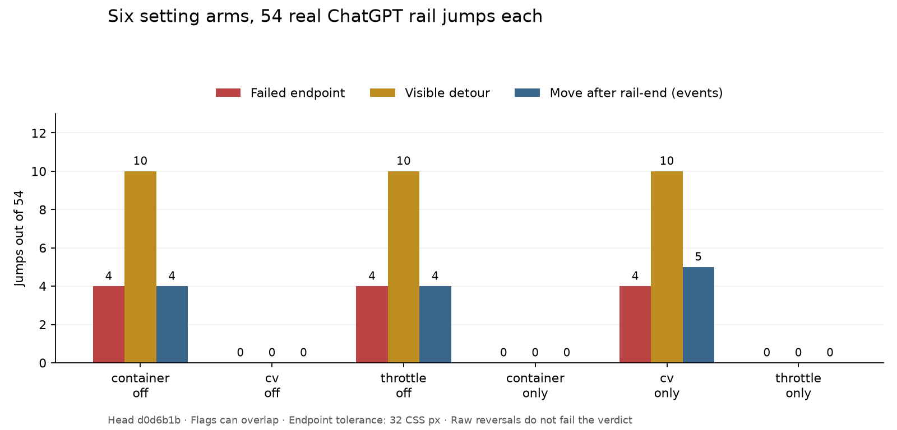

# Rail jump cause investigation — 2026-11-16

Diagnosis and scratch prototypes only; no change under `extension/`. The fix that followed is in
[report.md](report.md#fix). Per-run `.json` evidence named below is local, in
`~/.local/share/chatgpt-lab/captures/2026-11-16-rail-jump-live/`. The task that ran this
campaign was stopped before it wrote its last edits: all runs below had finished and are in
`cause-executions.jsonl`; the lead added the last two rows of the verdict table and the Cleanup
section from that file. No unrun arm is a zero.

## Scope and method

Head: `d0d6b1b38a09a1c679cd159b8f8b5257e9be6bd8`, unpacked dev build
`/home/simon/snap/chromium/common/rail-jump-head/butter` (retained). Real headed Chromium,
lab 2, fixtures math9/math12, default motion, 100% zoom. Took lab 2 and the shared perf lock
through `lab-lock acquire --lab auto --owner rail-jump-cause --wait 1800 --perf --needs-fixture math9`.
The send guard stays enabled. No fixture, lab configuration, or profile files are edited.

The page probe wraps Element's scrollTop setter and Element/Window scrollTo, scrollBy,
scrollIntoView (also the scroll alias in subsequent runs). MAIN instrumentation is installed
before page scripts; Butter's actual isolated execution context is instrumented before clicking.
Every wrapped call records its stack, requested value, immediate before/after scrollTop,
scrollHeight, viewport height, connection state and world. Both worlds record scroll/scrollend
and contentvisibilityautostatechange. A page-side WeakMap identifies scroller elements across
samples and event records; it does not rely on an HTML id. The probe records WAAPI/CSS animation
state and properties. Native smooth scrolling does not expose a WAAPI Animation object;
`smoothPending` records request-to-scrollend state and is not an independent compositor query.

Sampling is from before the trusted CDP click through at least two seconds after rail-end.
Unless explicitly normalized, new probe timestamps are milliseconds since arming; in the
plain-Blink witness the rail-jump/click trace is at 43 ms. The trace's elapsedMs field is
its own click-relative duration.
Raw turn/message keys and fixture text remain in page memory. Saved stacks replace the extension
origin with `extension:` and ChatGPT's origin with `page:`. Geometry reads force layout and can
change timing. The attribution run with full layout-debug tracing stalled for 46 seconds and
expired; it is excluded from all functional matrices.

Each full matrix is the original 54 jumps: two reload jumps and top/bottom to every settled
question plus four transitions, on both fixtures. Timing runs are sequential under the perf lock.

## 1. Who moves the scroller

Initial instrumented witness (`cause-witness.json`, math9 top to tick 1): no wrapped call
returns the scroller to zero. The element identity remains 1 and scrollHeight remains 291333.
The arrival smooth scroll requests 27705 at 1867 ms and emits scrollend at 2265–2266 ms.
A browser scroll to zero is observed at 2665 ms, with no intervening wrapped script write.
Butter's readiness correction follows at 2797 ms, writing 27704.609375 and reading 27705:

```text
Object.steady (extension:/rail/readiness.js:45:62)
async jump (extension:/rail/jump.js:386:9)
```

That stack is the correction, not the writer of zero. Full calls and events:
[cause-attribution.json](cause-attribution.json); frame timeline:
[cause-witness-timeline.csv](cause-witness-timeline.csv).

The normal-timing plain-Blink trace establishes the browser mechanism:
`cause-browser-trace-blink.json`, math9 top to tick 1, ends in 2846 ms. At 2712.033 ms, `ScrollableArea::SetScrollOffset` requests `[0 -305]`. At 2712.036 ms,
`PaintLayerScrollableArea::UpdateScrollOffset` records `{x:0,y:0}`; 0.003 ms later its
`Type` event records `kAnchoring`. At 2846.366 ms the correction writes 27705 with
`kProgrammatic`. Chromium's scroll enum distinguishes `kAnchoring` from `kClamping`,
`kProgrammatic`, and `kCompositor`. There is no wrapped call for the first move, while
the second has the isolated-world readiness stack above. The scroller identity and
scrollHeight remain unchanged. The negative anchoring request is clamped to zero; this is not a shrink of the scroller's scroll range. This is a browser anchoring scroll, rather than a script
write, a replaced DOM scroller, a scroll-height clamp, or a still-running smooth animation.

| Time from arm (ms) | Event | scrollTop (px) | scrollHeight (px) | Target / note |
|---:|---|---:|---:|---|
| 1941 | isolated arrive: smooth scrollTo | 27340 | 291333 | target request 27705 |
| 2205 | placeholder fully gone | 27698 | 291333 | 71 |
| 2343 | both-world scrollend | 27705 | 291333 | smooth interval ended |
| 2703 | last frame before anchoring | 27705 | 291333 | target top 64 |
| 2712.033 | browser SetScrollOffset | request -305 | — | no wrapped script call |
| 2712.036 | browser UpdateScrollOffset; kAnchoring | 0 | — | negative request clamped to zero |
| 2722 | both-world scrollend | 0 | 291333 | anchoring scrollend |
| 2846 | frame sample before correction | 0 | 291333 | target top 27768.609375 |
| 2846 | isolated readiness correction | 27705 | 291333 | readiness.js:45 |
| 2846 | rail-end: landed | 27705 | 291333 | trace target top 63.609375 |
| 2944 | frame: target unmounted | 27705 | 291333 | no target |
| 4092 | frame: target remounted | 27705 | 291333 | 63.609375 |
| 4853 | endpoint frame | 27705 | 291333 | 63.609375 |

The relevant arrival call stack is:

```text
Object.arrive (extension:/rail/trip.js:94:10)
jump (extension:/rail/jump.js:380:22)
```

Its requested target is 27705 at 1941 ms. The smooth scroll emits scrollend at 2343 ms,
369 ms before the anchoring update. The frame probe sees zero at 2846 ms and the target
unmounted at 2944 ms. It remains the same DOM scroller throughout.

The scratch `overflow-anchor: none` pilot's four clean jumps are **not** intervention
proof. The live head also reports computed overflow-anchor none, and the browser still
emits kAnchoring. That CSS pilot changes no established effective behavior. The exact
anchor node and anchoring subpath remain unestablished; ordinary style-enabled anchoring
is not assumed. Only the plain `blink` trace is used for mechanism attribution; the two
`devtools.timeline` / debug traces exceed the deadline and are excluded.

Primary source for the exact lab version, Chromium 156.0.8078.47:
[ScrollType enum](https://github.com/chromium/chromium/blob/156.0.8078.47/third_party/blink/public/mojom/scroll/scroll_enums.mojom#L12),
[UpdateScrollOffset trace](https://github.com/chromium/chromium/blob/156.0.8078.47/third_party/blink/renderer/core/paint/paint_layer_scrollable_area.cc#L430).

During the campaign ChatGPT exposed a second renderer shape: its authoritative entries
list no longer shared a component with RowComponent. The probe now checks the entries'
turn keys against all mounted turn keys instead of requiring that incidental prop.
The same zero-return witness and kAnchoring trace reproduce with this second shape.
Metadata records the shape in subsequent runs; no fixture or application code is patched.

### Failed math12 witness: a second, scripted writer

Do not attribute every zero move to the browser. In `cause-head-1.json`, settled math12
from top to tick 5 first returns to zero without a wrapped call at 4513 ms. The same
scroller still has scrollHeight 345033 and the arrival smooth interval has ended.
Butter's readiness restores 161578 at 4633 ms, and rail-end reports landed then.
At 5452 ms (819 ms after rail-end), ChatGPT explicitly scrolls it back to zero in MAIN:

```text
scrollTo({ top: 0, behavior: 'instant' })
ea (page:/cdn/assets/76629.b4d403ea2d.js:326:356742)
callback (page:/cdn/assets/76629.b4d403ea2d.js:342:10391)
ei (page:/cdn/assets/76629.b4d403ea2d.js:326:357430)
Object.callback [as compensateScrollToDistanceFromBottomPx]
  (page:/cdn/assets/76629.b4d403ea2d.js:342:10391)
er (page:/cdn/assets/149893.5791ef6db6.js:1:21096)
callback (page:/cdn/assets/76629.b4d403ea2d.js:342:10391)
eB (page:/cdn/assets/149893.5791ef6db6.js:1:30861)
o3 (page:/cdn/assets/226913.dd4de34d8f.js:3:143082)
```

The wrapper's immediate readback is zero. ScrollHeight is then 344897, only 136 px
smaller, so the range still easily permits 161578; this is an explicit zero request,
not a clamp forced by insufficient range. By 5576 ms the target is unmounted. The
same callback explicitly writes zero in the top-to-tick-7 failure too. These calls
follow the first browser-made zero, rather than initiating it. Full evidence is in
`cause-math12-attribution.json` (events, every call, and every frame).

The captured name identifies a distance-from-bottom compensation callback. That it
uses a stale state established by the first zero is supported by order and by the
scroll-anchor opt-out intervention; the callback's closure values were not captured.
The final full head trace will additionally identify the engine scroll type for the
math12 first move. In the first head matrix the probes capture 34 MAIN and 299
isolated-world calls. No scrollTop setter to zero occurs for a nonzero target;
the explicit ChatGPT zero writes use scrollTo, which the probe also wraps.

## 2. Start, zero, or bottom

`cause-middle.json` runs math12 tick 3 to tick 7 and back, twice. The two forward starts are
103124, and the reverse starts are 229183 and 229158. The second forward jump reaches 229158,
then returns to zero and ends with its target unmounted. The observed destination is zero,
not the nonzero starting position or bottom. Both reverse jumps finish at 103124. Other
transient zero moves occur during settling and can be corrected before completion; the
full event stream distinguishes them from the failed forward jump.

## 3. Six setting arms

Each arm has exactly one setting off or exactly one on. Each completed arm has at least
54 measured jumps. Empty cells below mean unrun, never zero.

| Arm | container | cv | throttle | Jumps | Failed | Visible detour flags | Strict post-completion moves | Exit |
|---|---|---|---|---:|---:|---:|---:|---:|
| container off | off | on | on | 54 | 4 | 10 | 4 | 1 |
| cv off | on | off | on | 54 | 0 | 0 | 0 | 0 |
| throttle off | on | on | off | 54 | 4 | 10 | 4 | 1 |
| container only | on | off | off | 54 | 0 | 0 | 0 | 0 |
| cv only | off | on | off | 54 | 4 | 10 | 5 | 1 |
| throttle only | off | off | on | 54 | 0 | 0 | 0 | 0 |
 

Across these six arms, cv tracks the failure: cv alone reproduces it, and cv off passes
with the other two settings on. No native exemptions are used in any setting arm.

The post-completion column now counts recorded scroll-position transitions strictly
later than rail-end, rather than merely sampling an off-target position at completion.
The initial `postCompletion` position flag could include a move that happened before
rail-end but appeared in its rounded-millisecond frame. Its sample counts for these
arms were 5/0/6/0/5/0; the event transition counts are 4/0/4/0/5/0. Both are retained
in `cause-post-end-counts.json`. The new CLI field is `postCompletionEventMoves`;
`postCompletion` retains the older position flag for comparison. No failed/detour
verdict changed across all eleven completed 54-jump matrices when this diagnostic
counter was added; the 32 px, one-viewport and two-second criteria were unchanged.

Counts also distinguish these post-rail-end moves from moves after a visible landing that occur during the final settle. Those are different
windows; instrumentation shows that the latter can precede rail-end.

## 4. Why near the end

The head witness's zero move precedes rail-end by about 132 ms. A correction and the completion
trace share the next sampled frame. This rejects treating the completion event itself as the
trigger. The end-step ablations use twelve jumps per arm: top to ticks 1 and 5, repeated three
times in math9 and math12. This deliberately includes both original witnesses plus the
cross-fixture destinations. The six settings arms and final validation use full 54-jump
matrices; these smaller ablations test the end-step trigger, not a full qualification.

| Scratch change | Jumps | Failed | Visible detour flags | Strict post-completion moves |
|---|---:|---:|---:|---:|
| arrive-instant | 12 | 2 | 7 | 7 |
| arrive-opacity-off | 12 | 1 | 6 | 2 |
| placeholder-visible | 12 | 2 | 7 | 3 |
| follow-off | 12 | 2 | 7 | 3 |
| flash-off | 12 | 2 | 7 | 4 |
| wash-off | 12 | 2 | 7 | 2 |

No tested arrival/completion-step ablation stops the bug. Removing the departure content fade does, in the later pilot. Arrive-instant changes
only arrive's smooth scroll; arrive-opacity-off skips only the arriving content fade;
placeholder-visible preserves visibility and uses opacity zero after its fade; follow-off
retains the existing pin observer rather than disconnecting and re-arming it after rail-end;
flash-off removes the question ring. All other source is the same as the head package.

Additional isolation pilots (four jumps each, both fixtures top to ticks 1 and 5):

| Scratch change | Jumps | Failed | Visible detour flags | Strict post-completion moves |
|---|---:|---:|---:|---:|
| turn-cv-off | 4 | 0 | 2 | 1 |
| block-cv-off | 4 | 0 | 2 | 1 |
| content-opacity-off | 4 | 0 | 0 | 0 |
| fades-instant | 4 | 0 | 2 | 0 |

Both content-visibility levels can reproduce the problem independently. Removing both
content opacity animations passes the pilot, while removing only arrive's content fade
or making all fades instantaneous does not. The departure-only pilot also passes four jumps, narrowing the trigger to the
departure fade. The selected candidate opts the content children out of native anchor selection, preserving
all the existing trip animations.

## 5. Intervention

Selected scratch copy (retained):
`/home/simon/snap/chromium/common/rail-jump-prototype-content-anchor-off/butter`.
It adds overflow-anchor none to the scroller's direct content children, excluding their
subtrees from anchor selection. Every original trip animation and all three Smoother
streaming settings remain enabled. It changes none of the jump's intended look.

Four pilot jumps pass (math9 and math12 top to ticks 1 and 5). Full validation run 1
also passes all 54 jumps: failed 0, visible detours 0, strict post-completion moves 0,
native exemptions 0, exit 0. Full validation run 2 also passes all 54 jumps with all four flags and native exemptions zero, exit 0. Full validation run 3 (`cause-intervention-3`) passes the same way: 54 jumps, failed 0, visible detours 0, exit 0. The exact diff against this checkout's extension source is:

```diff
--- a/extension/stream/containment.css
+++ b/extension/stream/containment.css
@@ -68,3 +68,6 @@
     box-shadow: inset 0 0 0 2px rgb(127 127 127 / 0);
   }
 }
+
+/* Diagnostic prototype: exclude chat content from scroll-anchor selection. */
+.thread-scroll-container > * { overflow-anchor: none !important; }
```

Alternative scratch copy:
`/home/simon/snap/chromium/common/rail-jump-prototype-depart-opacity-off/butter`.
Removing only departure's content fade passes the same four pilot jumps; the arrival
fade remains. It changes how the real chat fades under the trip placeholder, so the
content-anchor opt-out preserves more of the intended appearance. Its full matrix is
not established. Its exact diagnostic diff is:

```diff
--- a/extension/rail/trip.js
+++ b/extension/rail/trip.js
@@ -109,7 +109,7 @@
           m,
           content: content && content !== sc && sc.contains(content) ? content : null,
         };
-        trip.off = trip.content?.animate([{ opacity: 1 }, { opacity: 0 }], {
+        trip.off = false && trip.content?.animate([{ opacity: 1 }, { opacity: 0 }], {
           duration: T,
           easing: 'ease-in',
           fill: 'forwards',
```

Removing both content fades also passes four pilot jumps. Removing only arrival's fade,
turn-level skipping alone, block-level skipping alone, or making fades instantaneous
does not. A clean pilot is not treated as a completed full-matrix pass. The earlier
scroller-anchor-off pilot is inconclusive because that computed style is already none
on head. No product source is changed.

### After recording

The always-on prototype also passed recorded: math9 top to tick 1 and math12 top to tick 5 stayed
on their targets. It does not ship (see [report.md](report.md#fix)); `after.gif` shows the same two
jumps on the fix.

## Verdict

The fixed verdict fails when the endpoint target is unmounted or is more than 32 px from its
64 px inset (with scroll-range clamping), or completion times out. A visible detour is a visible
mounted-to-unmounted transition or an excursion greater than one viewport outside the interval
between its neighbouring positions. Masked movement is excluded. Raw reversals are informational.
The placeholder test checks both visibility and computed opacity, so a fully transparent layer
cannot hide an assertion merely by retaining visibility: visible.

Native exemptions require a measured no-extension run with the same fixture, phase, requested
start/destination, actual destination ordinal, actual start within 32 px, and the same failed
assertion (unmounted, alignment or completion, and the same detour type where applicable).
The default evidence file is `cause-native.json` beside this report; `NATIVE_EVIDENCE` can choose
another file or an empty value to disable exemptions. Each exempt result records its proof file.
No blanket native exemptions are used. Exit 1 means a non-native failed/detour jump, 0 means none,
and 2 means setup failure.

A fixed-definition classifier check passed eight assertions, including a masked reversal, a visible
excursion, target loss, and the 32/33 px alignment boundary and a gradual multi-frame overshoot. The classifier now also counts an excursion whose turning point falls behind the placeholder but is still on screen when the placeholder goes (review R3); replayed on fix-1/2/3, head-after-fix, both streaming-off runs and the native run, it changes no verdict and no run's failed or visible-detour count (head-after-fix: two jumps already gated gain a second excursion). The final turning-point classifier changes zero verdicts when replayed against the completed fresh native and head-1 runs. Reclassifying the earlier saved runs
(without exemptions) yields head-3/head-4/head-5: 9/9/10 gated jumps; streaming-off: zero gated
jumps despite 43 jumps with raw reversals. Fresh native run: 54 jumps, 3 failed alignment assertions, 1 visible-detour flag,
0 strict post-completion moves, 7 jumps with raw reversals; exit 1. Its starts are:

- math12, reload, bottom to initial tick 0: start 267808, final targetTop 116 (52 px miss).
- math12, settled, bottom to tick 10: start 347306, final 347307, targetTop -17529.
- math12, settled, previous to tick 1: start 20, targetTop -72.

All retain mounted targets; none has a mounted-to-unmounted loss. Full native evidence:
`cause-native.json`.

### Fresh verdict runs

| Run | Jumps | Failed | Visible detour flags | Native | Post-completion moves | Exit |
|---|---:|---:|---:|---:|---:|---:|
| head 1 | 54 | 3 | 9 | 0 | 2 | 1 |
| streaming off 1 (retry after setup error) | 54 | 0 | 0 | 0 | 0 | 0 |
| streaming off 2 | 54 | 0 | 0 | 0 | 0 | 0 |
| intervention 1 | 54 | 0 | 0 | 0 | 0 | 0 |
| intervention 2 | 54 | 0 | 0 | 0 | 0 | 0 |
| head 2 | 54 | 4 | 9 | 0 | 3 | 1 |
| intervention 3 | 54 | 0 | 0 | 0 | 0 | 0 |

The earlier `cause-off-1` attempt stopped with a virtualizer-shape setup error and is
excluded; its partial data and exit 2 remain in the command ledger. Two complete
streaming-off runs, not that partial attempt, establish the green control. Raw reversal
counts are retained (88 and 86 individual reversals in the two complete off runs).

## Commands and actual output

Campaign invocations, actual exit codes and final output lines are appended to
[cause-executions.jsonl](cause-executions.jsonl). Each run has its complete per-jump `.log` beside
this report; its sanitized `.json` evidence is local, in
`~/.local/share/chatgpt-lab/captures/2026-11-16-rail-jump-live/`. An exit-2 setup error is not a bug reproduction.

## Not established

- Independent native compositor animation-running state: the public API gives no Animation
  object for native smooth scrolling. Scroll requests, per-frame positions and scrollend events
  are observed instead.
- Equivalence to macOS Chrome or behavior beyond the two-second endpoint window.
- Performance measurements: these probes read geometry, software rendering is used, and tracing
  can change the result substantially.

## Cleanup

Done by the lead after the task stopped: `lab-restore --lab 2 --owner rail-jump-cause` (exit 0:
browser restarted with no extensions, one home tab, empty composer) and
`lab-lock release --lab 2 --owner rail-jump-cause` (lab and perf locks released). `lab-lock status`
then shows lab 1, lab 2 and perf not held. Both scratch builds named above are kept.
