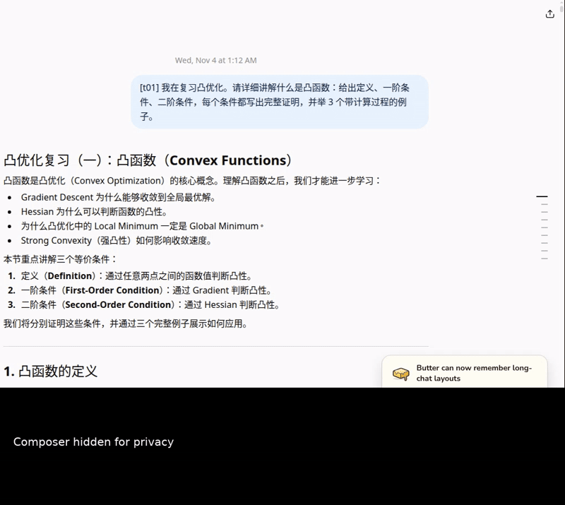

# Live rail jump control — 2026-11-16

The diagnosis changed no extension source; the fix that followed is in [Fix](#fix). PR #118 and issue #113 were read before testing;
their fake-page results were not accepted as proof of a live cause. Issue #96's older harnesses
were neither used nor repaired. The recording and bug-fix rules were read from `docs/recordings`.

Files marked (local), and every per-frame evidence JSON a run names, are raw captures kept on the
lab machine in `~/.local/share/chatgpt-lab/captures/2026-11-16-rail-jump-live/`, not in the repo
([notes/runs/README.md](../README.md)). This folder keeps the reports, GIFs, the two witnesses'
frame series and traces, summaries, charts, the per-run `.log` files and `cause-native.json`, the
native evidence `lab/harness/rail-jump-live.mjs` reads by default.

## Fix

Cause ([cause.md](cause.md)): after the target mounts and the trip reveals the chat, Chromium's
scroll anchoring (`kAnchoring` in its trace, no script write before it) moves the chat to
scrollTop 0. It needs Smoother streaming's `cv` setting.

Change (commit after `d0d6b1b` on `fix/rail-jump-detours`): while a jump is pinned, from the
click until the user scrolls, the jump is cancelled, or it ends without landing, `rail/jump.js`
sets `data-butter-pinned` on `<html>`, and one rule in `stream/containment.css` gives the
scroller's content children `overflow-anchor: none`. A takeover keeps it on; a glide pins, so it
has it too. Outside a jump the browser's anchoring stays on, which keeps the view still when
skipped content above it renders. Unit seam: `test/rail-jump-anchoring.test.mjs`, 5 tests,
all fail on `d0d6b1b` and pass with the fix. The always-on prototype from cause.md (the same rule
without the attribute) also passed three 54-jump runs, but turned anchoring off for good.

After review (F2) the rule also requires Smoother streaming's `cv` setting to be on
(`:not([data-butter-off~='cv'])`, as the file's other `cv` rules): with `cv` off the move does not
happen (the cv-off arm in cause.md), so anchoring stays on there. The last row of the table is the
run on that rule.

Live, lab 2, dev build `0.1.0-alpha.21+dev.2` unpacked at
`~/snap/chromium/common/rail-jump-fix/butter`, the red command
`LAB_ID=2 EXT=<build> LABEL=<name> node lab/harness/rail-jump-live.mjs`. The harness now also
checks, at every wheel unpin, that the attribute is gone and the scroller's turns child computes
`overflow-anchor: auto` (`anchoringLeftOff`), and counts the unpins where it was off just before
(`pinnedAnchoringOff`; the 4 others per run are wheels right after a fixture page loads, before
any jump on it). ChatGPT's
other, non-turn child of the scroller computes `none` with or without Butter.

| Run | Build | Jumps | Failed | Visible detours | Anchoring left off | Off while pinned | Exit | Log |
|---|---|---:|---:|---:|---:|---:|---:|---|
| fix-1 | fix | 54 | 0 | 0 | 0 / 48 | 44 | 0 | [fix-1.log](fix-1.log) |
| fix-2 | fix | 54 | 0 | 0 | 0 / 48 | 44 | 0 | [fix-2.log](fix-2.log) |
| fix-3 | fix | 54 | 0 | 0 | 0 / 48 | 44 | 0 | [fix-3.log](fix-3.log) |
| lead-verify-fix | fix (the lead's own run) | 54 | 0 | 0 | 0 / 48 | 44 | 0 | [lead-verify-fix.log](lead-verify-fix.log) |
| lead-verify-fix2 | fix, rule scoped to `cv` (review F2), dev build `+dev.3` | 54 | 0 | 0 | 0 / 48 | 44 | 0 | [lead-verify-fix2.log](lead-verify-fix2.log) |
| head-after-fix | head `d0d6b1b` | 54 | 3 | 9 | 0 / 48 | 0 | 1 | [head-after-fix.log](head-after-fix.log) |

The head run, after the three fix runs on the same day, shows the check still goes red without
the change. The classifier now also counts an excursion that is still on screen when the placeholder goes
(review R3); re-classifying these four runs with it changes no count in the table above. Post-completion moves: 0 in every fix run, 3 on head.



`after.gif`: math9 top to tick 1, then math12 top to tick 5, on the fix build, as in the bug GIFs
(same crop and composer mask). Source run `fix-recording` ([fix-recording.log](fix-recording.log),
4 jumps, all clean, exit 0); its math9 jump is the fixture's first after setup (`reload-setup`),
where the bug GIF's was a settled one. 800 by 715 px, 9.41 s, 113 frames, 1.7 MB; every frame
watched: no account name, chat title, URL or non-fixture text. Numbers in
[after-media.json](after-media.json).

Not established: macOS Chrome; anything after the two-second window; whether `overflow-anchor:
none` on the content while pinned lets remounted neighbours shift the view in a case the jump's
own alignment (the pin's ResizeObserver, the readiness waits) does not correct.

## Environment and method

Real ChatGPT Project fixture conversations in lab 2, headed Linux Chromium, default motion and
100% zoom. This is not macOS Chrome. Named fixtures: `math9` (nine questions after earlier history
loads, unusually long math answers) and `math12` (the longer question list). Both initially expose
five questions, rather than the user's four. No fixture was edited and no message was sent.

The head's packaged build is built from `d0d6b1b38a09a1c679cd159b8f8b5257e9be6bd8` with
`python3 scripts/package.py --dev`. Its local package number is `0.1.0-alpha.21+dev.1`;
this is the source of the user's `+dev.6`, with a different local packaging counter. The main
control is `907297d4f38c71413b5f49dbd432ed3ed470ec02`, built with the same command in a temporary
detached worktree. Extension zips are extracted outside the repo into Snap-readable scratch dirs.
Smoother streaming off changes exactly `container`, `cv`, and `throttle` to false in the task's
scratch extension origin, preserving and restoring that origin's prior settings.

The harness installs listeners for the dev rail trace's public document events. It requests the
trace snapshot every animation frame and samples the visible scroller's `scrollTop`, height,
viewport height, mounted turn ordinals, target top and height, lit/active/busy/pinned/flying state,
every tick's top, height, width and opacity, and whether the trip placeholder is showing. Raw
conversation and message keys stay in page memory. Rect reads can force layout; this instrumentation
is not a zero-cost observer. A blocked main thread produces frame gaps, not invented samples.

The observer is armed immediately before a real CDP mouse click on a tick (without locator auto-scrolling). Classification starts from the rail trace’s actual click position and ignores earlier frames; sanitized JSON retains the armed interval.
A separate setup wheel cancels the previous pin before positioning at the top or bottom. The harness verifies that setup edge again before arming. A history prepend or a delayed move after an earlier jump can still move the visible position between setup and the click: the trace’s actual starting scrollTop, not the requested edge label, is the classification baseline. The matrix attempts every tick from both extremes; the trace makes any source drift auditable, and the exploratory run supplies additional edge coverage. Sampling
continues until at least two seconds after `rail-end`. No-extension control writes a target
position itself; it has no Butter trace and no lit tick. Its negative result is not assumed: native
position failures and reversals are reported too. All mutation requests remain blocked.

Classification is exclusive, with failure taking precedence. Failed means no mounted target at
the endpoint, no observed completion, or final alignment more than 32 CSS px from the question's
64 px inset, with scroll-range clamping. This tolerance allows the first question's normal 20 px
padding difference. Detour means a reversal of more than 2 CSS px between sampled positions, or
more than one viewport outside the straight interval from the start to the final target.
Positions smaller than 2 px are treated as rounding noise. A jump can have both failure and detour
flags, while appearing in only the failed count. Raw detours include intentional movement hidden
behind Butter's trip; those counts alone are not proof of visible hops. The GIF is separate visual
evidence. Clean means neither assertion failed.


## Results

| Build / condition | Fixture | Jumps | Clean | Detour | Failed |
|---|---|---:|---:|---:|---:|
| head-3 | math9 | 24 | 3 | 21 | 0 |
| head-3 | math12 | 30 | 6 | 21 | 3 |
| head-4 | math9 | 24 | 3 | 20 | 1 |
| head-4 | math12 | 30 | 6 | 21 | 3 |
| head-5 | math9 | 24 | 3 | 20 | 1 |
| head-5 | math12 | 30 | 6 | 21 | 3 |
| streaming-off | math9 | 24 | 3 | 21 | 0 |
| streaming-off | math12 | 30 | 8 | 22 | 0 |
| main | math9 | 24 | 4 | 19 | 1 |
| main | math12 | 30 | 8 | 13 | 9 |
| native | math9 | 24 | 24 | 0 | 0 |
| native | math12 | 30 | 21 | 6 | 3 |

Each full run includes two reload jumps per fixture, then top-to-every-tick, bottom-to-every-tick, and four adjacent/far transitions. Thus each run contains 54 jumps: 24 on math9 and 30 on math12. All three final head runs exit 1. The case counts vary; the red verdict repeats. Final runs use the same observer and starting-edge checks. Exploratory head-1 and head-2 data are retained but excluded from this table.

The no-extension control calibrates each real target by finding its mounted turn with ordinary scroll writes, then restores the requested starting position and performs one measured write. Its completion is the first mounted-target position stable for 500 ms, followed by at least two more seconds of observation. This is a direct-scroll control, without Butter’s trip animation/readiness sequence. Calibration warms the target and makes the native reload condition less cold than the rail condition.

- head-3: 54 jumps; 48 targets unmounted at the click/write; 5 jumps with an unmasked move larger than one viewport after completion; maximum tick-row displacement with the settled question count unchanged 0 px; maximum animation-frame sampling gap 3028 ms; 4 blocked requests matching conversation or preparation endpoints.
- head-4: 54 jumps; 48 targets unmounted at the click/write; 6 jumps with an unmasked move larger than one viewport after completion; maximum tick-row displacement with the settled question count unchanged 0 px; maximum animation-frame sampling gap 3195 ms; 4 blocked requests matching conversation or preparation endpoints.
- head-5: 54 jumps; 48 targets unmounted at the click/write; 6 jumps with an unmasked move larger than one viewport after completion; maximum tick-row displacement with the settled question count unchanged 0 px; maximum animation-frame sampling gap 3386 ms; 4 blocked requests matching conversation or preparation endpoints.
- streaming-off: 54 jumps; 47 targets unmounted at the click/write; 0 jumps with an unmasked move larger than one viewport after completion; maximum tick-row displacement with the settled question count unchanged 0 px; maximum animation-frame sampling gap 3706 ms; 4 blocked requests matching conversation or preparation endpoints.
- main: 54 jumps; 48 targets unmounted at the click/write; 8 jumps with an unmasked move larger than one viewport after completion; maximum tick-row displacement with the settled question count unchanged 0 px; maximum animation-frame sampling gap 2987 ms; 4 blocked requests matching conversation or preparation endpoints.
- native: 54 jumps; 47 targets unmounted at the click/write; 0 jumps with an unmasked move larger than one viewport after completion; maximum tick-row displacement with the settled question count unchanged 0 px; maximum animation-frame sampling gap 4583 ms; 4 blocked requests matching conversation or preparation endpoints.

These guard counters count **blocked** preparation/conversation requests, not delivered messages.

The rail’s tick rows stayed at the same vertical positions throughout settled jumps (0 px displacement with question count unchanged). Physical tick-row jumps were **not reproduced** in that condition. The recorded rail change after the failed jump was its lit state: the visible first question and the absent pinned target were both lit (`[0, 5]`). Cold pagination can reflow the rail as questions are prepended.

The actual source position is retained separately from the requested `from` label. Source drift between setup and click occurred in 2, 2, and 1 jumps in the three final head runs respectively; the third run’s settled jumps all started at their requested edges. This is recorded in [summary.json](summary.json), rather than silently treating every requested bottom start as an actual bottom start.

## Recordings and representative traces

The GIFs use the exact rail-demo crop: x=580, y=88, width=1020, height=912 on the lab display. They are 800 px wide, at most 10 s and under 3 MB. The crop was inspected as a frame storyboard: no account name, chat title, URL, or non-fixture conversation text. The lower 212 px of the original crop are masked to protect a saved composer draft; the crop dimensions are unchanged. The draft was not cleared or sent. Raw captures remain local; only sanitized media is retained here.

### Detour

Recording: [bug-detour.gif](bug-detour.gif); source `head-3.json.gz` (local), jump 4: math9, settled, from top to tick 1 (zero-based). Verdict: detour. Trace end: 2890 ms after the click. At the final sample: scrollTop 27705, target top 63.609375.

Full frame series: [detour-positions.csv](detour-positions.csv). Full rail trace: [detour-trace.json](detour-trace.json). Times are normalized to the rail-jump event; other trace fields are unchanged. No message keys or text are recorded.

```json
[
  {
    "t": 0,
    "type": "rail-jump",
    "fields": {
      "jump": 5,
      "target": 1,
      "activeBefore": 0,
      "scrollTop": 0,
      "scrollHeight": 291333,
      "clientHeight": 912,
      "mountedFrom": 0,
      "mountedTo": 0,
      "earlier": false,
      "mounted": false,
      "path": "trip",
      "direction": "down"
    }
  },
  {
    "t": 1651,
    "type": "rail-try",
    "fields": {
      "jump": 5,
      "try": 1,
      "estimate": 27756.609375,
      "written": 27692.609375,
      "scrollTopRead": 27693,
      "scrollHeight": 291333,
      "frames": 2,
      "waitMs": 1387,
      "scrollTopAfter": 27693,
      "mountedFrom": 0,
      "mountedTo": 1,
      "lastBottom": 65102.359375,
      "lastWrapperBottom": 65102.609375,
      "lastWrapperInline": true,
      "mounted": true,
      "live": true
    }
  },
  {
    "t": 1654,
    "type": "rail-wait",
    "fields": {
      "jump": 5,
      "wait": "math",
      "durationMs": 2,
      "live": true,
      "pending": false
    }
  },
  {
    "t": 1865,
    "type": "rail-wait",
    "fields": {
      "jump": 5,
      "wait": "steady",
      "durationMs": 210,
      "live": true
    }
  },
  {
    "t": 1982,
    "type": "rail-wait",
    "fields": {
      "jump": 5,
      "wait": "quiet",
      "durationMs": 327,
      "live": true
    }
  },
  {
    "t": 1982,
    "type": "rail-wait",
    "fields": {
      "jump": 5,
      "wait": "recheck",
      "durationMs": 0,
      "live": true
    }
  },
  {
    "t": 2890,
    "type": "rail-end",
    "fields": {
      "jump": 5,
      "outcome": "landed",
      "path": "trip",
      "elapsedMs": 2891,
      "tries": 1,
      "expired": false,
      "scrollTop": 27705,
      "targetTop": 63.609375
    }
  }
]
```

| Time (ms) | scrollTop | Target top | Mounted turns | Lit ticks | Placeholder |
|---:|---:|---:|---|---|---|
| 6 | 0 | None | [0] | [1] | True |
| 316 | 27693 | None | [0] | [1] | True |
| 1651 | 27693 | 75.609375 | [0, 1] | [1] | True |
| 2251 | 27698 | 71 | [0, 1] | [1] | False |
| 2890 | 0 | 27768.609375 | [0, 1] | [1] | False |
| 2980 | 27705 | None | [0] | [1] | False |
| 4135 | 27705 | 63.609375 | [0, 1] | [1] | False |
| 4895 | 27705 | 63.609375 | [0, 1] | [1] | False |

### Failed

Recording: [bug-failed.gif](bug-failed.gif); source `head-3.json.gz` (local), jump 32: math12, settled, from top to tick 5 (zero-based). Verdict: failed. Trace end: 4351 ms after the click. At the final sample: scrollTop 0, target top None.

Full frame series: [failed-positions.csv](failed-positions.csv). Full rail trace: [failed-trace.json](failed-trace.json). Times are normalized to the rail-jump event; other trace fields are unchanged. No message keys or text are recorded.

```json
[
  {
    "t": 0,
    "type": "rail-jump",
    "fields": {
      "jump": 13,
      "target": 5,
      "activeBefore": 4,
      "scrollTop": 0,
      "scrollHeight": 345030,
      "clientHeight": 912,
      "mountedFrom": 0,
      "mountedTo": 0,
      "earlier": false,
      "mounted": false,
      "path": "trip",
      "direction": "down"
    }
  },
  {
    "t": 2116,
    "type": "rail-try",
    "fields": {
      "jump": 13,
      "try": 1,
      "estimate": 156782.5,
      "written": 156718.5,
      "scrollTopRead": 156719,
      "scrollHeight": 345030,
      "frames": 30,
      "waitMs": 1855,
      "scrollTopAfter": 156719,
      "mountedFrom": 4,
      "mountedTo": 4,
      "lastBottom": 161630.28125,
      "lastWrapperBottom": 161630,
      "lastWrapperInline": true,
      "mounted": false,
      "live": true
    }
  },
  {
    "t": 3189,
    "type": "rail-try",
    "fields": {
      "jump": 13,
      "try": 2,
      "estimate": 161630,
      "written": 161566,
      "scrollTopRead": 161566,
      "scrollHeight": 345033,
      "frames": 2,
      "waitMs": 1073,
      "scrollTopAfter": 161566,
      "mountedFrom": 4,
      "mountedTo": 5,
      "lastBottom": 195622.609375,
      "lastWrapperBottom": 195622.28125,
      "lastWrapperInline": true,
      "mounted": true,
      "live": true
    }
  },
  {
    "t": 3190,
    "type": "rail-wait",
    "fields": {
      "jump": 13,
      "wait": "math",
      "durationMs": 1,
      "live": true,
      "pending": false
    }
  },
  {
    "t": 3356,
    "type": "rail-wait",
    "fields": {
      "jump": 13,
      "wait": "steady",
      "durationMs": 165,
      "live": true
    }
  },
  {
    "t": 3412,
    "type": "rail-wait",
    "fields": {
      "jump": 13,
      "wait": "quiet",
      "durationMs": 221,
      "live": true
    }
  },
  {
    "t": 3412,
    "type": "rail-wait",
    "fields": {
      "jump": 13,
      "wait": "recheck",
      "durationMs": 0,
      "live": true
    }
  },
  {
    "t": 4351,
    "type": "rail-end",
    "fields": {
      "jump": 13,
      "outcome": "landed",
      "path": "trip",
      "elapsedMs": 4351,
      "tries": 2,
      "expired": false,
      "scrollTop": 161578,
      "targetTop": 64.28125
    }
  }
]
```

| Time (ms) | scrollTop | Target top | Mounted turns | Lit ticks | Placeholder |
|---:|---:|---:|---|---|---|
| 25 | 0 | None | [0] | [5] | True |
| 306 | 156719 | None | [0] | [5] | True |
| 2162 | 161566 | None | [4] | [5] | True |
| 3189 | 161566 | 76.28125 | [4, 5] | [5] | True |
| 3668 | 161571 | 71 | [4, 5] | [5] | False |
| 4350 | 0 | 161642.28125 | [4, 5] | [5] | False |
| 5337 | 0 | None | [0] | [5] | False |
| 6444 | 0 | None | [0] | [0, 5] | False |

## Causes ranked by evidence

1. **The recorded failure is after a successful arrival.** In `head-3`, math12 tick 5 mounted, the math/quiet/steady/recheck waits passed, and `rail-end` reported `landed` at 4,351 ms after the click with targetTop about 64 px. At the final sample the target was absent and scrollTop was zero. The rail still had active tick 5, pinned true and lit ticks `[0, 5]`. The successful trace result did not guarantee the target remained in view. This witness is not a failure to mount within eight tries.
2. **Smoother streaming is implicated in the target-loss pattern, at group granularity.** The three final head runs had post-mount target losses; the same 54-step streaming-off control had none. Its failed-landing count was zero and it had no unmasked post-completion moves larger than a viewport. Native ChatGPT also had no post-mount target loss in this matrix. The earlier `head-2` settled jumps were not being screen-recorded and still lost targets, so recording is not required for this symptom. This isolates a condition, not the responsible member of `container` / `cv` / `throttle` or the exact callback.
3. **Native scroll behavior is also part of the problem space.** No extension produced six raw reversals and three failed alignment assertions. In a separate native replay, the correct target write of 328,400 px was immediately read back as 328,400 px; the next sampled frame was back at the bottom, 347,022 px. The target stayed mounted, 17,529 px above the view. Butter cannot be the writer of that correction when it is absent. The responsible ChatGPT/browser mechanism remains unestablished.

The broad failed-jump and detour classes are therefore not exclusive to Butter. The stronger differential result here is the late **unmount** and return-to-zero pattern with full Butter, absent with streaming off and in the native matrix. Per step 1, this report does not authorize treating every failed native scroll as an extension defect. There is no extension fix in this task.

## Not established

- Whether the same underlying cause produces the user’s earlier reported loss just after the first mount; the selected witness still has its target mounted at `rail-end` and loses it later.
- The exact JavaScript writer responsible for each automatic move to zero, or the native correction back to the bottom; no call-stack attribution was collected.
- Which Smoother streaming member causes the difference, and whether observer layout reads change its frequency.
- Whether one main comparison establishes a change in failure rate; these are functional observations, not a statistical performance comparison.
- That the broad raw classifier is a test only of visible bugs: it deliberately counts masked trip corrections and small native reversals too.
- That every raw reversal is visible. Butter deliberately moves while the placeholder covers the chat, and its reveal can include a short opposite correction.
- Equivalence to macOS Chrome, exactly four ticks, or the exact timing of the user’s 8.65 s recording.
- Whether the problem remains absent/present later than the two-second post-completion window.
- A quantitative performance comparison: software rendering, forced geometry reads, frame gaps, and recording overhead affect timing.
- That PR #118’s earlier fake-page causes explain this live failure.

## Re-run

```sh
LAB_ID=2 EXT=/home/simon/snap/chromium/common/rail-jump-head/butter LABEL=verify node lab/harness/rail-jump-live.mjs
```

The command takes its own lab/perf lock, installs the send guard, reloads only the named fixtures, runs the 54 jumps, prints one line per jump and exits 1 on a detour or failure (0 if clean; 2 for setup errors). It restores defaults and releases its lock in `finally`. The task-owned head copy is retained to make this command runnable; the main scratch worktree is removed.


## Native control details

The three native alignment failures were distinct:

- Reload, bottom to initial tick 0: history prepended, the target remained mounted at targetTop 116 px, a 52 px miss against the 64 px inset.
- Settled, bottom to tick 10: the requested write did not remain the visible position; the final view was back at the bottom and the target was still mounted far above it.
- Settled, previous target to tick 1: the target remained mounted at targetTop -72 px after native geometry corrections.

A separate three-jump replay (`native-witness.json.gz` (local)) reproduced the bottom-to-tick-10 failure. Its immediate scrollTop readback proves the write was accepted before the later correction. [control-native.gif](control-native.gif) shows the bottom view; the numeric write/readback is in that archive. The other two replay jumps were clean. It had no Butter trace and no post-mount target unmounts.

During navigation, the page made blocked requests matching conversation or preparation endpoints. The `guard.sendAttempts` counter also matches preparation endpoints, so its value of four per full run is **not** a count of delivered messages. Every such request and every other non-GET ChatGPT request was aborted by the send guard. The harness invoked no send gesture and no real message was sent.

## Data and verification

[summary.json](summary.json) contains per-run counts, source drift at the actual click, target-loss transitions, post-completion moves and cleanup. Full sanitized frame/event JSON is compressed as `*.json.gz` (local); [archive-index.json](archive-index.json) records their byte counts and SHA-256 digests. Representative frame CSVs and trace JSON remain uncompressed. For example:

```sh
gzip -dc ~/.local/share/chatgpt-lab/captures/2026-11-16-rail-jump-live/head-3.json.gz > /tmp/rail-jump-inspect.json
```

Final repeatability commands and their original, complete per-jump stdout are in [commands.md](commands.md) and [head-3.log](head-3.log), [head-4.log](head-4.log), [head-5.log](head-5.log). All three exit 1. The final run also exercises the harness's own lock acquisition, default-extension restore and release, rather than borrowing the campaign lock.

## Cleanup and scope

During the diagnosis: no extension source changes, commits, pushes, or PR/issue comments. Final cleanup/status evidence is in [commands.md](commands.md).

Lab 2 was restored to its default extension list (empty), one home tab and an empty composer; both task-owned lab/perf locks were released. Lab 1 was owned by another task at final verification and was left untouched. The main scratch worktree and unpacked main copy were removed. The head copy is retained for the red command.
