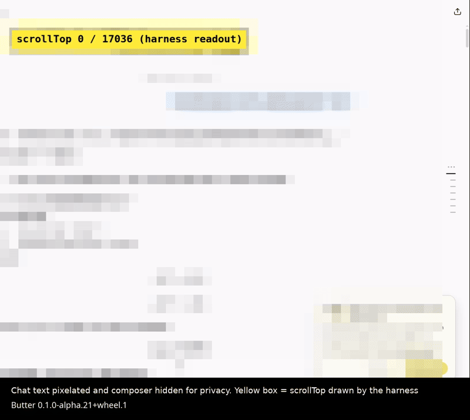
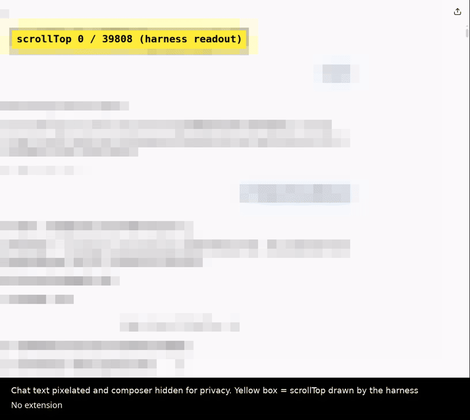

# Wheel jump back to the top (step 1, Control)

Question: does a long chat jump back to scrollTop 0 while the user wheels down, with Butter loaded and
without it?

**Result: reproduced with Butter, not without it.** On lab 2's `ats12` fixture, every Butter load the
harness measured jumped back at least once: 46 of 46 loads, both the dev and the test build of this
branch's head. All 19 measured loads without an extension reached the chat's end with no jump back.
For every jump back, the scroll probe saw no wrapped script scroll write, in ChatGPT's world or in
Butter's, that moved the chat down to the low position.



`bug-wheel-jump.gif`: test build `0.1.0-alpha.21+wheel.1`, one load. The chat is wheeled to the top,
then down in 700 px steps. The yellow box is a readout of the scroller's scrollTop, drawn by the
harness (not by ChatGPT or Butter). It climbs 0 → 6300, drops to 0 (frame 21, 1.75 s), climbs again
and drops to 0 again at frames 35, 48, 67, 81 and 113. The scrollbar thumb, kept sharp at the right
edge, goes back to the top each time.



`control-native.gif`: the same steps with no extension. scrollTop climbs 0 → 39808 (the end) with no
drop.

## Environment

| | |
|---|---|
| Lab | Lab 2, headed Linux Chromium on Xvfb `:98` (1600×1000), software rendering (llvmpipe) |
| Browser | Chromium 156.0.8078.47 (snap), no extra flags (classic scrollbars, not `OverlayScrollbar`) |
| Page | ChatGPT light theme, viewport 1599×912, scroller `.thread-scroll-container` clientHeight 860 |
| Fixture | `ats12` (a Project chat, 12 questions; native full height after loading all history ≈ 40.7k px) |
| Builds | `fix/wheel-jump-to-top` at `5192b68`: `python3 scripts/package.py --dev` → `0.1.0-alpha.21+dev.1` (head-dev); `python3 scripts/package.py --test wheel` → `0.1.0-alpha.21+wheel.1` (head-test). Unpacked under `~/snap/chromium/common/wheel-jump-head-{dev,test}/butter`; kept. |
| Butter settings | none stored (defaults). Every Butter load had `html[data-butter-off="layout"]` and showed the layout consent card (layout memory not consented in this profile) |
| Guard | Send guard on in every run; 0 conversation/prepare requests attempted |
| Date | 2026-11-16, lab held 19:28–20:38 |

The earlier sighting (scrollbar-cover run) used `--enable-features=OverlayScrollbar` and ChatGPT's dark
theme. This run used neither and still reproduced.

## Method

`lab/harness/wheel-jump-live.mjs` (seam 3). Each **load** is a fresh `page.goto` of the fixture. It
waits for the composer, then 9 s (settle), and records the scroller's state. Then it wheels with real
input (`page.mouse.wheel`, 700 px per step, 140 ms apart, the pointer over the chat column):

- **Default steps:** up until scrollTop stays 0 for three steps (this makes ChatGPT load the earlier
  history), then down to the chat's end or 150 steps.
- **`MODE=arm`:** the scrollbar-cover arm's steps. `scrollTop = scrollHeight` every 700 ms until the
  end holds 5 times (at most 80 writes), 8 steps up, 2 s, then down.
- **`RESTART=each`:** restarts the browser before every load.

While wheeling down, the page logs every scroll event `[t, scrollTop, scrollHeight]`. A **jump back**
is a fall of more than one viewport below the highest scrollTop since the last rise.

The scroll probe (`rail-jump-scroll-probe.mjs`) wraps the `scrollTop` setter and
`scroll`/`scrollTo`/`scrollBy`/`scrollIntoView`. It runs in the page's MAIN world (installed before
page scripts) and in Butter's isolated world (installed after the settle). A jump back counts as a
**script write** only when a wrapped write ran between the last high scroll event and the drop, and
scrollTop was still high just before that write.

A load where ChatGPT shows its own "Could not load this ChatGPT conversation" page (no turns) is
retried once. If it fails again, the load is skipped, not judged. The per-load JSON (scroll logs,
settle samples, writes near each jump with sanitized stacks) stays local in
`~/.local/share/chatgpt-lab/captures/wheel-jump-live/<LABEL>.json`.

The harness changed during the session, and each run below names the version it used:

- **rev 1:** no error-page skip. Its head-test run counted two error-page loads as PASS.
- **rev 2:** adds the skip.
- **final:** also does not count a write that found scrollTop already low as the jump's cause, adds
  `retried=` and `fromEnd=` to the load line, and gives the readout a fixed width.

## Results

| Arm (log) | Harness | Steps | Loads judged | Skipped | Failed | Jumps back per failed load | scrollHeight at settle | Exit |
|---|---|---|---:|---:|---:|---|---|---:|
| native ([native-first.log](native-first.log)) | rev 1 | default | 12 | 0 | 0 | — | 10276 ×12 | 0 |
| native ([native.log](native.log)) | final | default | 4 | 8 | 0 | — | 10276 ×4 | 2 |
| native, recording ([rec-native.log](rec-native.log)) | final | default | 1 | 0 | 0 | — | 10276 | 0 |
| head-dev ([head-dev.log](head-dev.log)) | rev 1 | default | 12 | 0 | 12 | 7, 6, 6, 9, 6, 6, 7, 8, 7, 6, 9, 6 | 15087 ×9, 14847, 10276 ×2 | 1 |
| head-test ([head-test-first.log](head-test-first.log)) | rev 1 | default | 10 (+2 error pages printed as PASS) | — | 10 | 8, 6, 9, 6, 6, 6, 6, 6, 9, 24 | 15087 ×8, 10276, 10256 | 1 |
| head-test ([head-test.log](head-test.log)) | final | default | 11 | 1 | 11 | 14, 20, 17, 19, 17, 16, 21, 14, 24, 14, 25 | 15087 ×7, 14847 ×2, 12857, 10276 | 1 |
| head-test, `RESTART=each` ([head-test-restart.log](head-test-restart.log)) | final | default | 4 | 0 | 4 | 19, 14, 19, 14 | 15087 ×3, 10256 | 1 |
| head-test, `MODE=arm` ([head-test-arm.log](head-test-arm.log)) | rev 2 | arm | 6 | 0 | 6 | 1, 14, 1, 1, 1, 1 | 15087 ×3, 12857 ×2, 10276 | 1 |
| head-test, recording ([rec-head-test.log](rec-head-test.log)) | final | default | 1 | 0 | 1 | 18 | 15087 | 1 |

Two smoke runs before these (2 loads each, 4 s settle, not saved) agree: dev build 2/2 failed with 7
and 6 jumps back; native 0/2.

**Totals.** Butter: 46 loads judged, 46 failed (44 measured plus the two smoke loads). Native: 19
judged, 0 failed (including the two smoke loads).

**overflow-anchor.** The scroller's own computed `overflow-anchor` was `auto` in every judged load,
with and without Butter. Its child holding the turns was `auto`, and its other child (ChatGPT's footer
block, 76 px) was `none`. ChatGPT's error page had a scroller of `none` and one `auto` child.

**Opened at the end.** No load ended within 2 px of the chat's end.

- Native always opened 53 px short of it (`fromEnd=53`, scrollTop 9363 of 10276, 3 turns mounted).
- With Butter, most loads opened at scrollTop 1990 (or 1750, or 0) of 14847–15087, with 1–2 turns
  mounted (`fromEnd` about 12000).
- A few Butter loads opened like native (`fromEnd` 49–61, 10256/10276, 3 turns): head-dev #5 and #8,
  head-test first run #9 and #12, final run 1 load, restart run #2, arm #1. Those failed too.

**Frequency per condition** (Butter):

| Condition | Failed loads |
|---|---|
| Default steps | 12/12 (head-dev), 10/10 and 11/11 (head-test), 1/1 (recording), 2/2 (smoke) |
| Restart before every load | 4/4 |
| Arm steps | 6/6 |
| First load of a run (right after the run's browser restart) | failed in every run |
| Later loads of a run | failed in every run |

No "good" Butter load was seen under any condition, so nothing in the data separates a bad load from
a good one. The earlier sighting's intermittency is not reproduced here. See Not established.

## The two kinds of jump back

**1. While wheeling down through the chat.** This was the only kind under the default steps and the
restart condition, and it also appeared in arm load #2.

- **Where:** scrollTop falls from 2100–20751 to 0 (to 700 in 20 of 468 jumps). It repeats every few
  steps in one load, often alternating between two positions: 6300 and 4900, 9800 and 4900, or 4200
  and 4900. The sighting saw 6300 and 2800.
- **Timing:** the drop appears 14–711 ms after the previous scroll event (median 123 ms; 377 of the
  382 still in the JSON are under 310 ms), mostly within one wheel step (steps are about 150 ms
  apart). Usually no scroll event at the stepped position comes between,
  so the drop takes the place of that step's scroll.
- **scrollHeight:** unchanged across the drop in most jumps (77/83 head-dev, 65/86 and 151/201
  head-test, 61/66 restart).
- **Cause by probe:** in all 468, no wrapped call.
  - Butter's isolated world made no wrapped scroll write during any wheel-down phase.
  - ChatGPT's MAIN world made `scrollTo` calls there in some runs (51 in head-dev, 32 in the first
    head-test run, 0 in the final one). None of them fell between the last high event and a drop.
- **How much history:** it happens whether ChatGPT loaded all of the history while wheeling up
  (scrollHeight about 40.7k at the jumps) or part of it (12.8k–24.6k in the final head-test run).
- **Picture:** in the bug GIF, the chat area shows the page background with no content drawn in
  frames 20 (just before a drop) and 21, 35, 67, 81 and 113 (just after one).

**2. Just after reaching the chat's end** (arm steps: loads #1, #3, #4, #5, #6).

- **What:** the wheel reached the end, then 0.7–0.9 s after the last step (696–896 ms after the
  previous scroll event) scrollTop dropped from the end to 0. This was one jump per load.
- **scrollHeight:** unchanged in 4 of the 5.
- **Cause by probe:** in 4 of the 5, no wrapped call.
- **Arm load #1 is the exception.** At that moment ChatGPT loaded earlier history (scrollHeight
  10372 → 12827), and its own `compensateScrollToDistanceFromBottomPx` called `scrollTo({top: 2455})`.
  The probe read scrollTop 0 just before that write, so the write moved the chat from 0 to 2455; it
  did not take it down from 9512.
  - The rev 2 harness used for this run printed it as `script write`.
  - The final harness classifies it as "no wrapped call (a later write found it already low)".

## ChatGPT's "Could not load" page

Some navigations got ChatGPT's own error page, "Could not load this ChatGPT conversation" with a Try
again button. It came with and without Butter, more often as the session went on:

- **First native run (19:31):** 0 of 12 loads.
- **Mid-session:** 3 of 6 first attempts in the arm run, and the first navigation after each of the 4
  browser restarts.
- **Final runs (20:15–20:37):**
  - head-test: 10 of 12 first attempts, 1 load skipped.
  - native: 9 of 12 first attempts, 8 loads skipped.
- **A hand check with no extension (20:37):** error page, chat, error page on three navigations in a
  row.

So:

- The final native run exits 2 by the harness's rule (half the loads or more skipped). Its 4 judged
  loads passed.
- In the restart condition, the error page always took the first navigation after a restart, so every
  load that was measured there was the second navigation.

## Commands and their final output lines

The lab lock was taken with `lab-lock acquire --lab 2 --owner wheel-jump-top --wait 1800` for the
smoke, arm, recording and restart runs (`LAB_OWNER=wheel-jump-top`). The other runs took the lock
themselves. Long `REPORT load` lines are omitted here; they are in the logs.

```text
$ python3 scripts/package.py --dev            → dist/butter-0.1.0-alpha.21+dev.1.zip
$ python3 scripts/package.py --test wheel     → dist/butter-0.1.0-alpha.21+wheel.1.zip

$ LAB_ID=2 EXT= LABEL=native LOADS=12 node lab/harness/wheel-jump-live.mjs          # rev 1, 19:31
REPORT scrollHeight range 10276–10276 over 12 loads
REPORT overflow-anchor scroller [children]: auto [T:auto,none]
SUMMARY native: 0/12 loads failed
EXIT 0

$ LAB_ID=2 EXT=~/snap/chromium/common/wheel-jump-head-dev/butter LABEL=head-dev LOADS=12 node lab/harness/wheel-jump-live.mjs   # rev 1
FAIL load ats12 #1: 7 jumps back, first 20751 → 0 at step 14
… (12 FAIL lines)
REPORT scrollHeight range 10276–15087 over 12 loads
REPORT overflow-anchor scroller [children]: auto [T:auto,none]
SUMMARY head-dev: 12/12 loads failed
EXIT 1

$ LAB_ID=2 EXT=~/snap/chromium/common/wheel-jump-head-test/butter LABEL=head-test LOADS=12 node lab/harness/wheel-jump-live.mjs  # rev 1
SUMMARY head-test: 10/12 loads failed      (#10, #11 were ChatGPT's error page, printed as PASS)
EXIT 1

$ LAB_ID=2 LAB_OWNER=wheel-jump-top EXT=~/snap/chromium/common/wheel-jump-head-test/butter LABEL=head-test-arm MODE=arm LOADS=6 node lab/harness/wheel-jump-live.mjs
SUMMARY head-test-arm: 6/6 loads failed
EXIT 1

$ LAB_ID=2 LAB_OWNER=wheel-jump-top EXT=~/snap/chromium/common/wheel-jump-head-test/butter LABEL=rec-head-test LOADS=1 RECORD=1 node lab/harness/wheel-jump-live.mjs
FAIL load ats12 #1: 18 jumps back, first 6300 → 0 at step 9
SUMMARY rec-head-test: 1/1 loads failed
EXIT 1

$ LAB_ID=2 LAB_OWNER=wheel-jump-top EXT= LABEL=rec-native LOADS=1 RECORD=1 node lab/harness/wheel-jump-live.mjs
SUMMARY rec-native: 0/0 loads failed (1 skipped: chat did not load)      (first try)
EXIT 2
PASS load ats12 #1: reached the end in 57 steps                          (second try)
SUMMARY rec-native: 0/1 loads failed
EXIT 0

$ LAB_ID=2 LAB_OWNER=wheel-jump-top EXT=~/snap/chromium/common/wheel-jump-head-test/butter LABEL=head-test-restart RESTART=each LOADS=4 node lab/harness/wheel-jump-live.mjs
SUMMARY head-test-restart: 4/4 loads failed
EXIT 1

$ LAB_ID=2 EXT=~/snap/chromium/common/wheel-jump-head-test/butter LABEL=head-test LOADS=12 node lab/harness/wheel-jump-live.mjs   # final
FAIL load ats12 #1: 14 jumps back, first 9800 → 0 at step 15
… (11 FAIL lines; #7 skipped)
REPORT scrollHeight range 10276–15087 over 11 loads
REPORT overflow-anchor scroller [children]: auto [T:auto,none]
SUMMARY head-test: 11/11 loads failed (1 skipped: chat did not load)
EXIT 1

$ LAB_ID=2 EXT= LABEL=native LOADS=12 node lab/harness/wheel-jump-live.mjs          # final, 20:31
PASS load ats12 #1: reached the end in 57 steps
… (4 PASS lines; 8 loads skipped)
SUMMARY native: 0/4 loads failed (8 skipped: chat did not load)
HARNESS ERROR: half the loads or more did not load the chat
EXIT 2

$ python3 lab/harness/wheel-jump-gif.py <rec-head-test MP4> bug-wheel-jump.gif "Butter 0.1.0-alpha.21+wheel.1: wheel down 700 px per step"
$ python3 lab/harness/wheel-jump-gif.py <rec-native MP4> control-native.gif "No extension: wheel down 700 px per step"
```

Since then, the skipped-load line reads "ChatGPT did not load the chat twice". The verdicts are
unchanged.

## GIFs

- **Source:** each is one `RECORD=1` load. ffmpeg x11grab on display `:98` at 30 fps, with
  `rail-demo.mjs`'s crop (x 580, y 88, 1020×912: the chat column and the rail; no URL bar, sidebar or
  account).
- **Mask** (`wheel-jump-gif.py`):
  - The chat column (x 0–960, y 0–820) is pixelated in 20 px blocks.
  - The composer band (y 820–912) is black, with a caption.
  - Sharp areas: the inside of the harness readout's yellow box (x 26–534, y 66–106, measured inside
    the box in every frame of both recordings), and the rail and scrollbar strip (x 960–1020).
- **Sizes:** both 800×715, 9.75 s, 117 frames at 12 fps. `bug-wheel-jump.gif` is 2.55 MB;
  `control-native.gif` is 1.72 MB (sped up 1.08×). Numbers are in the `-media.json` files.
- **Checked:** every frame was watched on contact sheets. No legible chat text, title, URL or account
  name. Butter's consent card shows only as pixelated blocks, apart from its right edge, which lies
  in the sharp strip.
- **A leak caught and fixed before keeping:** the first version left a sharp 10 px row and an 18 px
  column, because 958 and 830 are not multiples of the block size. Fragments of chat text showed
  there.
- **Private files:** the unmasked MP4s are in `~/.local/share/chatgpt-lab/captures/2026-11-16-wheel-jump-top/`.

## Files

- **Logs:** `*.log` here, one per run, with the home path replaced by `~`.
- **`summary.txt`:** per-arm aggregates from the local JSON: settle state, jump positions and causes,
  gaps before drops, and down-phase write counts by world.
- **Local only:** the per-load JSON in `~/.local/share/chatgpt-lab/captures/wheel-jump-live/`. The
  first head-test run's JSON was overwritten by the final head-test run, which used the same label;
  its log and the aggregates quoted above remain.

## Not established

- **The cause.** The probe only rules out wrapped JS scroll writes as the direct mover. A browser-side
  move (scroll anchoring, layout clamping, a content-visibility size change) or a write through a
  path the probe does not wrap (`focus()`, `Element.scrollTop` on another prototype, a native
  smooth-scroll animation) was not traced. No Chrome trace was taken.
- **What makes Butter's loads differ from native.** Butter loads mostly open at scrollTop 1990 with
  1–2 turns mounted (native opens at its end with 3 turns), but loads that opened like native also
  failed. The `overflow-anchor` styles were identical in both. Which Butter feature is involved was
  not tested: no `OPTS` setting was turned off, and the layout consent state was not varied.
- **The sighting's intermittency.** Here every Butter load failed. Why some loads in the sighting
  reached the end is not known. The arm steps here usually reached the end and then dropped to 0
  within 0.9 s, which a check made only during the wheel steps may not catch.
- **The first load after a browser restart.** The first navigation after every restart got ChatGPT's
  error page, so that case was never measured. Load #1 of each run failed like the later ones.
- **ChatGPT's error page.** Why it appeared more often as the session went on (with and without
  Butter) is unknown, as is whether a retried (second) navigation behaves differently from a first
  one.
- **macOS Chrome.** Only Linux Chromium 156 with software rendering, classic scrollbars and CDP wheel
  events of 700 px each (no smooth scrolling, no momentum) was run. A trackpad or a mouse wheel on
  macOS sends many small deltas with momentum and uses overlay scrollbars, and Chrome there renders
  on the GPU. Whether the jump back happens there, and how often, is not shown.
- **Other fixtures, dark theme and `OverlayScrollbar`.** Not run this time.
