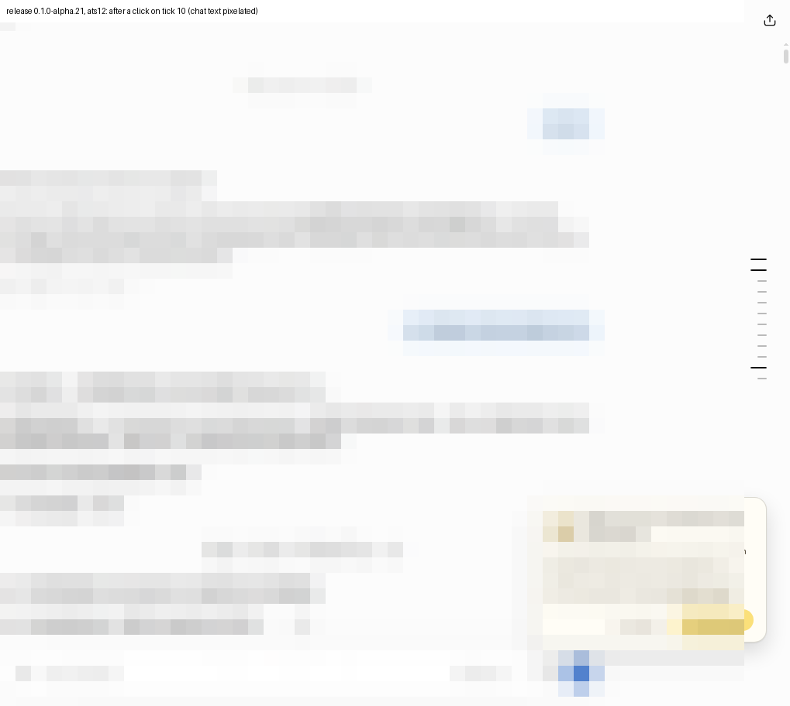

# Live survey: page structure, wheel scrolling, rail jumps and tick selection — 2026-11-18

Lab run only; no extension code changed. Lab 2, fixtures `ats12`, `math9`, `math12` and `demo-en12`;
the send guard was on in every connection and no message was sent. Raw captures (per-load and
per-frame JSON, screenshots) stay in `~/.local/share/chatgpt-lab/captures/2026-11-18-live-survey/`.

## Results

Each row is one check on one arm. The verdict lines and exit codes are in the logs named in the last
column; `REPORT` lines there carry the measurements. "Judged" counts exclude skipped loads.

| # | Check | Arm | Result | Verdict line(s) behind it | Exit | Log |
|---|---|---|---|---|---:|---|
| 1 | Page structure (§1) | native, 4 fixtures | surveyed (REPORT only) | — | 0 | [structure-native.log](structure-native.log) |
| 1 | Page structure (§1) | head, `ats12` `math12` | surveyed (REPORT only) | — | 0 | [structure-head.log](structure-head.log) |
| 2 | Wheel, `ats12` | native | **PASS** 4/4 | `PASS load ats12 #1–#4: reached the end in 56–57 steps`; `SUMMARY native: 0/4 loads failed` | 0 | [wheel-native.log](wheel-native.log) |
| 2 | Wheel, `ats12` | release | **FAIL** 4/4 | `FAIL load ats12 #1: 9 jumps back, first 5149 → 0 at step 3` …; `SUMMARY release: 4/4 loads failed` | 1 | [wheel-release.log](wheel-release.log) |
| 2 | Wheel, `ats12` | head | **FAIL** 4/4 | `FAIL load ats12 #1: 7 jumps back, first 7843 → 0 at step 10` …; `SUMMARY head: 4/4 loads failed` | 1 | [wheel-head.log](wheel-head.log) |
| 2 | Wheel, `ats12`, `MODE=arm` | head | **FAIL** 3/3 | `FAIL load ats12 #1: 6 jumps back, first 8400 → 0 at step 12` …; `SUMMARY head-arm: 3/3 loads failed` | 1 | [wheel-head-arm.log](wheel-head-arm.log) |
| 2 | Wheel, `math12`, 1 load | head | **FAIL** 1/1 | `FAIL load math12 #1: 6 jumps back, first 60302 → 0 at step 49` | 1 | [wheel-head-math12.log](wheel-head-math12.log) |
| 2 | Wheel | release, native on `math12` | not run | — | — | — |
| 3 | Rail jumps, `math9` + `math12` | head (dev) | **PASS** 54 clean | `SUMMARY {"jumps":54,"failed":0,"visibleDetour":0,…,"anchoringLeftOff":0,"pinnedAnchoringOff":44}` | 0 | [railjump-head.log](railjump-head.log) |
| 3 | Rail jumps | release (dev) | not run: harness error | `HARNESS ERROR: click produced no dev rail trace; not a measured jump` | 2 | [railjump-release.log](railjump-release.log) |
| 3 | Rail jumps (harness's own scroll-write jumps, no Butter) | native | **FAIL** 4 failed, 1 detour | `SUMMARY {"jumps":54,"failed":4,"visibleDetour":1,…}` | 1 | [railjump-native.log](railjump-native.log) |
| 4 | Ticks: `count` | head / release | **PASS** both fixtures | `PASS ats12 count`, `PASS math12 count` | — | [ticks-head-final.log](ticks-head-final.log), [ticks-release.log](ticks-release.log) |
| 4 | Ticks: `wheel-lit-matches`, `wheel-never-none`, `wheel-top-lit`, `wheel-monotonic` | head / release | **PASS** both fixtures (math12: questions 0–2 only) | `PASS ats12 wheel-…`, `PASS math12 wheel-…` (8 lines per run) | — | same |
| 4 | Ticks: `click-lands` | head | **PASS** 24/24 | `PASS ats12 click-lands`, `PASS math12 click-lands` | — | [ticks-head-final.log](ticks-head-final.log) |
| 4 | Ticks: `click-lands` | release | **FAIL** 10/24 | `FAIL ats12 click-lands: 6/12; tick 10: its question's top at unmounted px …`, `FAIL math12 click-lands: 4/12; …` | — | [ticks-release.log](ticks-release.log) |
| 4 | Ticks: `click-lit`, `click-only`, `click-lit-2s`, `click-only-2s` | head / release | **PASS** both fixtures | `PASS ats12 click-lit` … (8 lines per run) | — | both |
| 4 | Ticks: `card-text` | head / release | **FAIL** `ats12` (tick 4), **PASS** `math12` | `FAIL ats12 card-text: tick 4: card text (389 chars) is not question 4's (37 chars)`, `PASS math12 card-text` | — | both |
| 4 | Ticks: `keys-arrow` | head / release | **PASS** both fixtures | `PASS ats12 keys-arrow`, `PASS math12 keys-arrow` | — | both |
| 4 | Ticks: `keys-enter` | head | **PASS** both fixtures | `PASS ats12 keys-enter`, `PASS math12 keys-enter` | — | [ticks-head-final.log](ticks-head-final.log) |
| 4 | Ticks: `keys-enter` | release | **FAIL** both fixtures | `FAIL ats12 keys-enter: Enter on tick 6: its question's top at unmounted px, lit [0,1,6]`, `FAIL math12 keys-enter: … lit [0,6]` | — | [ticks-release.log](ticks-release.log) |
| 4 | Ticks, whole run | head (final; first run the same) | 1 FAIL | `SUMMARY head-final: 1 FAIL` (`SUMMARY head: 1 FAIL`) | 1 (1) | [ticks-head-final.log](ticks-head-final.log) ([ticks-head.log](ticks-head.log)) |
| 4 | Ticks, whole run | release | 5 FAILs | `SUMMARY release: 5 FAILs` | 1 | [ticks-release.log](ticks-release.log) |
| 4 | Ticks | native | not applicable (no rail) | — | — | — |
| 5 | Selection pill | head | **PASS** 7/7 | 7 `{"name":…,"pass":true}` lines | 0 | [selection-head.log](selection-head.log) |
| 5 | Seek preview (ad-hoc drag) | head | shows while held; release not judged | no verdict lines (ad-hoc) | 0 | [seek-drag-head-2.log](seek-drag-head-2.log) |
| 5 | `bookmarks-live.mjs` | — | not run | — | — | — |

The exit code of a tick run is per run (both fixtures), so the per-check rows show "—". `ticks-head-try.log` is a first trial of
the tick script on `ats12` (wheel pass without the resume, so it never got past 4200; all its
verdicts PASS, exit 0); it is kept for the record and not counted.

**In short.** (1) Butter's selectors and markers still match today's page, except two first
alternatives (`#prompt-textarea`, `#thread-bottom-container`; their second alternatives match) and
the send-button selectors, which match nothing with an empty composer. What changed is ChatGPT's new
`[data-rail-chat-transcript]` element with `overflow-anchor: none`, a reading-position mode on the
scroller, `data-measured-turn` on rows, almost no `data-testid` left, no `html.dark` class, and
header/composer overlaps that differ from the rail's constants. (2) The wheel jump back to the top
reproduces on release and head (12/12 Butter loads: 11 on `ats12`, 1 on `math12`; native 0/4 on
`ats12`), and every Butter load on `ats12` still opens low (scrollTop 1990). (3) Head's rail jumps are clean (54/54). (4) The rail's lit-tick rule behaves on both
builds; the "wrong tick" a user sees comes from the page jumping: release's failed clicks leave the
clicked tick lit while the chat shows its start (10/24 clicks), and the wheel jump back lights the
first ticks. One card (`ats12` tick 4) shows a text other than the question bubble's.


## Environment and builds

| | |
|---|---|
| Lab | Lab 2, headed Linux Chromium on Xvfb `:98` (1600×1000), software rendering; lock owner `survey-1118`, held 00:51–02:29 UTC (98 min of lab time) |
| Browser | Chromium 156 (snap), no extra flags, classic scrollbars, ChatGPT light theme |
| native | no extension (`EXT=`) |
| release | tag `v0.1.0-alpha.21` (`99594fa`): `git archive v0.1.0-alpha.21` into `~/snap/chromium/common/survey-1118-src-release`, then `python3 scripts/package.py --test survey` there → `0.1.0-alpha.21+survey.1`, unpacked at `~/snap/chromium/common/survey-1118-release/butter`; the dev build of the same tree (`--dev` → `0.1.0-alpha.21+dev.1`) at `survey-1118-release-dev/butter` |
| head | commit `edaf178`: the same steps → `survey-1118-head/butter` (test build) and `survey-1118-head-dev/butter` (dev build) |
| Settings | none stored (defaults); layout memory unconsented in this profile, so every Butter load had `data-butter-off="layout"` |

Both arms carry the same `version_name` (`0.1.0-alpha.21+survey.1`); they are told apart by their
directory. The wheel and tick runs used the test builds; `rail-jump-live.mjs` needs a dev build (it
reads the dev rail trace), so it ran on the dev builds.

## 1. Page structure

Method: `lab/harness/survey-page-structure.mjs` (new, read-only: scroll writes only, no clicks, send
guard on) loads each fixture, waits 9 s, then loads all earlier history with scroll writes to the
top, and surveys the page four times: as opened, at the top, the middle and the end. It counts every
selector and marker the listed sources depend on, inside the visible scroller (or in the document
for the composer, header and Butter's hosts), and records the scroller, its children, the wrapper
chain to the first mounted turn, the turn's attributes, the header and composer overlap, ChatGPT's
virtualizer props and the conversation API responses (paths with ids masked, JSON keys only). Run on
all four fixtures with no extension ([structure-native.log](structure-native.log)) and on `ats12`
and `math12` with head ([structure-head.log](structure-head.log)). Counts below are
opened/top/middle/end.

**Summary.** Every selector the page reader, offscreen marking, containment CSS, the rail's turn
tracker and seek read still matches today's chats, with the same counts as the turns mounted
(1–3 per position). The API format the rail reads is unchanged. What changed, compared with the
2026-11-11 sanitized snapshot (`test/fixtures/page/live-snapshot.html`) and the 2026-11-16 reports:

1. **A transcript element now computes `overflow-anchor: none`.** Between the scroller and the turns,
   the element `div[data-rail-chat-transcript][data-chatgpt-conversation-selection-target][data-thread-find-target]`
   (attribute `data-rail-chat-transcript` is new since the 11-11 snapshot) computes
   `overflow-anchor: none`, with and without Butter, on all four fixtures. Its ancestors (the
   scroller, the `[container-type:inline-size]` child, the `[data-thread-user-message-navigation-content]`
   element) and its descendants (spacer, rows, turns) compute `auto`. The 2026-11-16 harnesses read
   only the scroller and its direct children, which are still `auto [T:auto, none]` exactly as on
   11-16, so whether this element was already `none` then is not recorded. Butter's pinned-jump rule
   targets `.thread-scroll-container > *` (the `[container-type]` child), which is unchanged.
2. **ChatGPT has a reading-position mode.** The scroller now carries `data-thread-reading="anchored"`,
   `data-thread-has-reading-passage`, `role="region"`, `aria-label="Conversation"` and `tabindex="0"`
   (none in the 11-11 snapshot), an element `[data-thread-reading-passage]` appears in some
   positions, and ChatGPT's virtualizer component (the one holding `entries`) now has props
   `readingPosition` and `responseSpacerState`. What it does to scroll positions was not traced.
3. **Each virtualized row has `data-measured-turn`.** The row wrapper around each turn
   (`div[style="height; margin-top; contain: size"]`, which `rail/turns.js` reads through
   `wrapper.style.height`) now carries `data-measured-turn` once measured; a just-mounted row lacks it
   for a moment. The spacer structure is unchanged: `div.relative.shrink-0[style=height]` >
   `div.flex.flex-col[style=margin-top]` > rows; a new `div.contents` sits between the transcript and
   the spacer.
4. **`data-testid` is almost gone.** The whole document has one `data-testid`
   (`app-shell-header-context-menu-surface`) with an empty composer. `[data-testid="send-button"]`,
   `#composer-submit-button`, `button[aria-label="Send prompt"]` and `[data-testid="stop-button"]`
   match nothing with an empty composer; `button[type=submit]` matches one only on `math12`, whose
   composer shows a submit button (and a taller composer: 203 px into the scroller against 76 on the
   others), which looks like a saved draft there. The send button with text in the composer was not
   checked (nothing was typed).
5. **No `html.dark` / `html.light` class.** `<html>` has `class="chatgpt-theme"` and `data-theme`,
   `data-appearance-mode` attributes. `rail/rail.js`'s dark check also reads the computed
   `color-scheme`, so it may still work; dark theme was not run.
6. **Header overlap differs by chat.** On `ats12` and `demo-en12` the scroller starts at y 52, below
   the 52 px header (overlap 0); on `math9` and `math12` it starts at y 0 and the header overlaps it by
   52 px (`clientHeight` 860 vs 912). The rail's lit band assumes `HEADER = 52` px of overlap in both.
   The composer overlaps the scroller's bottom by 76 px (203 on `math12`); the rail assumes
   `COMPOSER = 140`.

| Dependency (read by) | Code or fixtures expect | Found today | Verdict |
|---|---|---|---|
| `.thread-scroll-container` (rail/turns.js, shared/settings.js, branch/page.js, seek/*-main.js, stream/containment.css) | one visible scroller per open chat | 1 visible on every fixture and position; same class list as the 11-11 snapshot; new attributes `data-thread-reading="anchored"`, `data-thread-has-reading-passage`, `role`, `aria-label`, `tabindex` | matches; new attributes |
| scroller `overflow-anchor`, its children | 11-16: scroller `auto`, `[T:auto, none]` | `auto`, `[T:auto, none]` in every load (native, release, head, all fixtures) | unchanged since 11-16 |
| `[data-rail-chat-transcript]` (between scroller and turns) | not in the 11-11 snapshot | `overflow-anchor: none` (computed), with and without Butter; its ancestors and descendants `auto` | **new** |
| `[data-turn-key]` (page/reader.js, rail/turns.js, stream/offscreen.js, containment.css, seek) | one div per mounted turn, key = question id | 1–3 mounted, `div`, attributes `class` + `data-turn-key` only (+ `data-butter-seen` with Butter); keys equal React `entries[].turnKey`; turn class `[&_[data-virtualized-turn-content]]:[content-visibility:visible]` as in the snapshot | matches |
| row wrapper `style.height` (rail/turns.js `measure`) | `div[style="height; margin-top; contain: size"]` per turn | same style, plus new `data-measured-turn` | matches; new attribute |
| virtualizer spacer (`margin-top` on the rows' parent) | `div.relative.shrink-0[height]` > `div.flex.flex-col[margin-top]` | same; one new `div.contents` above it | matches |
| `[data-testid^="conversation-turn-"]`, `article` (old turns; reader.js LOOSE_TURN, settings.js) | absent on live chats | 0 | as expected |
| `[data-markdown-text-style="assistant-message"]` (reader.js, reader-main.js, offscreen.js, containment.css) | one markdown root per answer | one per mounted turn; `MarkdownRoot-…` class; children `p`, `h2`, `span`, … (direct markdown) | matches |
| `[class*="DilResponseRoot"]`, `[data-dil-source-message-id]` | Dil renderer, when used | 0 on all four fixtures (as in the 11-11 snapshot) | not exercised |
| `[data-chatgpt-selection-message-id]` (reader.js MESSAGE, reader-main.js, seek) | ancestor of each answer on live chats | one per answer, two levels above the markdown root | matches |
| `[data-message-author-role="assistant"][data-message-id]`, `[data-message-id]` | absent on live chats (reader.js comment, 2026-11-08) | 0 | as expected |
| `[data-chatgpt-selection-conversation-id]` (branch/page.js) | on the answer | one per answer | matches |
| `[data-user-message-bubble]` (rail/turns.js text, seek preview) | one per question | one per turn; its text equals the API question for 23 of 24 ticks checked (see §4) | matches |
| `[data-talvt-turn-state]` (offscreen.js, containment.css, settings.js, branch/page.js, seek) | inside each turn; `in_progress` while streaming | one per turn, on a `div.group.flex.flex-col` inside it, value `complete`; `in_progress` 0 (nothing streamed) | matches; streaming not exercised |
| answer blocks (`COLUMN > :not([data-dil-source-message-id])` + KEEP) | the blocks offscreen.js marks and containment.css skips | 79–1539 per position; with head all mounted ones get `data-butter-seen` (ats12 78–119, math12 303–621) and turns compute `content-visibility: auto` | matches |
| paragraphs, seek blocks (`ANSWER > …`) | reader.js PARAGRAPH, reader-main.js BLOCKS | counts track the blocks (e.g. ats12 middle 126 paragraphs, 118 seek blocks of 123) | matches |
| `[data-wide-block]`, `[class*="TableFrame-"]`, `hr` (KEEP) | wide blocks never skipped | `[data-wide-block]` = number of `table` (1–8); `TableFrame-` 0 | matches |
| `pre`, `[data-code-block]` (bookmarks SURFACE) | code blocks | 0 (no code in these fixtures) | not exercised |
| `.katex`, `.katex-display`, `annotation[encoding="application/x-tex"]`, `[data-math-source]` (branch/page.js, seek, rail/jump.js) | every formula carries its source | `.katex` = annotation = `[data-math-source]` count (e.g. math9 middle 574/565/554) | matches |
| `[data-testid="chatgpt-citation"]` (branch/page.js) | citations | 1 on `ats12` (top) | matches |
| `[class*="AdaptiveStreaming"]` (seek layout cache) | during a reveal | 0 (nothing streamed) | not exercised |
| `div.\[container-type\:inline-size\].min-h-full` (containment.css, settings.js) | the thread's inline-size container | 1; `inline-size` natively, `normal` with Butter | matches |
| composer: `.ProseMirror[contenteditable="true"]` (pre-jump.js), `…[role="textbox"]` (branch/page.js) | one composer | 1 each | matches |
| composer: `#prompt-textarea[contenteditable="true"]` (branch/page.js first alternative) | — | 0 (the second alternative matches) | first alternative stale |
| `#thread-bottom-container` (bookmarks/content.js COMPOSER, first alternative) | — | 0; `form:has(.ProseMirror[contenteditable="true"])` 1 | first alternative stale |
| `form[data-composer-placement]` (branch/page.js Work-mode facts) | present | 1 | matches |
| send button: `[data-testid="send-button"]`, `#composer-submit-button`, `button[type="submit"]`, `button[aria-label="Send prompt"]` (pre-jump.js, branch/page.js) | the composer's send button | all 0 with an empty composer (`button[type=submit]` 1 on `math12` only) | not established with text typed |
| `[data-testid="stop-button"]` (branch/page.js) | while streaming | 0 (nothing streaming); the page has one `data-testid` in all | not established |
| `use[href*="chat-bubble-checkmark-dashed"]` (branch/page.js) | Temporary Chat switch on | 0 (not a temporary chat) | not exercised |
| `header` (seek/preview-main.js), rail `HEADER = 52` | header overlapping the scroller by 52 px | header y 0–52; overlap 52 on `math9`/`math12`, 0 on `ats12`/`demo-en12` | differs by chat |
| composer overlap, rail `COMPOSER = 140` | about 140 px | 76 px (`math12` 203) | differs (smaller) |
| `html.dark` (rail/rail.js dark check) | class `dark` in dark theme | no `dark`/`light` class; `class="chatgpt-theme"`, `data-theme`; light theme only run | not established |
| `/backend-api/conversations?/<id>(/messages)?` (history/conversation-main.js PAGE) | GET pages with `messages` (or `mapping`), `page_info.has_previous_page` | `GET /backend-api/conversations/<id>?num_turns&include_has_versions` and `…/messages?before&num_turns&include_has_versions`, 200, JSON with `messages` (keys `author`, `content`, `id`, `metadata`, …) and `page_info`; regex matches | matches |
| React `entries` (harness only: rail-jump-live-page.mjs, wheel-jump PAGELOG, rail-ticks-live.mjs) | `memoizedProps.entries[].turnKey` | found at fiber depth 10, 12/9/12/12 entries; props now also `readingPosition`, `responseSpacerState`, no `RowComponent` | matches |

Full selector counts per fixture and position:

| Selector (in the scroller unless marked) | native ats12 | native math9 | native math12 | native demo-en12 | head ats12 | head math12 |
|---|---|---|---|---|---|---|
| `turn [data-turn-key]` | 3/3/1/3 | 2/2/2/1 | 3/1/1/2 | 2/1/1/1 | 2/3/1/3 | 2/1/1/1 |
| `turn (old) [data-testid^=conversation-turn-]` | 0/0/0/0 | 0/0/0/0 | 0/0/0/0 | 0/0/0/0 | 0/0/0/0 | 0/0/0/0 |
| `article` | 0/0/0/0 | 0/0/0/0 | 0/0/0/0 | 0/0/0/0 | 0/0/0/0 | 0/0/0/0 |
| `markdown root (COLUMN)` | 3/3/1/3 | 2/2/2/1 | 3/1/1/2 | 2/1/1/1 | 2/3/1/3 | 2/1/1/1 |
| `Dil response root` | 0/0/0/0 | 0/0/0/0 | 0/0/0/0 | 0/0/0/0 | 0/0/0/0 | 0/0/0/0 |
| `Dil source wrapper [data-dil-source-message-id]` | 0/0/0/0 | 0/0/0/0 | 0/0/0/0 | 0/0/0/0 | 0/0/0/0 | 0/0/0/0 |
| `answer root (ANSWER)` | 3/3/1/3 | 2/2/2/1 | 3/1/1/2 | 2/1/1/1 | 2/3/1/3 | 2/1/1/1 |
| `paragraphs (ANSWER > :not(ul,ol), ANSWER > :is(ul,ol) > li)` | 125/88/126/125 | 1585/1190/1278/806 | 497/643/671/322 | 513/150/196/274 | 79/88/126/88 | 322/643/671/643 |
| `old message wrapper [data-message-author-role=assistant][data-message-id]` | 0/0/0/0 | 0/0/0/0 | 0/0/0/0 | 0/0/0/0 | 0/0/0/0 | 0/0/0/0 |
| `[data-message-author-role=assistant]` | 0/0/0/0 | 0/0/0/0 | 0/0/0/0 | 0/0/0/0 | 0/0/0/0 | 0/0/0/0 |
| `[data-message-author-role=user]` | 0/0/0/0 | 0/0/0/0 | 0/0/0/0 | 0/0/0/0 | 0/0/0/0 | 0/0/0/0 |
| `[data-message-id]` | 0/0/0/0 | 0/0/0/0 | 0/0/0/0 | 0/0/0/0 | 0/0/0/0 | 0/0/0/0 |
| `selection id [data-chatgpt-selection-message-id]` | 3/3/1/3 | 2/2/2/1 | 3/1/1/2 | 2/1/1/1 | 2/3/1/3 | 2/1/1/1 |
| `selection conv id [data-chatgpt-selection-conversation-id]` | 3/3/1/3 | 2/2/2/1 | 3/1/1/2 | 2/1/1/1 | 2/3/1/3 | 2/1/1/1 |
| `question bubble [data-user-message-bubble]` | 3/3/1/3 | 2/2/2/1 | 3/1/1/2 | 2/1/1/1 | 2/3/1/3 | 2/1/1/1 |
| `cv blocks (COLUMN > :not(dil) KEEP)` | 122/83/123/122 | 1539/1170/1251/782 | 467/635/649/317 | 497/143/185/266 | 79/83/123/83 | 317/635/649/635 |
| `cv blocks (Dil > KEEP)` | 0/0/0/0 | 0/0/0/0 | 0/0/0/0 | 0/0/0/0 | 0/0/0/0 | 0/0/0/0 |
| `seek blocks (ANSWER > KEEP:not(hr))` | 118/81/118/118 | 1465/1109/1193/741 | 442/618/620/301 | 476/137/177/257 | 76/81/118/81 | 301/618/620/618 |
| `[data-wide-block]` | 2/1/2/2 | 8/6/4/6 | 5/1/1/1 | 3/2/3/1 | 0/1/2/1 | 1/1/1/1 |
| `[class*=TableFrame-]` | 0/0/0/0 | 0/0/0/0 | 0/0/0/0 | 0/0/0/0 | 0/0/0/0 | 0/0/0/0 |
| `table` | 2/1/2/2 | 8/6/4/6 | 5/1/1/1 | 3/2/3/1 | 0/1/2/1 | 1/1/1/1 |
| `pre` | 0/0/0/0 | 0/0/0/0 | 0/0/0/0 | 0/0/0/0 | 0/0/0/0 | 0/0/0/0 |
| `[data-code-block]` | 0/0/0/0 | 0/0/0/0 | 0/0/0/0 | 0/0/0/0 | 0/0/0/0 | 0/0/0/0 |
| `[data-talvt-turn-state]` | 3/3/1/3 | 2/2/2/1 | 3/1/1/2 | 2/1/1/1 | 2/3/1/3 | 2/1/1/1 |
| `[data-talvt-turn-state=in_progress]` | 0/0/0/0 | 0/0/0/0 | 0/0/0/0 | 0/0/0/0 | 0/0/0/0 | 0/0/0/0 |
| `[data-talvt-turn-state=complete]` | 3/3/1/3 | 2/2/2/1 | 3/1/1/2 | 2/1/1/1 | 2/3/1/3 | 2/1/1/1 |
| `[class*=AdaptiveStreaming]` | 0/0/0/0 | 0/0/0/0 | 0/0/0/0 | 0/0/0/0 | 0/0/0/0 | 0/0/0/0 |
| `.katex` | 45/42/55/45 | 792/583/574/461 | 223/313/313/149 | 231/87/118/114 | 45/42/55/42 | 149/313/313/313 |
| `.katex-display` | 36/18/36/36 | 568/434/456/292 | 161/231/244/117 | 155/44/55/85 | 22/18/36/18 | 117/231/244/231 |
| `annotation[encoding=application/x-tex]` | 45/42/55/45 | 792/583/565/461 | 223/313/313/149 | 231/87/118/114 | 45/42/55/42 | 149/313/313/313 |
| `[data-math-source]` | 45/42/55/45 | 792/583/554/461 | 223/313/313/149 | 231/87/118/114 | 45/42/55/42 | 149/313/313/313 |
| `[data-testid=chatgpt-citation]` | 0/1/0/0 | 0/0/0/0 | 0/0/0/0 | 0/0/0/0 | 0/1/0/1 | 0/0/0/0 |
| `inline-size container div.[container-type:inline-size].min-h-full` | 1/1/1/1 | 1/1/1/1 | 1/1/1/1 | 1/1/1/1 | 1/1/1/1 | 1/1/1/1 |
| `container (harness form) div[class*=container-type][class~=min-h-full]` | 1/1/1/1 | 1/1/1/1 | 1/1/1/1 | 1/1/1/1 | 1/1/1/1 | 1/1/1/1 |
| `composer .ProseMirror[contenteditable=true]` (document) | 1/1/1/1 | 1/1/1/1 | 1/1/1/1 | 1/1/1/1 | 1/1/1/1 | 1/1/1/1 |
| `composer #prompt-textarea[contenteditable=true]` (document) | 0/0/0/0 | 0/0/0/0 | 0/0/0/0 | 0/0/0/0 | 0/0/0/0 | 0/0/0/0 |
| `composer .ProseMirror[contenteditable=true][role=textbox]` (document) | 1/1/1/1 | 1/1/1/1 | 1/1/1/1 | 1/1/1/1 | 1/1/1/1 | 1/1/1/1 |
| `#thread-bottom-container` (document) | 0/0/0/0 | 0/0/0/0 | 0/0/0/0 | 0/0/0/0 | 0/0/0/0 | 0/0/0/0 |
| `form:has(.ProseMirror[contenteditable=true])` (document) | 1/1/1/1 | 1/1/1/1 | 1/1/1/1 | 1/1/1/1 | 1/1/1/1 | 1/1/1/1 |
| `form[data-composer-placement]` (document) | 1/1/1/1 | 1/1/1/1 | 1/1/1/1 | 1/1/1/1 | 1/1/1/1 | 1/1/1/1 |
| `[data-testid=send-button]` (document) | 0/0/0/0 | 0/0/0/0 | 0/0/0/0 | 0/0/0/0 | 0/0/0/0 | 0/0/0/0 |
| `#composer-submit-button` (document) | 0/0/0/0 | 0/0/0/0 | 0/0/0/0 | 0/0/0/0 | 0/0/0/0 | 0/0/0/0 |
| `button[type=submit]` (document) | 0/0/0/0 | 0/0/0/0 | 1/1/1/1 | 0/0/0/0 | 0/0/0/0 | 1/1/1/1 |
| `[data-testid=stop-button]` (document) | 0/0/0/0 | 0/0/0/0 | 0/0/0/0 | 0/0/0/0 | 0/0/0/0 | 0/0/0/0 |
| `button[aria-label=Send prompt]` (document) | 0/0/0/0 | 0/0/0/0 | 0/0/0/0 | 0/0/0/0 | 0/0/0/0 | 0/0/0/0 |
| `header` (document) | 2/2/2/2 | 2/2/2/2 | 2/2/2/2 | 2/2/2/2 | 2/2/2/2 | 2/2/2/2 |
| `form` (document) | 1/1/1/1 | 1/1/1/1 | 1/1/1/1 | 1/1/1/1 | 1/1/1/1 | 1/1/1/1 |
| `use[href*=chat-bubble-checkmark-dashed]` (document) | 0/0/0/0 | 0/0/0/0 | 0/0/0/0 | 0/0/0/0 | 0/0/0/0 | 0/0/0/0 |
| `html.dark` (document) | 0/0/0/0 | 0/0/0/0 | 0/0/0/0 | 0/0/0/0 | 0/0/0/0 | 0/0/0/0 |
| `html.light` (document) | 0/0/0/0 | 0/0/0/0 | 0/0/0/0 | 0/0/0/0 | 0/0/0/0 | 0/0/0/0 |
| `chatgpt-butter-nav` (document) | 0/0/0/0 | 0/0/0/0 | 0/0/0/0 | 0/0/0/0 | 1/1/1/1 | 1/1/1/1 |
| `chatgpt-butter-nav[data-on]` (document) | 0/0/0/0 | 0/0/0/0 | 0/0/0/0 | 0/0/0/0 | 1/1/1/1 | 1/1/1/1 |
| `butter-seek-preview` (document) | 0/0/0/0 | 0/0/0/0 | 0/0/0/0 | 0/0/0/0 | 0/0/0/0 | 0/0/0/0 |
| `[data-turn-key][data-butter-seen]` (document) | 0/0/0/0 | 0/0/0/0 | 0/0/0/0 | 0/0/0/0 | 2/3/1/3 | 2/1/1/0 |
| `[data-butter-seen]` (document) | 0/0/0/0 | 0/0/0/0 | 0/0/0/0 | 0/0/0/0 | 78/84/119/84 | 303/617/621/0 |
| `[data-butter-unrendered]` (document) | 0/0/0/0 | 0/0/0/0 | 0/0/0/0 | 0/0/0/0 | 0/0/0/0 | 0/0/0/0 |

With head, the "end" survey of both fixtures found scrollTop 0 (the chat had jumped back after the write to the end), so its counts are of the chat's start.

## 2. Wheel scrolling

`lab/harness/wheel-jump-live.mjs` (unchanged), lab 2 `ats12`, `GAP=20000`, default steps (wheel up
to the top, then down in 700 px steps to the end or 150 steps), plus head once with `MODE=arm`. No
load got ChatGPT's "Could not load" page today; none was skipped.

| Arm (log) | Loads judged | Skipped | Failed | Jumps back per failed load | Where each load opened (`fromEnd`, scrollTop/scrollHeight) | Exit |
|---|---:|---:|---:|---|---|---:|
| native ([wheel-native.log](wheel-native.log)) | 4 | 0 | 0 | — | 1, 1, 1, 1 (9415 of 10276: at the end) | 0 |
| release ([wheel-release.log](wheel-release.log)) | 4 | 0 | 4 | 9, 9, 7, 6 | 11967, 11967, 12207, 12207 (1990 of 14817–15057) | 1 |
| head ([wheel-head.log](wheel-head.log)) | 4 | 0 | 4 | 7, 7, 8, 9 | 12207, 11967, 12207, 12207 (1990 of 14817–15057) | 1 |
| head, `MODE=arm` ([wheel-head-arm.log](wheel-head-arm.log)) | 3 | 0 | 3 | 6, 6, 6 | 12182, 12207, 12207 (1990) | 1 |
| head, `math12`, 1 load ([wheel-head-math12.log](wheel-head-math12.log)) | 1 | 0 | 1 | 6 | 34 (66096 of 67042) | 1 |

**The jump back to the top still reproduces, on release and head alike, and not without Butter.**

- **Every Butter load failed:** 11/11 (release 4/4, head 4/4, arm 3/3); native 0/4, each reaching
  the end in 56–57 steps.
- **Where the chat goes:** to 0 (to 700 in 5 jumps, to 3410 in 1) from 3678–20751. In all 11 loads,
  3–4 of the jumps come from the same spot, 19600–19622, so no Butter load got past about 20.8k of
  the ~40.7k chat: all 11 used up their 150 steps without reaching the end.
- **No wrapped script write** made any jump: every jump's cause is "no wrapped call", in both worlds,
  as on 11-16.
- **Where loads open:** native opens at the end (`fromEnd` 1; on 11-16 it was 53). Every Butter load
  opened at scrollTop 1990 of 14817–15057 with 2 turns mounted (`fromEnd` ≈ 12000), the "low opening"
  of 11-16; no Butter load opened like native today.
- **`MODE=arm`:** the 80 writes of `scrollTop = scrollHeight` never held the end: after them
  scrollTop was 0 (scrollHeight 40671) in all three loads. The structure probe saw the same with head
  on `ats12` and `math12`: 2.5 s after a write to the end, scrollTop was 0.
- **The page around it:** scroller `auto`, children `[T:auto, none]` in every load of every arm, as on
  11-16. The new `[data-rail-chat-transcript]` element between them computes `none` (§1), yet the
  jumps continue; whether the browser's anchoring still moves the chat (the 11-16 cause) was not
  traced today.
- **`math12` (head, one load):** jumped back 6 times, the first from 60302 to 0 at step 49. Unlike
  `ats12`, this load opened at the end (`fromEnd` 34). With 700 px steps it could not reach the end of
  the ~347k chat in 150 steps anyway. No native `math12` load was run.

## 3. Rail jumps

`lab/harness/rail-jump-live.mjs` (unchanged), lab 2, `math9` and `math12`, 54 jumps per run, on the
dev builds.

| Arm (log) | Jumps | Failed | Visible detours | Anchoring left off after a wheel unpin | Off while pinned | Exit |
|---|---:|---:|---:|---:|---:|---:|
| head dev ([railjump-head.log](railjump-head.log)) | 54 | 0 | 0 | 0 / 48 | 44 | 0 |
| release dev ([railjump-release.log](railjump-release.log)) | — | — | — | — | — | 2 |
| native ([railjump-native.log](railjump-native.log)) | 54 | 4 | 1 | — | — | 1 |

- **Head:** every jump clean (`rawReversal` 43, all classified clean), the same result as the fix runs
  of 2026-11-16, on today's page.
- **Release:** the harness stops at the first click with `HARNESS ERROR: click produced no dev rail
  trace; not a measured jump`. It identifies a click by the dev build's rail trace
  (`dev/rail-trace.js`), which `v0.1.0-alpha.21` does not have. Release's jumps were measured by the
  tick harness instead (§4: 10 of 24 clicks ended at the chat's start).
- **Native:** with no extension the harness makes its own jumps with scroll writes to each target's
  measured or computed position. 4 of 54 failed (`math9` reload to tick 4: the target never
  mounted; `math12` reload to tick 0, the target ending at 116 px against 64 ± 32 after one
  reversal; `math12` twice to tick 10, the target 17529 px above the view) and 1 detoured. The
  harness's own native jumps were not clean on 11-16 either (`native.log` there: 3 failed, 6
  detours on `math12`, including the same reload to tick 0 ending at 116 px), and its page probe
  found no row heights in ChatGPT's virtualizer state then or now (`measuredRows: 0`). So the native
  arm is a weak control: it shows the harness's scroll writes, not a ChatGPT problem.

## 4. Tick selection

New harness `lab/harness/rail-ticks-live.mjs` (described in its header). Real pointer, wheel and
keyboard input over CDP; Butter's rail read from its shadow root on `chatgpt-butter-nav`. A tick is
**lit** when its bar's opacity is above 0.9 (lit 1, rest 0.28; `rail/model.js` `ACTIVE`/`REST`), read
with the pointer off the rail after the wave settles. The **rule** it is compared with is the rail's
own (`rail/turns.js`, GLOSSARY "Lit band"): every mounted question whose turn shows more than 40 px
between 52 px below the scroller's top and 140 px above its bottom is lit, plus, while a jump is
pinned or flying, its target. So more than one tick can be lit by design: after a click on the last
question, ticks 10 and 11 are both lit because both turns are in the band.

Runs: head on `ats12` and `math12` twice (the first run, [ticks-head.log](ticks-head.log), on an
earlier revision of the script without the stuck-resume cap and the blocked-request log; the final
run [ticks-head-final.log](ticks-head-final.log)), and release on both
([ticks-release.log](ticks-release.log)). The two head runs give the same verdicts.

| Check | head `ats12` | head `math12` | release `ats12` | release `math12` |
|---|---|---|---|---|
| `count`: ticks = ChatGPT's turn list | PASS 12 = 12 | PASS 12 = 12 | PASS 12 = 12 | PASS 12 = 12 |
| `wheel-lit-matches` | PASS 57/57 samples | PASS 27/27 | PASS 57/57 | PASS 27/27 |
| `wheel-never-none` | PASS | PASS | PASS | PASS |
| `wheel-top-lit` | PASS | PASS | PASS | PASS |
| `wheel-monotonic` | PASS | PASS | PASS | PASS |
| `click-lands` (12 clicks) | PASS 12/12 | PASS 12/12 | **FAIL 6/12** | **FAIL 4/12** |
| `click-lit`, `click-lit-2s` | PASS | PASS | PASS | PASS |
| `click-only`, `click-only-2s` | PASS | PASS | PASS (see below) | PASS (see below) |
| `card-text` (hover each tick) | **FAIL** tick 4 | PASS 12/12 | **FAIL** tick 4 | PASS 12/12 |
| `keys-arrow` (ArrowDown moves focus and card) | PASS | PASS | PASS | PASS |
| `keys-enter` (Enter jumps there) | PASS | PASS | **FAIL** | **FAIL** |

**Tick selection itself follows the rail's rule on both builds.** In every wheel sample that was
judged, the lit ticks were exactly the questions in the lit band, never none, the question covering
the band's top was always lit, and the first lit tick never moved back while the page did not.
Hover, focus and ArrowDown show the right question's card, except one case below.

**What the user sees as "wrong tick" today comes from the page jumping, not from the lit rule:**

1. **Wheel (head and release).** The wheel pass hit the same jump back to the top as §2: on `ats12`
   twice (4200 → 0 and 32900 → 0), on `math12` seven times. At each, the rail lit ticks 0–1 (or
   none, then 0) for the chat's start, correctly for where the chat had gone. The harness put the
   chat back with one scroll write and went on. On `math12` it stopped after five jumps back in a row
   from 78138 (about the third question), so the wheel checks there cover questions 0–2 only. In the
   first head run, without the cap, it was sent back 286 times at the same spot.
2. **Clicks on release.** 6 of 12 clicks on `ats12` (ticks 4, 5, 6, 8, 9, 10) and 4 of 12 on `math12`
   (ticks 2, 4, 6, 8) ended at scrollTop 0 with the clicked question unmounted, the old rail-jump bug
   fixed on this branch (2026-11-16 rail-jump report). The rail then lit the clicked tick *and* ticks
   0–1 (`ats12`) or 0 (`math12`), and kept the clicked tick lit 2 s later: a tick for a question that
   is not on screen. The harness's `click-only` check does not flag this because the rule itself lights
   the pinned target. On head, all 24 clicks landed 64 px below the scroller's top (the first
   question at 32 px on `ats12`, the last ones at the range's end) and stayed 2 s.
   
3. **Enter on a focused tick, release.** Same failure as the clicks: after Enter on tick 6, its
   question was unmounted (the chat at its start) and tick 6 was lit alongside tick 0 (and 1 on
   `ats12`).

**`card-text` on `ats12` tick 4 (both builds).** Hovering tick 4 shows a card of 389 characters
(whitespace collapsed; the API text cut at 400 with "…"), while the question bubble ChatGPT shows
for question 4, the turn a click on tick 4 lands on, has 37 characters, and neither text contains
the other. The other 23 cards match exactly. In an ad-hoc probe, that turn held an element
matching `img, [class*="file"], [class*="attachment"]`; the one other turn probed (question 3) held
none. The conversation API's user messages for this chat are all
`content_type: "text"` with one string part, no attachments in `metadata.attachments`, none hidden;
one of them is far longer than the rest (812 non-space characters). Which API message the card
shows, and why it differs from the bubble, is not established (see Not established); the rail's
order and landing for tick 4 are right.

**Send guard.** Every tick run on `math12` had 2 `POST /backend-api/f/conversation/prepare`
requests blocked by the guard, both while the fixture opened, before any input (the final head and
release runs log the phase). They are ChatGPT's own; `math12`'s composer also shows a submit button
and a taller composer than the other fixtures, natively too, which looks like a saved draft there.
Nothing was sent: the guard aborted them, and every later open of `math12` still counted 12
questions.

## 5. Other page-dependent features (head)

- **Selection pill: PASS 7/7, exit 0.** `lab/harness/bookmark-selection-live.mjs` (unchanged) on a
  fresh copy of the head test build (`survey-1118-head-sel`), `math12`, 1280×800
  ([selection-head.log](selection-head.log), [selection/selection-notice.json](selection/selection-notice.json)):
  the pill sits 4 px right of ChatGPT's real "Ask ChatGPT" button, top aligned, with its radius,
  background and shadow; the Bookmark cell saves one bookmark and shows the top-right card; Undo
  deletes it; the rail's ✕ removes it and Undo restores it; no pill for a selection in a question;
  0 Butter page errors. ChatGPT's selection toolbar button is still labelled "Ask ChatGPT". The script
  cleared the bookmarks it made.
- **Seek preview on the scrollbar: works while held; release not judged.** Ad-hoc drag (not a repo
  harness; [seek-drag-head.log](seek-drag-head.log), [seek-drag-head-2.log](seek-drag-head-2.log)):
  `math12` set to 55%, the native thumb pressed (x 1594, the classic bar of a scroller with
  `scrollbar-gutter: stable both-edges`, 10 px gutters each side) and moved ±200 px in 50 px steps.
  While held, `butter-seek-preview` showed with 24–28 items in its layer (0 at one position),
  scrollTop followed the thumb and no turn mounted (1 throughout). On release ChatGPT loaded earlier
  history (scrollHeight 70475 → 118046), the chat stood at the same fraction of its range (0.409
  against 0.408 at the last held sample) and the preview was still shown about 4.4 s after the
  release and gone by about 4.9 s (page clock, from the last held sample). The first try pressed the scrollbar's down arrow (the chat was at its end) and moved
  nothing. Whether the landing shows what the preview showed was not checked.
- **`bookmarks-live.mjs`: not run.** Its matrix takes its own lab lock with `--lab auto` and the perf
  lock (it could pick lab 1, which has `math12`), and both suites need more time than was left.

## Not established

- **What moves the chat back to the top today.** Not traced (no `TRACE=1` run). On 11-16 it was
  Chromium's scroll anchoring with `cv` on. Today the new `[data-rail-chat-transcript]` element
  between the scroller and the turns computes `overflow-anchor: none`, yet the jumps still happen on
  release and head and still need Butter (native 0/4). Whether anchoring still picks an anchor (in
  the scroller's other content, or because Chromium does not skip a `none` subtree as assumed here),
  or whether ChatGPT's new reading-position mode (`data-thread-reading="anchored"`,
  `readingPosition`) is involved, is open. The probe again saw no wrapped script write behind any
  jump.
- **Whether the transcript's `overflow-anchor: none` is new since 11-16.** The 11-16 harnesses did not
  read that element, and the 11-11 snapshot has no computed styles.
- **`card-text` on `ats12` tick 4.** Which message the card's text is and why it differs from the
  bubble; whether other chats have such questions. Text was not read out, by design.
- **The send button.** No send-button selector matched with an empty composer; nothing was typed,
  so whether `pre-jump.js`'s and `branch/page.js`'s selectors find it with text is not shown. Same for
  the stop button (nothing streamed).
- **Streaming selectors** (`[data-talvt-turn-state="in_progress"]`, `AdaptiveStreaming`,
  `data-butter-unrendered`) and the **Dil renderer**: no fixture streams or uses Dil.
- **Dark theme** (`html.dark` is gone; the rail's fallback was not exercised), **Temporary Chat**,
  **Work mode**, **Ask in branch** and **bookmarks-live** were not run.
- **The header and composer overlaps** differ from the rail's `HEADER = 52` / `COMPOSER = 140` on
  some chats; whether that makes a visible lit-band error was not judged (the tick checks use the
  same constants as the rail).
- **The seek release landing** (whether the chat lands where the preview showed).
- **math12's wheel checks** cover questions 0–2 only (the jump back stopped the pass at 78138).
- **macOS Chrome**, overlay scrollbars, trackpad input: only Linux Chromium with classic scrollbars
  and 700 px (or larger) CDP wheel steps was run.

## Clean-up

`lab-restore --lab 2 --owner survey-1118` (exit 0: the home tab with the send guard, browser not
restarted since its extension list already matched the lab's default, none), then
`lab-lock release --lab 2 --owner survey-1118` (exit 0). `lab-lock status` at the end
([lock-status.log](lock-status.log)):

```text
{"lab": 1, "held": false, "owner": null}
{"lab": 2, "held": false, "owner": null}
{"lab": "perf", "held": false, "owner": null}
```

Unpacked builds kept under `~/snap/chromium/common/survey-1118-{release,head,release-dev,head-dev,head-sel}/butter`
and their source trees `survey-1118-src-{release,head}`. Raw captures (per-load and per-frame JSON,
unmasked screenshots, ad-hoc scripts) are in `~/.local/share/chatgpt-lab/captures/2026-11-18-live-survey/`.
Lab 1 was not used.

## Files

- `report.md` (this), `commands.md` (each command and its final output lines).
- `*.log`: one per run, home path replaced by `~`, URLs removed; they hold no chat text, URLs or ids.
- `selection/selection-notice.json`: the selection pill run's numeric evidence.
- `release-click-tick10-masked.png`: the release click failure, chat column pixelated in 20 px blocks
  (x 0–960 of the 1019×912 crop), rail strip sharp; checked by eye for legible text.
- New harnesses: `lab/harness/rail-ticks-live.mjs` (tick selection, verdict lines) and
  `lab/harness/survey-page-structure.mjs` (read-only structure survey, REPORT lines only).

