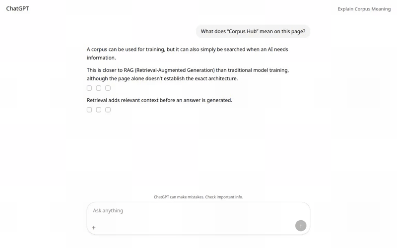

# Ask in branch key, Alt+Shift+Q (#126): fixture and live runs

Question: does Ask in branch's key (the `branch` command, Alt+Shift+Q) open the question box for a
reply selection on the fixture and on live ChatGPT, does ChatGPT itself leave the key alone, and
are the other branch scenarios and the Bookmark key unchanged?

Build: `feat/branch-shortcut` at `269888d` (extension unchanged by this run). Control: `main` at
`b2df865`. Chromium 157 on Linux.

## Results

| Run | Command | Result |
|---|---|---|
| 1. Fixture, real key | `ONLY=shortcut xvfb-run -a -s '-screen 0 1600x1000x24' node lab/harness/branch-qa.mjs` | Exit 0, 7/7, the key pressed as X input |
| 2. Fixture, all branch scenarios | `node lab/harness/branch-qa.mjs` | First run exit 1 (`button`, stale label expectation, fixed below); rerun exit 0, 38/38 |
| 3. Fixture, bookmarks | `xvfb-run -a -s '-screen 0 1600x1000x24' node lab/harness/bookmarks-qa.mjs` | Exit 1 twice: `save` (stale expectation, fixed) then only `wash`, which fails the same way on `main` `b2df865` |
| 4. Live, lab 1, `math12` | `LAB_ID=1 LAB_OWNER=b126 EXT=<copy of extension/> node lab/harness/branch-shortcut-live.mjs` | `key-assigned`, `box-opens`, `chatgpt-ignores`, `esc-closes` PASS; the no-extension control printed `FAIL native-ignores` (see Findings) |

### Run 1: the spec's fixture cases

Every case in #126's fixture-harness list is in `lab/harness/branch/scenarios/shortcut.mjs`; none is
missing.

| Spec case | Line |
|---|---|
| Selection in one reply, key → box open, input focused, quote = selection | `with text selected in a reply the key opens the question box, focused, quoting it` |
| ChatGPT's button absent (no pill) → box under the quote | `with no pill (ChatGPT’s button absent) the key opens the box under the quote` |
| No selection; across two replies; Temporary Chat; unsaved chat; Ask in branch off; Butter paused → no box, selection unchanged | `nothing, silently: no selection, a selection across two replies, Temporary Chat, an unsaved branch, an unsaved new chat, Ask in branch off, Butter paused` (focus unchanged too) |
| Box open, focus moved to the page, key → focus back in the input | `with the box open the key puts focus back in its input` |
| Draft, Esc, key → box reopens with the draft | `a draft left with Esc comes back when the key reopens the box` |
| Label "Ask in branch" + "Alt Shift Q"; name alone with the key removed | `the cell’s label shows "Ask in branch" + "Alt Shift Q", and aria-keyshortcuts carries it`; `with the key removed the label reads "Ask in branch" alone` |
| `bookmarks-qa.mjs` still passes (Bookmark key and hint) | Run 3 |

```
the branch key is pressed as X input (xtest-keys.py)
INFO the key is pressed as X input
ok   shortcut: the cell’s label shows "Ask in branch" + "Alt Shift Q", and aria-keyshortcuts carries it
ok   shortcut: with text selected in a reply the key opens the question box, focused, quoting it
ok   shortcut: with the box open the key puts focus back in its input
ok   shortcut: a draft left with Esc comes back when the key reopens the box
ok   shortcut: with no pill (ChatGPT’s button absent) the key opens the box under the quote
ok   shortcut: nothing, silently: no selection, a selection across two replies, Temporary Chat, an unsaved branch, an unsaved new chat, Ask in branch off, Butter paused
ok   shortcut: with the key removed the label reads "Ask in branch" alone
pass shortcut: 7/7 checks passed (11 s)
errors [] foreign []
7 checks passed
EXIT 0
```

The key removed through `chrome.developerPrivate.updateExtensionCommand({keybinding: ''})` reads
back as `''` from `chrome.commands.getAll()` (asserted in this scenario and in the bookmarks
`shortcut-cleared` scenario, which passes): that call does remove a key.

### Run 2: other branch scenarios

The first full run failed one check:

```
FAIL button threw: AssertionError [ERR_ASSERTION]: hover label
+ 'Ask in branchAlt Shift Q'
- 'Ask in branch'
```

`button.mjs` compared the label's name and key hint joined (`tip.text + tip.kbd`) with `'Ask in
branch'`, written when the cell had no key. #126 adds the hint on purpose, so the scenario was
stale, not the extension. Harness fix: it now checks `tip.text === 'Ask in branch'` and `tip.kbd ===
'Alt Shift Q'` separately. Rerun:

```
pass button: 2/2 checks passed (5 s)
pass question-box: 1/1 … pass zh: 1/1 checks passed (28 s)
pass shortcut: 7/7 checks passed (11 s)
38 checks passed
EXIT 0
```

(Headless: no X display, so `shortcut` ran with the worker relaying the command.)

### Run 3: bookmarks

The first run exited 1 with two failing checks, each failing in both markups (`old`, `live`):

- `save`: `the cells are named by their labels; the Bookmark cell carries its key in
  aria-keyshortcuts` — got `[{"name":"Ask in branch","keys":"Alt+Shift+Q"},{"name":"Bookmark
  selection","keys":"Alt+Shift+M"}]`. The check required Ask in branch's cell to have no key
  (`!cells[0].keys`), stale since #126. Harness fix: it now requires `Alt+Shift+Q` there. The
  Bookmark cell's key (`Alt+Shift+M`) was right.
- `wash`: `a row jump to a paragraph washes it, starting only once the page has stopped` —
  `"moved":272,"startedAfterClick":564`. **Not from #126:** the same scenario alone on `main` at
  `b2df865` fails the same check with the same numbers (`"moved":272,"startedAfterClick":579/580`,
  both markups, exit 1). On this branch alone: `moved` 194 and 102. Left as is; a follow-up issue.

Rerun with the `save` fix (display `:221`), exit 1, `wash` the only failure:

```
== markup: old
pass save: 30/30 checks passed (28 s)
pass shortcut-cleared: 1/1 checks passed (2 s)
FAIL wash: a row jump to a paragraph washes it, starting only once the page has stopped {…,"moved":272,…,"startedAfterClick":579}
FAIL: 1 of 286 checks failed; skipped: wash-mockup
== markup: live
pass save: 30/30 checks passed (28 s)
pass shortcut-cleared: 1/1 checks passed (2 s)
FAIL wash: … {…,"moved":272,…,"startedAfterClick":580}
FAIL: 1 of 286 checks failed; skipped: wash-mockup
FAIL markup: old, live
EXIT 1
```

The Bookmark key and its hint are unchanged: `save` (label "Alt Shift M", aria-keyshortcuts
`Alt+Shift+M`) and `shortcut-cleared` pass in both markups.

## Live (run 4)

Lab 1 (`"sends": "never"`), fixture `math12`, send guard on, lock owner `b126`; lab 2 was held by
another task. Lab 1 was stopped (no Xvfb): it was started under the lock, restored with
`lab-restore` (exit 0, home URL, empty composer, default extensions) and stopped again, then the lock
released. The box was never typed into or submitted; Esc closed it.

```
REPORT branch command key: "Alt+Shift+Q"
PASS key-assigned
REPORT selection: 26 chars, in a reply: true
REPORT before {"menus":32,"active":"div","composerLen":0,"sel":26,"open":false,"focused":false,"quote":null,"draftLen":null}
REPORT after {"menus":32,"active":"chatgpt-butter-branch","composerLen":0,"sel":0,"open":true,"focused":true,"quote":26,"draftLen":0}
REPORT page keydowns for Q: 0; all keydowns: 2
PASS box-opens
REPORT frames sampled 61, before the box 20, selection differed in 0
PASS chatgpt-ignores
REPORT after Esc {"menus":32,"active":"body","composerLen":0,"sel":26,"open":false,"focused":false,"quote":null,"draftLen":null}
PASS esc-closes
REPORT native selection: 26 chars, in a reply: true
REPORT native page keydowns for Q: 1 [{"code":"KeyQ","alt":true,"shift":true,"at":11444.099999964237,"prevented":true}]
REPORT native before {"menus":32,"active":"div","composerLen":0,"sel":26,"open":false,"focused":false,"quote":null,"draftLen":null}
REPORT native after {"menus":32,"active":"div","composerLen":0,"sel":0,"open":false,"focused":false,"quote":null,"draftLen":null}
FAIL native-ignores: the selection changed
EXIT 1
```

- With Butter: the box opened with the 26-character selection as its quote and its input focused.
  ChatGPT got only the Alt and Shift keydowns, never the Q: Chrome's command takes the chord before
  the page. No menu or dialog appeared (the count, 32, includes ChatGPT's always-present ones), the
  URL and composer stayed the same, focus went only into Butter's box, and the selection was intact
  in all 20 frames before the box showed. Esc closed the box and gave the selection back.
- Without an extension (control): ChatGPT's page received the Alt+Shift+Q keydown and its
  `defaultPrevented` was true, and the selection was gone 800 ms later. No menu, URL, composer or
  focus change. So ChatGPT, or something on its page, handles this chord itself, and clears the
  selection. With Butter loaded this never happens, because the page never sees the key. It would
  happen to a user who removes Butter's key in `chrome://extensions/shortcuts`, which is no change
  from today. What the handler is was not looked into (one live run; budget).
- `FAIL native-ignores` came from a verdict line on the control. That line now prints
  `REPORT native ChatGPT reacted: ...` / `did nothing with the key` instead: the control measures
  ChatGPT, not Butter, and must not fail the run (lab/README.md, Verdict lines). The edited script
  was not run live again.

Setup note: run 3 used `xvfb-run -a` while lab 1's Xvfb was stopped, so it took display `:99`,
lab 1's display, and lab 1 could not start until run 3 ended (two setup errors, exit 2, before the
run above; restored and released each time). Fixture runs started while a lab is stopped should
use `xvfb-run -n <number away from 98/99>`; `branch-shortcut-gif.mjs` says so.

## Recordings and screenshots

| Before (`main` at `b2df865`) | After (`269888d` + this run's harness) |
|---|---|
|  |  |

`lab/harness/branch-shortcut-gif.mjs` on the branch fixture, headed under Xvfb, the same steps on
both builds (`EXT_DIR` = a temporary `git worktree` of `b2df865` for before, removed afterwards):
select the quote, press Alt+Shift+Q as X input (a caption shows the press), Esc if a box opened,
hover Ask in branch's cell. Before: no box; label "Ask in branch". After: the box opens with the
quote; label "Ask in branch  Alt Shift Q". 800 × 500, 12 fps, 5.7 s / 6.3 s, 110 / 170 KB.

| File | Mockup panel (#126) |
|---|---|
| `shortcut-label-1280-light.png` | `after-light`: the label "Ask in branch" + "⌥⇧Q" |
| `shortcut-label-1280-dark.png` | `after-dark` |
| `shortcut-label-1280-nokey.png` | the no-key half of `after-mac`: "Ask in branch" alone (the ⌥⇧Q half can't render on Linux) |
| `bookmark-label-1400-light.png` | `after-light`'s Bookmark cell: "Bookmark selection" + "⌥⇧M" (bookmark fixture, 1400 px viewport) |

From run 1 (`SHOTS=/tmp/b126/run1`).

After review (round 0), the three label shots were re-taken with `evidenceShot` (cropped to the
selection, the pill and the label, 24 px margin, each with its `.json` sidecar) in a headed
`ONLY=shortcut` run at 8/8.

Key symbols (the user's follow-up to the approved mockup, `mockups/key-hint-symbols.html`): the
cells' key hints now show key symbols run together (`⌥⇧Q`, `⌥⇧M`) on Windows and Linux too, as
Chrome already reports them on a Mac; `aria-keyshortcuts` is unchanged. The three label shots were
re-taken (`ONLY=shortcut` headed, 8/8), `bookmark-label-1400-light.png` was added (an evidence shot
in the bookmark harness's `save` scenario, 31/31 in both markups), and `after.gif` was re-recorded
(800 × 500, 12 fps, 6.3 s, 166 KB; its label reads "Ask in branch  ⌥⇧Q"). `before.gif` is
unchanged. The `Alt Shift Q`/`Alt Shift M` hints quoted elsewhere in this report are from the runs
before this change.

Privacy: every image is the synthetic fixture page; no account, chat title, URL or real chat text.
The live run saved no images and printed lengths and counts only.

## Harness changes in this run

- `lab/harness/branch/scenarios/button.mjs`: label name and key hint checked separately; the hint
  is `Alt Shift Q`.
- `lab/harness/bookmarks/scenarios/save.mjs`: Ask in branch's cell carries `Alt+Shift+Q` in
  aria-keyshortcuts.
- New `lab/harness/branch-shortcut-live.mjs` (live check) and `lab/harness/branch-shortcut-gif.mjs`
  (recordings); both listed in `lab/README.md`.
