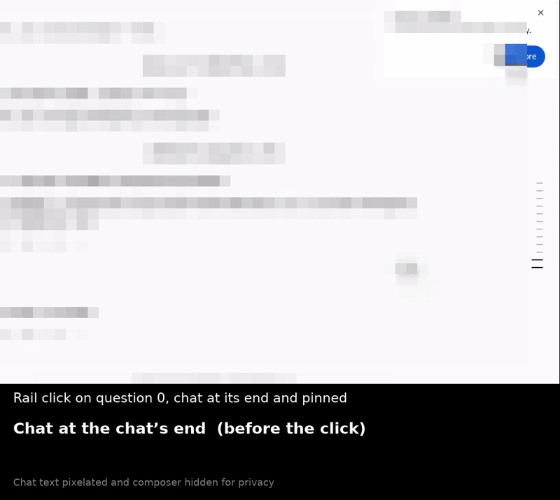

# The leave gesture on real ChatGPT (issue #171, stage 3) — 2026-11-25

Lab 2, fixed dev build `0.1.0-alpha.22+dev.2` (`python3 scripts/package.py --dev` at `64d27d2`,
unpacked to `~/snap/chromium/common/rail-pin-171d/dev/butter`; `extension/` unchanged since). The
unfixed build is `e37e393`'s (`~/snap/chromium/common/rail-pin-171a/dev/butter`). Send guard on in
every connection; nothing was sent. Raw captures stay in
`~/.local/share/chatgpt-lab/captures/2026-11-25-rail-jump-fix/` and `…/2026-11-25-rail-jump-harness/`.
Stage 1 is in [rail-jump-pin](../2026-11-24-rail-jump-pin/report.md),
[rail-jump-gesture](../2026-11-24-rail-jump-gesture/report.md) and
[rail-jump-before](../2026-11-24-rail-jump-before/report.md).

## Result

**With the fix, 0 of 58 jumps failed in two full `math12` runs (6 of 30 before), and every jump
from the chat's end with the end pin set landed and stayed: 26 of 26, among them questions 0, 1
and 2 twice each.** Each run's control (a plain scrollTop write to question 0 with the pin set and
no rail jump) was pulled to the chat's end, so the runs could see the bug. On the unfixed build the
same harness fails `end-pinned`→0, 1 and 2 with ChatGPT's own writes to the end named in each line.
The seek release, now sent through the shared module, held 12 of 12 with 2 of 2 controls pulled.

| Before (`e37e393`) | After (`64d27d2`) |
|---|---|
|  |  |

Both GIFs show the same steps: a jump that ends at the chat's end, the end pin set, then a click on
the rail's first tick. The readout in the black band gives where the chat is and when that began.

## Rail jumps (`lab/harness/rail-jump-live.mjs`)

| Run | Build | Steps | `PASS jump` | `FAIL` | Control | Exit | Log |
|---|---|---|---:|---:|---|---:|---|
| smoke-unfixed | unfixed | `end-pinned`→0–3, `top-unpinned`→0, 3 | 3 | 3 (`end-pinned`→0, 1, 2) | pulled at 1882 ms | 1 | [smoke/smoke-unfixed.log](smoke/smoke-unfixed.log) |
| smoke-fixed | fixed | the same | 6 | 0 | pulled at 1904 ms | 0 | [smoke/smoke-fixed.log](smoke/smoke-fixed.log) |
| a1-run1 | fixed | `math12`, default sequence (29 jumps) | 29 | 0 | pulled at 2116 ms | 0 | [a1-run1.log](a1-run1.log) |
| a1-run2 | fixed | the same | 29 | 0 | pulled at 1718 ms | 0 | [a1-run2.log](a1-run2.log) |
| a2-rec | fixed | `after.gif`'s steps (4 jumps) | 4 | 0 | pulled at 1913 ms | 0 | [a2-rec.log](a2-rec.log) |
| b2-math9 | fixed | `math9`, default sequence (23 jumps) | 23 | 1 (`FAIL control`) | **held** | 1 | [b2-math9.log](b2-math9.log) |

- In both full runs every `end-pinned` jump started with the pin read true. The jumps to questions
  0–10 ended with it false; the jump to question 11, which lands at the chat's end, ended with it
  true: following the end is left as it was.
- No start failed to hold (0 `SETUP-ERROR`), and the stored options were put back as found.
- **`math9` shows no regression and is not evidence of the fix.** All 23 jumps passed, but the
  control held: after a write to question 0 the transcript did not grow, so nothing could be
  pulled there. The run's exit 1 is the harness's rule that a run whose control was never pulled
  cannot see the end pull. On 2026-11-24 the unfixed build also had 0 failed jumps on `math9`.

## Seek release (`seek-pin-live.mjs`, `math12`, fixed build)

12 releases, estimated destinations: 12 `PASS seek-pin`, 0 pulled, all 12 landed on the previewed
question; 2 of 2 `write` controls pulled (3228 and 1713 ms); exit 0
([b1-seek-pin-2.log](b1-seek-pin-2.log)). The first try ([b1-seek-pin.log](b1-seek-pin.log)) was a
setup error: the script waits for the rail, which is off on a new install; `adhoc/rail-opt.mjs`
turned it on and put the stored options back afterwards. Stored-layout destinations were not run.

## Streaming (`stream-replay-live.mjs` and `adhoc/stream-jump-live.mjs`, `math9`, fixed build)

- The replay's own checks: 11 `PASS`, 0 `FAIL`, among them `stream-no-jump`, `no-escape` and
  `server-unchanged` ([b3-stream.log](b3-stream.log)).
- **A jump to question 1 during the stream stayed there** (`PASS stream-jump-stays`, twice): clicked
  at chunk 54 of 357, the chat stayed on question 1 while chunks 80–357 arrived
  ([b3-stream-jump.log](b3-stream-jump.log)).
- **Not established: following the end while an answer streams (stories 14 and 16).** On this
  replay ChatGPT itself does not follow the end: with no jump the chat was at the end in 0 of 418
  samples, as in the no-extension replays of 2026-11-18 and 2026-11-23, and the end pin read false
  before the jump. So the jump during the stream could not have been pulled, and after a real wheel
  back to 146 px from the end the chat did not follow the remaining growth
  ([b3-stream-jump-back.log](b3-stream-jump-back.log)), jump or no jump. The unit tests cover both
  stories against the fake end pin.

## Found on the way

- **A start at the top right after a reload cannot hold**: before earlier history has loaded,
  ChatGPT loads a page and moves the chat (pin false, so not the end pull). The default sequence
  now has one jump right after the reload, from the end.
- `nav-takeovers.mjs` faked the reader's scrollbar press with a script event, which Butter now
  ignores on purpose; it uses a real mouse press now.
- ChatGPT served three builds of its scroll chunk within these two days. The harness reads the pin
  through React's fiber, which does not depend on the build; the logpoints of stage 1 do.

## Not established

- Stories 14 and 16 on real ChatGPT (above).
- Stored-layout seek destinations; a bookmark jump, a click on the three dots and a keyboard jump on
  real ChatGPT (covered by the unit tests only).
- What shrinks and grows near questions 0–2 of `math12`, and why `math9` has no such growth.

## Lab time and clean-up

| Owner | UTC | Runs | What |
|---|---|---:|---|
| `rail-pin-171d` | 02:27–02:37 | 4 | harness smoke runs |
| `rail-pin-171e` | 02:57–03:11 | 3 | two full `math12` runs, the recording |
| `rail-pin-171f` | 03:11–03:33 | 6 | seek pin, `math9`, three replays |

Each ended with `lab-restore` exit 0 (no extension, empty composer) and `lab-lock release` exit 0
([restore-a.log](restore-a.log), [restore-b.log](restore-b.log),
[lock-status-a.log](lock-status-a.log), [lock-status-b.log](lock-status-b.log)).

## Files

- `after.gif` (800 px, 5.0 s, 0.4 MB), made by `adhoc/after-gif.py` from the recording run with the chat text pixelated
  in 20 px blocks, as in `before.gif`; all 60 frames were checked and no word of chat text can be read at full size.
- `a1-*.log`, `a2-rec.log`, `b*.log`, `smoke/*.log`: scrubbed logs (URLs `<url>`, home `~`).
- `adhoc/stream-jump-live.mjs` (the jump during a replay), `adhoc/rail-opt.mjs`, `adhoc/run.sh`.
